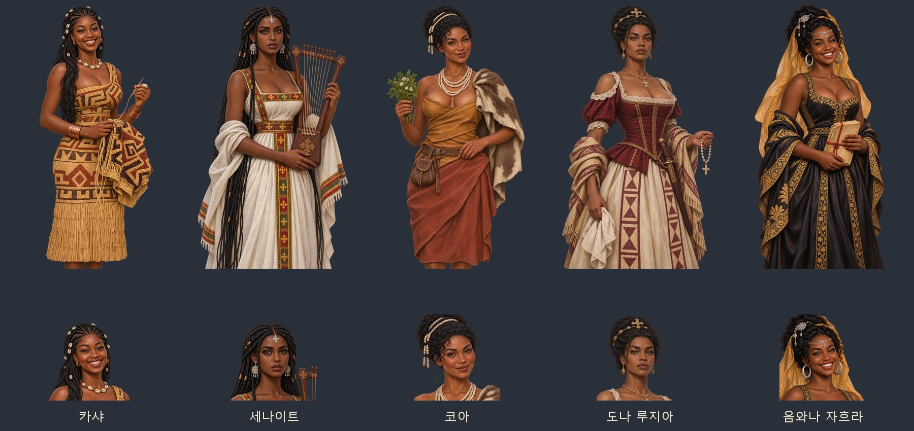
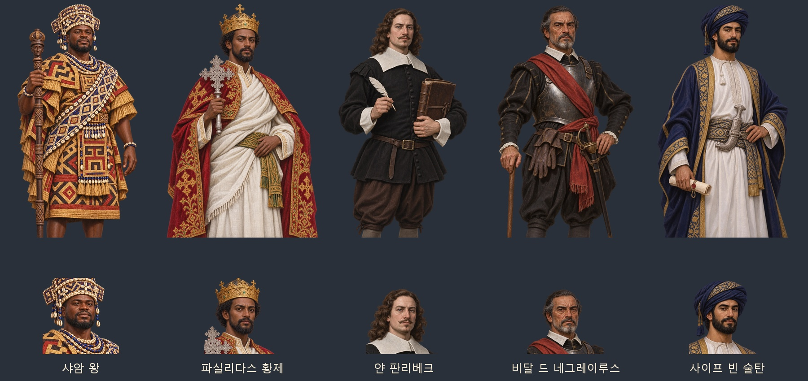
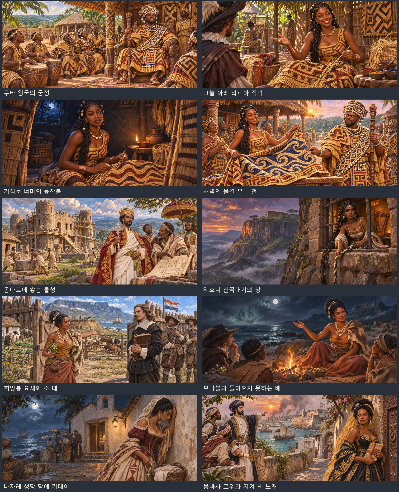

# 아프리카의 다섯 이야기 — 초상과 사건 원화

2026-11-04 사용자 요청. 카샤·세나이트·코아·도나 루지아·음와나 자흐라와 대본에 이름이 있는 주변 인물 5명의 얼굴상·무릎상, 기존 사건 그림 열쇠 10개를 채운다.

## 그림과 파일

- 얼굴상 10장: 512×512, 투명 WebP.
- 무릎상 10장: 1024×1536, 투명 WebP. 머리 장식·손·소품과 무릎 높이까지 보인다.
- 사건 샷 10장: 1881×836, 가로 9:4 WebP.
- 원화 20장: `artifacts/africa17-art-20261104/sources/portraits/`, `sources/scenes/`의 PNG.
- 게임용 30장 묶음: [ZIP](../../artifacts/africa17-art-20261104/africa17-art-20261104.zip).







## 얼굴과 복식

모두 내장 **ImageGen**으로 제작한다. 첨부 사진은 미소·진지한 눈빛·얼굴 윤곽·헤어의 일반적인 특징을 참고하고, 여성 얼굴은 별개의 성인 가상 인물로 디자인한다. 추가 이집트풍 참고물은 표정·얼굴형·눈매의 방향만 반영한다. 고대 이집트 왕관과 의상을 17세기 다른 지역에 옮기지 않는다.

사용자가 요청한 마른 체형과 풍성한 가슴, 열린 목선·민소매·드러난 어깨를 반영하되 가슴은 불투명한 직물로 덮는다. 지역 직물과 소품을 구별하며, 같은 인물의 얼굴상은 무릎상 원화를 잘라 만든다. 장면 제작에도 완성된 인물 원화를 참조해 얼굴·머리·색·복식을 이어 쓴다.

| 인물 | 나이·표정 | 소품·복식 | 경로의 끝 이름 |
|---|---|---|---|
| 카샤 | 23세, 보조개와 환한 미소 | 조개 장식 땋은 머리, 기하학 라피아, 바늘과 짜던 천 | `legendary/kasha` |
| 세나이트 | 21세, 큰 눈과 진지한 눈빛 | 긴 땋은 머리, 은 십자, 흰 케미스, 열 줄 베겐나 | `legendary/senait` |
| 코아 | 24세, 부드러운 눈매와 잔잔한 미소 | 타조알 구슬, 카로스, 가죽 두른 옷과 부쿠 풀 | `legendary/koa` |
| 도나 루지아 | 26세, 곧은 눈썹과 당당한 입매 | 붉은 몸통옷·레이스, 라피아 숄, 묵주·칼·머릿수건 | `legendary/luzia` |
| 음와나 자흐라 | 25세, 환하게 웃는 눈과 입 | 곱슬 올림머리, 은 장신구, 검정·금색 옷, 필사본 | `legendary/zahra` |
| 샤암 왕 | 30대 후반, 침착한 위엄 | 조개·구슬 머리 장식, 겹친 라피아, 조각 지팡이 | `history/af_shyaam` |
| 파실리다스 황제 | 33세, 단호한 표정 | 금관, 흰 샴마·붉은 망토, 에티오피아 십자 | `history/af_fasilides` |
| 얀 판리베크 | 33세, 신중한 표정 | 갈색 곱슬머리, 검은 웃옷·흰 깃, 장부·깃펜 | `history/af_riebeeck` |
| 비달 드 네그레이루스 | 59세, 엄한 노장의 표정 | 희끗한 수염, 흉갑·붉은 띠, 지팡이 | `history/af_vidal` |
| 사이프 빈 술탄 | 36세, 절제된 표정 | 남색 터번·흰 옷, 은 칸자르·명령서 | `history/af_saif` |

각 경로 앞에는 `images/portraits/`, 뒤에는 `.webp` 또는 `_half.webp`를 붙인다. 주변 인물은 대사를 말하는 위 다섯 사람이며, 배경의 이름 없는 신하·병사·장인들은 사건 샷 안에 그렸다.

## 사건 연결

| 그림 열쇠 | 장면 |
|---|---|
| `af_kuba_court` | 북과 라피아 직물로 둘러싸인 샤암 왕의 궁정 |
| `af_kuba_loom` | 그늘 아래 바다 무늬를 묻는 카샤 |
| `af_kuba_peek` | 거적문 너머, 등잔 아래 지친 카샤와 붕대 감은 손 |
| `af_kuba_dawn` | 새벽 물결 무늬 천을 펼친 카샤와 살펴보는 샤암 왕 |
| `af_gondar_castle` | 공사 중인 곤다르 돌성과 파실리다스 황제 |
| `af_gondar_wehni` | 절벽 꼭대기 창에서 머리·목화실 줄을 내리는 세나이트 |
| `af_cape_fort` | 초기 흙·나무 요새에서 소 떼를 두고 맞선 코아와 판리베크 |
| `af_cape_night` | 모닥불가의 코아와 바다 안개의 유령선 |
| `af_mbwila_chapel` | 루안다 나자레 성당 담에 기댄 루지아 |
| `af_mombasa_siege` | 예수 요새와 오만 다우선, 필사본을 지키는 자흐라·사이프 |

모두 `images/legend-events/<열쇠>.webp`다. 기존 `js/systems/africa17.js`의 `withPic`과 동일한 이름으로 등록하므로 사건 대화에서 자동으로 열린다. 사건 그림이 열려 있을 때에는 무릎상이 그림을 덮지 않고 대화창 얼굴상을 쓴다. 그림을 닫은 일반 대화에서는 무릎상을 사용한다.

동료 ID·합류 조건·날짜·보상·저장 상태는 바꾸지 않는다. 군주와 총독을 동료 후보에 추가하지 않는다. `images/manifest.js`와 `js/data/portraitfaces.js`는 이번 열쇠만 더하며 다른 작업의 항목을 보존한다.

## 재현과 검증

- [정확한 생성 지시문·참조 역할·원본 경로](../../tools/africa17_art_20261104_prompts.json)
- [내보내기·투명도 검사·미리보기·묶음 도구](../../tools/package_africa17_art_20261104.py)
- [브라우저 검사](../../tests/africa17_art_20261104_smoke.cjs)
- [이미지 규격·투명도 검사 기록](../../artifacts/africa17-art-20261104/asset-checks.json)
- [실제 대화 화면·검사 결과](../../artifacts/africa17-art-20261104/screenshots/checks.json)

```powershell
python tools/package_africa17_art_20261104.py
python tools/portrait_faces.py --keys-file artifacts/africa17-art-20261104/portrait-keys.json --merge
node tests/africa17_art_20261104_smoke.cjs
```

초상 20장의 규격·투명도, 전용 그림 선택과 얼굴 좌표, 10명 각각의 얼굴상·무릎상 대화를 확인했다. 사건 장면 10장의 해독·표시·종료·대화 얼굴·대본 열쇠 연결도 모두 통과했다. `pageerror`와 `console.error`는 0건이며 화면 30장을 위 경로에 남겼다. 기존 `tests/africa17_smoke.js`의 다섯 사건 합류·실패·기한·보상·옛 저장 분기도 통과했다. 게임용 이미지 30장과 원본 PNG 20장의 보관을 확인했고 ZIP의 CRC 검사도 통과했다. 시험 브라우저는 모두 `finally`에서 닫았다.

## 공간과 직물 참고 자료

쿠바 직물과 왕실 장식은 메트로폴리탄 미술관의 [라피아 위신 직물](https://www.metmuseum.org/art/collection/search/318398), [조개·구슬을 쓴 왕실 머리 장식](https://www.metmuseum.org/art/collection/search/319298), [의례용 치마](https://www.metmuseum.org/art/collection/search/317995)를 참고했다. 곤다르와 몸바사 건축의 참고는 유네스코의 [파실 게비](https://whc.unesco.org/en/list/19), [예수 요새](https://whc.unesco.org/en/list/1295)다. 여성 의상은 요청에 따른 게임용 각색이며, 유령선과 머리 줄 탈출은 게임 대본의 전설 요소다.
