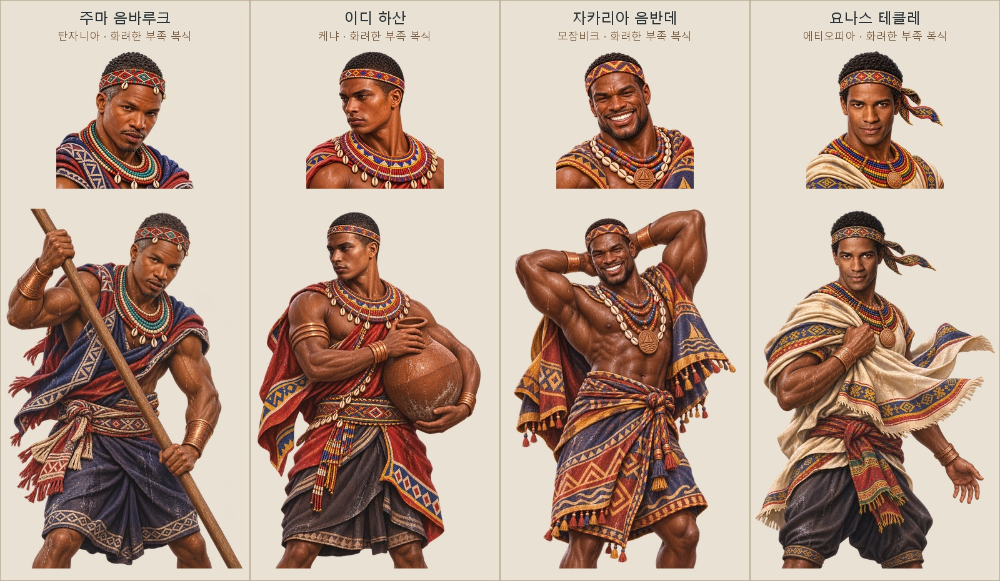
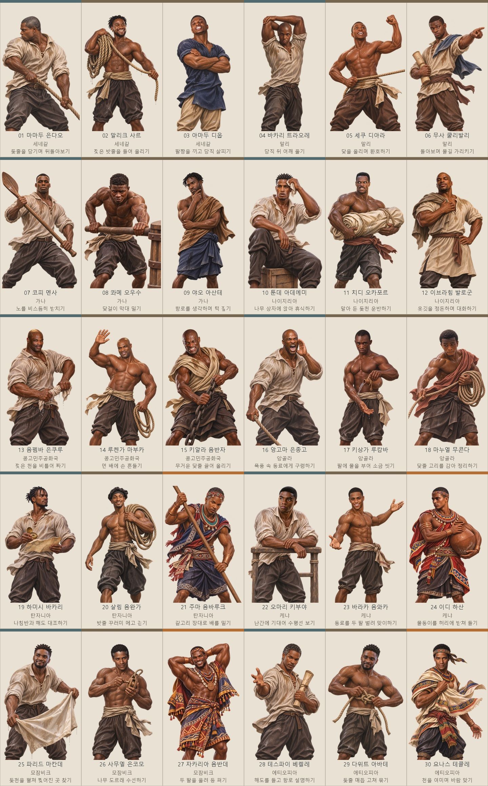

# 아프리카 남성 항해사 30명의 얼굴상·무릎상

첨부 사진의 얼굴·표정을 참고해 기존 항해 게임 인물화 양식으로 남성 항해사 30명을 제작했다. 내장 ImageGen으로 무릎상 30장과 같은 인물의 얼굴상 30장을 각각 생성했으며, 인물마다 헤어스타일·표정·동작을 나눴다. 피부·얼굴·손·의상의 묘사 수준을 통일하고 땀, 파도에 젖은 천, 마른 소금 자국과 바람에 날리는 옷자락을 표현했다.

## 구성

- 세네갈·말리·가나·나이지리아·콩고민주공화국·앙골라·탄자니아·케냐·모잠비크·에티오피아 출신 각 3명.
- 흰 셔츠 10명, 상의 탈의 10명, 전통 복장 10명.
- 전통 복장 가운데 `af21`·`af24`·`af27`·`af30`은 화려한 직조 무늬, 구슬·조개·구리빛 장식, 머리띠와 어깨 장식을 쓴다.
- 밧줄 당기기, 노 받치기, 닻걸이 밀기, 돛 수선, 구령, 물 붓기, 동료 맞이, 휴식 등 서로 다른 동작 30개.

국가는 창작 인물의 지리적 출신을 현대 국가 이름으로 표기한 것이다. 복식은 아프리카 여러 지역의 천·구슬·조개·금속 장식에서 착안한 게임용 창작 디자인이다.

## 파일과 등록

`images/portraits/mates/african-windsalt/af01~af30.webp`는 얼굴상 512×512, 같은 이름의 `_half.webp`는 무릎상 1024×1536 투명 WebP다. 전용 이미지 열쇠와 대화 리그의 얼굴 자리 60개를 등록했다. 2026-11-17에는 `afcrew_af01~30`의 능력치·특기·언어·고향·영입 자료를 연결했다. 희망봉 발견일부터 5년마다 최대 3명·40년마다 재추첨하며 현재 동료는 제외한다. [발견 기준 등장·지역·저장 규칙과 검증](../discovery-crew-20261117.md).

- [인물·그림 대응 기록](../../tools/african_windsalt_20261116_assets.json)
- [등록 도구](../../tools/register_african_windsalt_20261116.py)
- 원화·최종 지시문·출신·표정·포즈·사진 대응: 저장소 상위 `output/african-windsalt-navigators-30-20261116/`.
- 최종 지시문은 `prompts-final.json`, 원본 PNG는 `face/`·`half/`, 내보낸 파일은 `game-ready/`, 배포 묶음은 같은 이름의 `.zip`이다.

## 검증

내보내기 도구로 60장의 크기·RGBA 투명도·중복 해시와 ZIP 무결성을 확인했다. `node tests/african_windsalt_art_20261116_smoke.cjs` 통과: 실제 이미지 60장 읽기·규격·투명도·얼굴 자리와 게임·도감의 콘솔 오류 0건을 확인했다. 검사 브라우저는 `finally`에서 종료했다.

[검사 결과](../../artifacts/african-windsalt-20261116/report.json) · [등록 그림의 실제 브라우저 표시](../../artifacts/african-windsalt-20261116/ornate-in-game.png)
