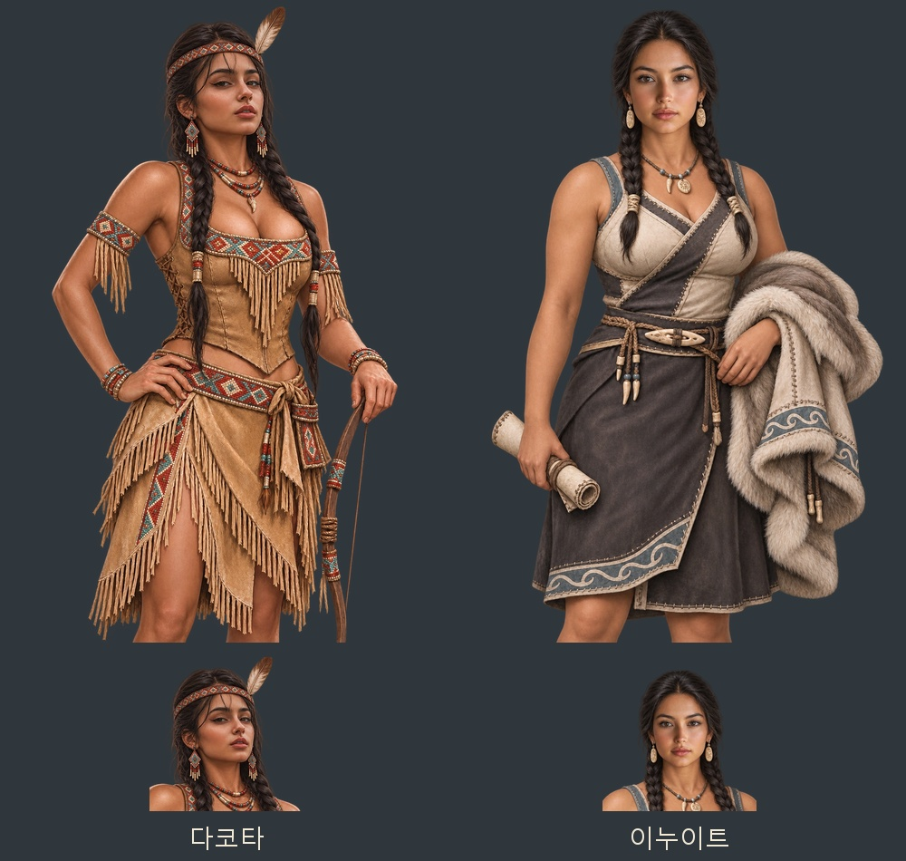

# 다코타·이누이트 얼굴 수정과 이미지 누락 점검 — 2026-11-06

다코타·이누이트의 기존 무릎상을 편집 대상으로, 후속 첨부 2번·4번 사진을 각각 얼굴 참고로 삼아 내장 `image_gen`으로 수정했다. 다코타는 턱을 살짝 든 얼굴과 눈·코·입·턱선, 이누이트는 차분한 시선과 닫힌 입의 얼굴을 반영했다. 기존 복식·체형·자세·손·소품·무릎 구도를 유지하도록 편집했으며, 얼굴상은 같은 수정 무릎 원화에서 추출했다.

| 인물 | 무릎상 | 얼굴상 | 참고 |
|---|---|---|---|
| 다코타 | `images/portraits/folk-join/folk_dakota_f_amer_v2_half.webp` | `images/portraits/folk-join/folk_dakota_f_amer_v2.webp` | 후속 첨부 2번 |
| 이누이트 | `images/portraits/folk-join/inuit_f_amer_v2_half.webp` | `images/portraits/folk-join/inuit_f_amer_v2.webp` | 후속 첨부 4번 |

무릎상은 1024×1536, 얼굴상은 448×448 투명 WebP다. 기존 v1 원본·그림을 보존하고 새 v2 파일을 등록했다. `js/data/folkjoin.js`가 두 민족의 여성 후보에 v2를 고르며, 기존 저장의 v1 여성 동료도 기존 `fixPortrait` 경로에서 같은 v2 한 쌍으로 복원된다. 아메리카 여성 22종의 통합 미리보기·제작 목록·44장 ZIP도 최신 두 얼굴로 갱신했다.

- [수정 그림 4장·미리보기·제작 지시문 ZIP](../../artifacts/american-face-revision-20261106/american-face-revision-20261106.zip)
- [내장 ImageGen 최종 편집 프롬프트](../../tools/american_face_revision_20261106_prompts.json)
- 수정 PNG 원본: `artifacts/american-face-revision-20261106/sources/`
- 원본·참고 보존: `artifacts/american-face-revision-20261106/references/`
- 생성 결과와 파일 대응: `artifacts/american-face-revision-20261106/generation-results.json`

검증: `node tests/folk_american_women_20261106_smoke.cjs` 통과. 수정된 두 인물을 포함한 22종·44장의 신규 후보, 저장 복원, 전용 얼굴·무릎상 선택, 규격·해독·얼굴 좌표, 짝 누락 대체, 남성·다른 민족 보존, 실제 얼굴·무릎 대화창 44개를 확인했다. `pageerror`·`console.error` 0. 두 수정 인물의 실제 무릎 대화창과 미리보기를 눈으로 확인했다. 시험 브라우저는 종료했다.

## 발견물·아이템·교역품 누락 조사

이름이 존재하는 파일만 세지 않고, `index.html`의 자료·시스템 순서와 실제 `G.Img.chain` 선택을 대조했다. 시스템에서 추가하는 이야기 모드 흔적 7종도 포함했다.

| 종류 | 실제 항목 | 전용 이미지 | 같은 물건의 기존 이미지 공유 | 누락 |
|---|---:|---:|---:|---:|
| 발견물 | 1,233 | 1,233 | 0 | 0 |
| 아이템 | 1,053 | 367 | 686 | 0 |
| 교역품 | 158 | 158 | 0 | 0 |

아이템의 공유 686종은 종류 공통 그림을 세어 포함한 것이 아니다. 해당 물건과 같은 ID의 유물·선수상·관련 발견 원화로 이어지는 선택 경로가 실제 존재함을 확인했다. 발견물 1,233종은 기본 그림 외에도 마지막 장면(`discovery-ends`)과 움직임 판(`discovery-sheets`)이 모두 등록되어 있고 파일이 존재한다. 누락 항목이 없어 추가 발견물·아이템·교역품 원화 생성은 발생하지 않았다.

- 자료·파일 대조: `node tools/audit_asset_completeness_20261106.cjs --strict`
- 실제 브라우저 선택·해독: `node tests/asset_completeness_20261106_smoke.cjs`
- [누락 조사 전체 목록](../../artifacts/asset-completeness-20261106/audit.json)
- [실행 중 자료·이미지 해독 결과](../../artifacts/asset-completeness-20261106/browser-audit.json)

최종 브라우저 검사에서 기본 선택 그림과 발견물 마지막 장면·움직임 판 2,466개를 포함한 중복 없는 이미지 파일 4,630개를 정상 해독했다. 누락 0·해독 실패 0·`pageerror` 0·`console.error` 0이며 시험 브라우저는 `finally`에서 종료했다.
