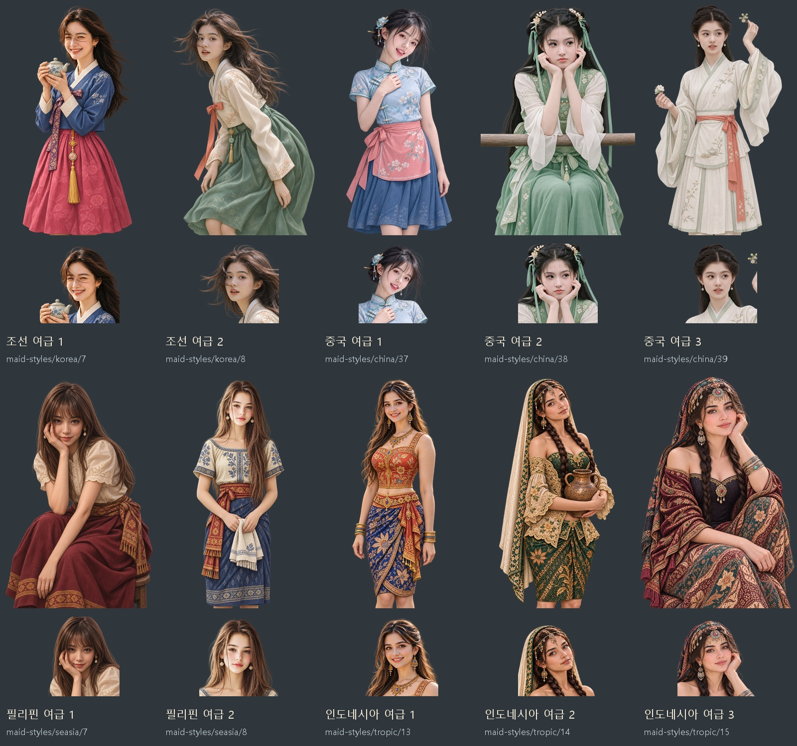

# 조선·중국·필리핀·인도네시아 여급 초상 10쌍 — 2026-11-09

사용자의 네 요청을 합쳐 조선 2명·중국 3명·필리핀 2명·인도네시아 3명, 총 10명의 얼굴상·무릎상 20장을 제작했다. 후속 지시에 따라 **이벤트 샷은 제작하지 않았다.**

각 첨부 사진 한 장을 그 인물의 주 참고로 고정했다. 원 캡처의 얼굴형·눈·코·입과 표정, 시선·고개·어깨 방향, 머리 모양과 손동작을 따라 몸을 무릎까지 다시 구성했다. 사진 속 카메라는 차 주전자로 바꾸고, 턱을 괸 손·꽃을 든 손·항아리를 안은 팔·앉은 자세는 이어 그렸다. 같은 PNG 원화에서 얼굴상을 추출하므로 한 쌍의 얼굴과 의상이 같다.

어려 보이거나 연령이 불분명한 참고를 바탕으로 한 그림은 가슴 확대·노출 강조 없이 불투명한 역할 의상과 자연스러운 체형으로 제작했다. 명확한 성인 참고를 쓴 인도네시아 3명은 풍성한 성인 체형과 자수·보석·바틱 무늬, 열린 팔·어깨·허리 구도의 게임용 의상을 사용했다. 복식은 지역 요소를 활용한 창작 변형이다.

[참고 얼굴과 새 얼굴상 비교](asian-maids-20261109-face-comparison.jpg) · [원 캡처와 무릎상 자세 비교](asian-maids-20261109-pose-comparison.jpg) · [20장 ZIP](../../artifacts/asian-maids-20261109/asian-maids-20261109.zip)

| 지역·순서 | 그림 키 | 반영한 얼굴·머리·동작 |
|---|---|---|
| 조선 1 | maid-styles/korea/7 | 치아가 보이는 눈웃음·바람에 날리는 긴 머리·두 손에 든 주전자 |
| 조선 2 | maid-styles/korea/8 | 뒤돌아보는 얼굴·살짝 벌린 입·숙인 상체·흩날리는 머리 |
| 중국 1 | maid-styles/china/37 | 기울인 고개·열린 미소·꽃 비녀·가슴께 옷 여밈에 닿는 손 |
| 중국 2 | maid-styles/china/38 | 두 손으로 턱 괴기·다문 입·옆 시선·양옆 머리와 초록 댕기 |
| 중국 3 | maid-styles/china/39 | 옆 시선·살짝 벌린 입·올린 팔·꽃을 든 손·넘겨 묶은 머리 |
| 필리핀 1 | maid-styles/seasia/7 | 한 손으로 뺨 받치기·작은 미소·앞머리·앞으로 숙여 앉은 자세 |
| 필리핀 2 | maid-styles/seasia/8 | 정면의 차분한 눈·다문 입·긴 갈색 생머리·조용한 자세 |
| 인도네시아 1 | maid-styles/tropic/13 | 밝은 치아 미소·긴 반묶음 머리·사선 몸과 내려놓은 팔 |
| 인도네시아 2 | maid-styles/tropic/14 | 기울인 고개·살짝 벌린 입·양갈래 땋은 머리·항아리 안기 |
| 인도네시아 3 | maid-styles/tropic/15 | 뺨에 닿는 손·부드러운 반미소·땋은 머리·한 무릎을 세워 앉기 |

[조선 2쌍](asian-maids-20261109-joseon-preview.jpg) · [중국 3쌍](asian-maids-20261109-china-preview.jpg) · [필리핀 2쌍](asian-maids-20261109-philippines-preview.jpg) · [인도네시아 3쌍](asian-maids-20261109-indonesia-preview.jpg)

내장 **image_gen 편집 모드**를 사용했다. [실제 프롬프트·참고 사진·생성 원본·수정 기록](../../tools/asian_maids_20261109_prompts.json) · [명세 준비 도구](../../tools/prepare_asian_maids_20261109.py) · [추출·등록·검증·묶음 도구](../../tools/package_asian_maids_20261109.py).

원화 PNG와 참고 사진은 `artifacts/asian-maids-20261109/sources/`·`references/`에 보관했다. 게임 파일은 표의 키 뒤에 `.webp`를 붙인 얼굴상(448×448), `_half.webp`를 붙인 무릎상(1024×1536)이다. 모두 투명 알파를 보존한다. 새 번호를 지역 여급 그림 후보 묶음에 추가해 `G.Img.maidList`와 도감에서 읽는다. 필리핀은 동남아(seasia), 인도네시아는 열대(tropic) 묶음에 분류했다. 사진 속 사람의 실제 국적을 판정한 것은 아니다.

검증: `node tests/asian_maids_20261109_smoke.cjs` 통과. 네 지역의 인원수 2·3·2·3명, 새 후보 10개와 짝 파일 20개, 지역 여급 묶음 선택·파일 규격과 해독·얼굴 좌표·같은 원화의 얼굴/무릎상 연결·실제 대화창 20개와 도감 목록을 확인했다. `pageerror`·`console.error`·이미지 요청 실패 0. 투명 알파 보존 20장·새 키만 추가·원화/참고/수정 입력 보관·ZIP 20장 무결성과 `event_shots: false`도 확인했다. 전체/얼굴 비교판과 조선 1·중국 2·인도네시아 2의 실제 얼굴/무릎 대화창을 눈으로 확인했다. 브라우저는 `finally`에서 닫았다. 결과와 화면은 `artifacts/asian-maids-20261109/runtime/`에 보관했다.
