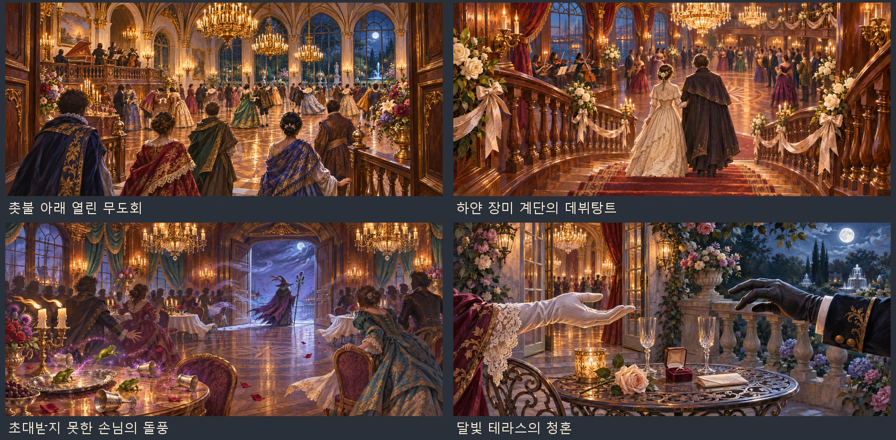

# 무도회·데뷔탕트 공용 사건 샷

2026-11-04 사용자 요청: 딸·외국 귀족·여인이 매번 바뀌므로 특정 인물에 묶이지 않는 공용 배경을 만든다. 내장 **ImageGen**으로 장면마다 별도 생성하고, 인물 초상이나 실존 인물 사진은 참조하지 않았다.



| 파일 | 공용으로 쓰는 방법 | 대본의 연결 |
|---|---|---|
| `ball_open.webp` | 넓은 연회장·촛불·악단, 가까운 손님은 뒷모습 | 일반 무도회 개막·손님 입장 |
| `debut.webp` | 하얀 장미 계단을 내려가는 딸·보호자의 뒷모습, 얼굴을 보여 주지 않음 | 딸의 데뷔탕트 |
| `witch.webp` | 문가 마녀의 뒷모습과 망토·지팡이·돌풍·개구리, 얼굴을 보여 주지 않음 | 초대받지 못한 마녀의 난입 |
| `proposal.webp` | 두 성인의 장갑 낀 손·장미·반지함·테라스, 머리와 몸통은 화면 밖 | 제독·성인 아들을 향한 청혼 |

모두 `images/events/ball/`의 1881×836 WebP다. 배경에 이름·국기·특정 가문 문장·알아볼 수 있는 인물 얼굴을 넣지 않았다. 딸은 소매와 케이프를 갖춘 단정한 긴 드레스 차림이며 신체를 강조하지 않는다. 청혼 배경은 수락·거절 어느 쪽에도 쓸 수 있게 손을 잡기 직전으로 표현했다.

실제 등장인물의 이름과 얼굴은 기존 대화창 초상을 그대로 쓴다. `js/systems/ball.js`에 있던 네 그림 열쇠와 `noStand: true`를 사용하므로 인물 무릎상이 공용 장면 앞을 덮지 않는다. 규칙·대사·손님 선택·데뷔 나이·드레스 점수·혼인·합류·저장 상태는 바꾸지 않았다.

## 파일과 재현

- [공용 샷 4장·미리보기·생성 지시문 ZIP](../../artifacts/ball-event-art-20261104/ball-event-art-20261104.zip)
- 원본 PNG 4장: `artifacts/ball-event-art-20261104/sources/`
- [정확한 생성 지시문·원본 경로](../../tools/ball_event_art_20261104_prompts.json)
- [내보내기·등록·미리보기·묶음 도구](../../tools/package_ball_event_art_20261104.py)
- [규격 검사 결과](../../artifacts/ball-event-art-20261104/asset-checks.json)
- [게임 화면·검사 결과](../../artifacts/ball-event-art-20261104/screenshots/checks.json)

```powershell
python tools/package_ball_event_art_20261104.py
node tests/ball_event_art_20261104_smoke.cjs
```

전용 검사는 네 그림의 해독·1881×836 규격, 다른 손님과 서로 다른 고장의 두 딸에게 같은 배경을 사용하는 대화 7회, 인물별 초상 구별, 실제 무도회·데뷔·마녀·청혼의 그림 호출과 종료를 확인한다. 기존 `tests/ball_smoke.js`는 시샘·정치·마녀 합류·청혼·데뷔 점수·가문 계승·저장 분기를 확인한다. 브라우저는 모두 `finally`에서 닫는다.

결과: 전용 화면 검사와 기존 무도회 검사 모두 통과했다. `pageerror`·`console.error` 0건이며, ZIP의 네 이미지와 CRC도 확인했다. 다른 손님·딸을 표시한 화면 7장과 결과 JSON을 위 경로에 보관했다.
