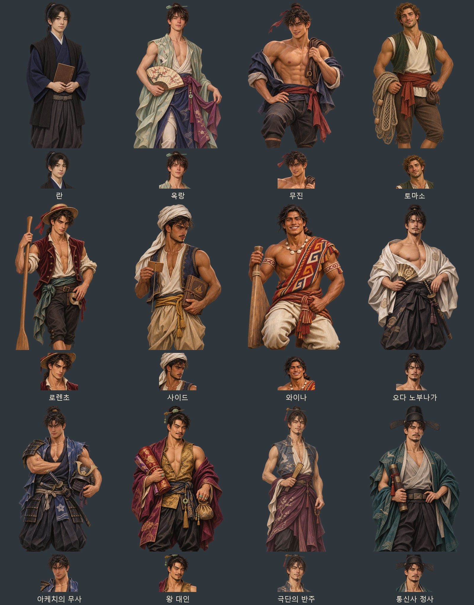
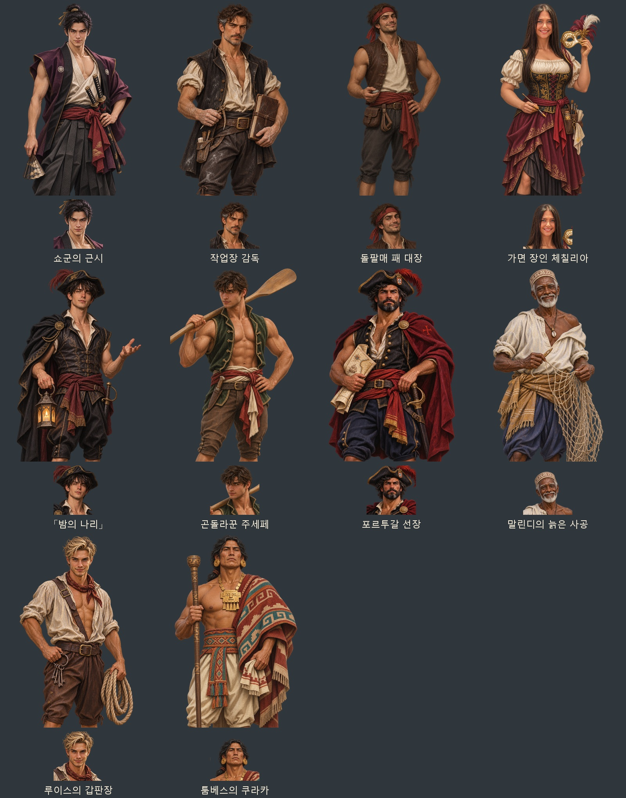

# 신작 항해사 이벤트 — 인물 22명

사용자가 「이번에 추가된 22명 우선」으로 확정한 동아시아·유럽·인도양·신대륙의 미남 항해사 사건을 대상으로 제작했다. 동료 7명과 주변 인물 15명, 총 22명(남성 21명·여성 1명)의 무릎상·얼굴상 44장이다. 내장 ImageGen으로 한 명씩 원화를 생성했다.

첨부 사진의 얼굴 인상·표정·머리 모양을 참고하고, 의상과 소지품은 게임 속 역할에 맞춰 새로 그렸다. 사진의 현대 옷·스포츠 장비·로고는 넣지 않았다. 성인 남성은 열린 셔츠·민소매·드러난 어깨·팔과 가슴으로 근육질 또는 슬림한 체형을 구분했다. 체칠리아는 풍성한 체형, 코르셋, 드러난 어깨와 팔, 비대칭 치마로 구성했다. 역할과 문화권의 색·직물·소지품을 살린 게임용 의상 각색이며, 정밀한 복식 복원은 아니다.

란은 원래 자료에서 17세이므로 나이를 바꾸지 않고 목깃을 여민 긴소매 의상의 일반 초상으로 그렸다. 란의 일반 착의 초상 및 토마소·돌팔매 패 대장·체칠리아의 첫 요청 또는 출력이 도구 안전 검사에서 거절되어, 수정 지시문으로 다시 제작했다. 성인 세 인물은 가슴을 덮는 상의를 사용하고 팔·어깨·체형과 의상의 개성을 유지했다. 최초·수정 지시문과 최종 참고 경로는 제작 JSON에 함께 기록했다.

| 인물 | ID | 구분·표현 |
| --- | --- | --- |
| 란 | `bx_ranmaru` | 동료, 17세 일반 착의·장부 |
| 옥랑 | `bx_okrang` | 동료, 가늘고 유연한 배우·비취색 무대옷·부채 |
| 무진 | `bx_mujin` | 동료, 근육질 곡예사·열린 푸른 옷·말고삐 |
| 토마소 | `bx_tommaso` | 동료, 근육질 어부·민소매 상의·그물 |
| 로렌초 | `bx_lorenzo` | 동료, 날렵한 곤돌라꾼·붉은 조끼·노·가면 |
| 사이드 | `bx_said` | 동료, 흰 터번·민소매 조끼·카말과 항해서 |
| 와이나 | `bx_wayna` | 동료, 넓은 어깨·직물 망토·과라 판자 |
| 오다 노부나가 | `bx_nobunaga` | 주변 인물, 열린 흰 소매옷·부채 |
| 아케치의 무사 | `bx_akechi` | 주변 인물, 강한 팔·부분 갑옷·투구 |
| 왕 대인 | `bx_salt` | 주변 인물, 비단·금색 조끼·옥가락지 |
| 극단의 반주 | `bx_banzhu` | 주변 인물, 마른 체형·민소매 비단·접부채 |
| 통신사 정사 | `bx_envoy` | 주변 인물, 사모·느슨한 푸른 겉옷·문서통 |
| 쇼군의 근시 | `bx_hatamoto` | 주변 인물, 날렵한 체형·하오리·칼 두 자루 |
| 작업장 감독 | `bx_overseer` | 주변 인물, 성숙한 얼굴·장부·측정 도구 |
| 돌팔매 패 대장 | `bx_slinger` | 주변 인물, 붉은 두건·민소매 조끼·돌팔매 |
| 가면 장인 체칠리아 | `bx_maskmaker` | 주변 인물, 풍성한 체형·코르셋·가면과 붓 |
| 밤의 나리 | `bx_notte` | 주변 인물, 슬림한 체형·검은 망토·등불 |
| 곤돌라꾼 주세페 | `bx_giuseppe` | 주변 인물, 근육질·열린 녹색 조끼·노 |
| 포르투갈 선장 | `bx_pt` | 주변 인물, 강한 팔·수염·붉은 망토·해도 |
| 말린디의 늙은 사공 | `bx_oldman` | 주변 인물, 70대·단단한 팔·흰 옷·그물 |
| 루이스의 갑판장 | `bx_bosun` | 주변 인물, 열린 셔츠·쇠열쇠·밧줄 |
| 툼베스의 쿠라카 | `bx_curaca` | 주변 인물, 넓은 어깨·금 장신구·직물 망토 |

무릎상은 1024×1536 투명 WebP, 얼굴상은 같은 무릎상에서 추출한 448×448 투명 WebP다. 동료 7명은 `images/portraits/mates/<ID>.webp`와 `<ID>_half.webp`, 주변 15명은 `images/portraits/history/<ID>.webp`와 `<ID>_half.webp`를 사용한다. 노부나가의 기존 공용 전설 초상은 유지하고 이번 사건 전용 `bx_nobunaga` 경로를 추가했다.

- [게임용 초상 44장·미리보기 2장·전체 지시문 ZIP](../../artifacts/beaux-portraits-20261105/beaux-portraits-20261105.zip)
- [원본 PNG 22장](../../artifacts/beaux-portraits-20261105/sources/)
- [최초·수정 지시문과 참고 경로](../../tools/beaux_portraits_20261105_prompts.json)
- [게임 자료에서 추출한 대상 목록](../../artifacts/beaux-portraits-20261105/characters.json)
- 변환·등록: `python tools/package_beaux_portraits_20261105.py`
- 얼굴 좌표: `python tools/portrait_faces.py --keys-file artifacts/beaux-portraits-20261105/keys.json --merge`
- 실제 대화창 검사: `node tests/beaux_portraits_20261105_smoke.cjs`
- 실제 화면·검사 결과: `artifacts/beaux-portraits-20261105/screenshots/`

기존 `G.Legend.speaker`·`G.Hist.speaker`와 동료의 얼굴·무릎상 선택 경로에 이미지를 등록한다. 사건 대사·날짜·보상·동료 합류·연애 제외 규칙과 기존 저장 자료는 바꾸지 않는다.

검증: 22명·44장 모두 규격·투명 알파·얼굴 좌표 검사를 통과했다. 실제 `file://` 대화창에서 22명의 얼굴상·무릎상 표시, 주변 인물 15명의 누락 여부, 동료 7명의 전용 그림 선택과 기존 `eventOnly`·`wed: 'sea'` 설정 유지를 확인했다. 화면 44장을 저장했으며 콘솔 오류는 0이다. 등록부·얼굴 좌표 자료·검사 스크립트 문법과 변경 파일의 공백 검사도 통과했다. 검사 브라우저는 종료했다. ZIP에는 최종 WebP 44장·미리보기 2장·전체 제작 지시문이 들어 있다.
