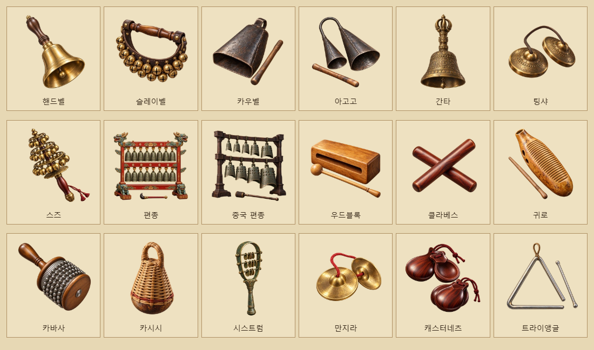
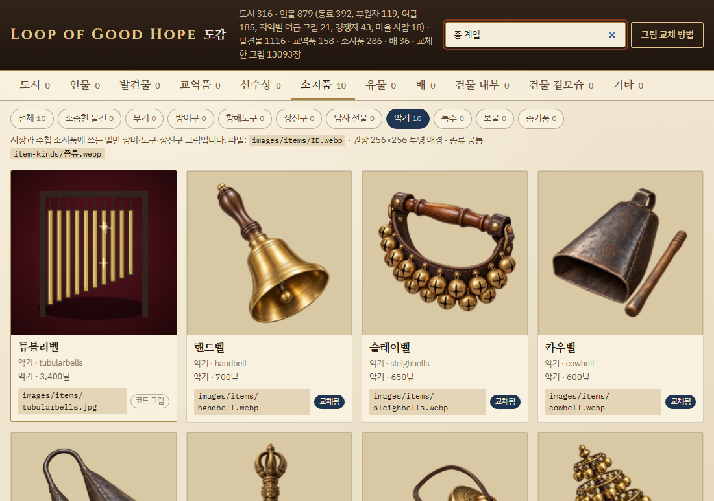
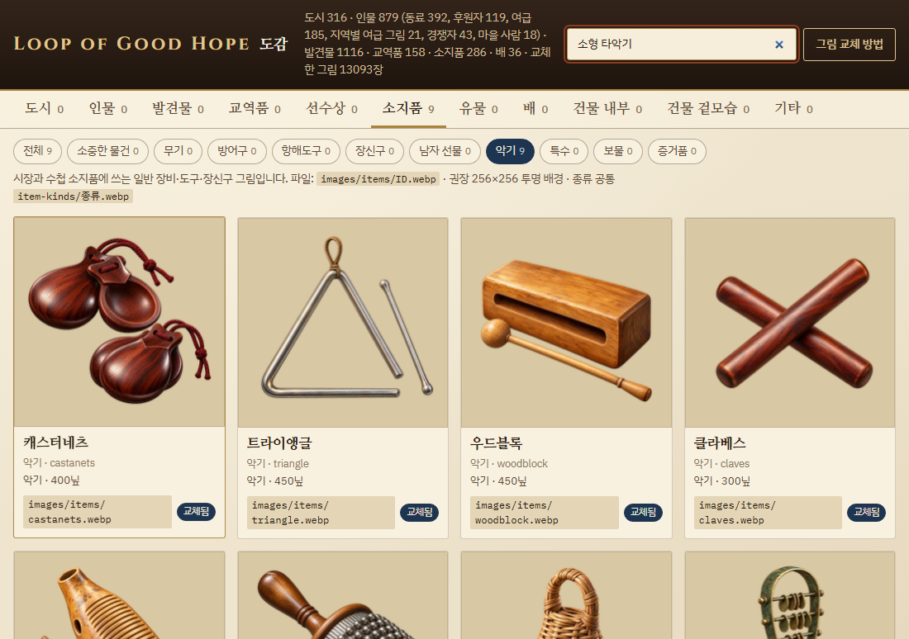

# 종 계열·소형 타악기 — 2026-11-01

새 악기 16종(종 계열 9종·소형 타악기 7종)을 추가해 전체 시장 악기는 186종이다. 이미 등록된 캐스터네츠·트라이앵글은 기존 ID·가격·판매처를 유지하고 전용 원화와 검색 별칭을 보강했다. 기존 튜블러벨은 「종 계열」 검색에 함께 나온다.

## 품목과 판매처

| 악기 | 시장 권역 | 전용 그림 |
|---|---|---|
| 핸드벨 | 이베리아·북유럽·지중해 | `images/items/handbell.webp` |
| 슬레이벨 | 북유럽 | `images/items/sleighbells.webp` |
| 카우벨 | 북유럽·지중해·아메리카 | `images/items/cowbell.webp` |
| 아고고 | 아프리카·아메리카 | `images/items/agogo.webp` |
| 간타 | 인도·중앙아시아 | `images/items/ghanta.webp` |
| 팅샤 | 인도·중앙아시아 | `images/items/tingsha.webp` |
| 스즈 | 일본 | `images/items/suzu.webp` |
| 편종 | 조선 | `images/items/pyeonjong.webp` |
| 중국 편종 | 중국 | `images/items/bianzhong.webp` |
| 우드블록 | 이베리아·북유럽·지중해 | `images/items/woodblock.webp` |
| 클라베스 | 아메리카 | `images/items/claves.webp` |
| 귀로 | 아메리카 | `images/items/guiro.webp` |
| 카바사 | 아메리카 | `images/items/cabasa.webp` |
| 카시시 | 아프리카·아메리카 | `images/items/caxixi.webp` |
| 시스트럼 | 아프리카 | `images/items/sistrum.webp` |
| 만지라 | 인도 | `images/items/manjira.webp` |
| 캐스터네츠(기존) | 이베리아 | `images/items/castanets.webp` |
| 트라이앵글(기존) | 이베리아·북유럽·지중해 | `images/items/triangle.webp` |

자료의 형태·연주법을 참고하고 가격과 시장 권역은 게임 분류에 맞춰 정했다. 조선 편종과 중국 편종은 `subRegion`으로 판매처를 구분한다. 종교에 따른 판매 제한은 두지 않는다. 시장당 악기 최소 5종 규칙과 기존 저장 호환을 유지한다.

## 외형과 검색

18종 모두 내장 `image_gen` 도구로 개별 원화를 생성해 256×256 RGBA WebP로 저장했다. 금속 반사·내부 공간·나뭇결·짜임·구슬 사슬을 표현하고 투명 배경과 최소 16px 여백을 유지한다. 시장 구입·매각·구매 확인, 소지품과 도감의 `G.Img.chain.item`에서 같은 파일을 쓴다. 파일이 없으면 종류별 코드 그림을 쓴다.

조선 편종 원화는 최초 출력의 종 수와 채를 수정해 위아래 각각 8개, 총 16개의 종으로 맞췄다. 중국 편종은 크기가 다른 종과 어두운 나무틀로 구분했다. 트라이앵글은 한 모서리의 열린 틈, 캐스터네츠는 오목한 나무판 두 쌍과 손가락 끈이 보인다.

도감에서 「종 계열」 10종, 「소형 타악기」 9종을 찾는다. 「손종」「징글벨」「금강령」「볜중」「캐스터넷」「삼각철」「차임벨」 같은 별칭도 검색한다.



## 참고 자료

- [국립국악원: 편종](https://www.gugak.go.kr/site/program/searchrelic/view?category=%EC%95%85%EA%B8%B0&menuid=001013003002003&seq=2693) — 같은 크기 종 16개, 두 단 구성, 두께에 따른 음높이와 틀 장식.
- [스미스소니언: 고대 중국 종](https://asia.si.edu/whats-on/exhibitions/resound-ancient-bells-of-china/), [메트로폴리탄: 중국 종](https://www.metmuseum.org/art/collection/search/44518) — 청동 종 묶음·돌기 장식·바깥을 치는 연주법.
- [메트로폴리탄: 스즈](https://www.metmuseum.org/art/collection/search/500655) — 손잡이 위 여러 층의 작은 방울.
- [대영박물관: 간타](https://www.britishmuseum.org/collection/object/A_1948-0716-11-a), [엘리자베스타운 칼리지: 팅샤](https://puffenberger.omeka.net/items/show/49) — 의식용 손종, 가죽 끈으로 이은 두꺼운 작은 심벌.
- [그리넬 칼리지: 아고고](https://omeka-s.grinnell.edu/s/MusicalInstruments/item/2681), [만지라](https://omeka-s.grinnell.edu/s/MusicalInstruments/item/8436) — 크기가 다른 두 쇠종, 가운데가 볼록한 작은 놋쇠 심벌.
- [메트로폴리탄: 시스트럼](https://www.metmuseum.org/art/collection/search/545681) — 고리 틀과 금속 가로대.
- [DDEX 악기 사전](https://service.ddex.net/dd/DD-AVS-010/dd/ddex_LatinPercussion.html) — 카우벨·클라베스·귀로·카바사의 구조와 소리 내는 방식.
- [라플라타 국립대학: 베림바우와 카시시](https://sedici.unlp.edu.ar/handle/10915/27933), [Percussion Plus의 타악기 분류](https://www.percussionplus.co.uk/collections/percussion) — 카시시의 연주 맥락 및 손 타악기 분류.

## 제작·검증

[전체 생성·수정 지시문](bells-small-percussion-prompts-20261101.json)에 내장 도구·원본·출력 경로를 기록했다. 원본은 `artifacts/bells-small-percussion-20261101/raw/`, 치수·용량·해시는 같은 폴더의 `assets.json`에 보존한다.

```powershell
python tools/instrument_item_art.py --spec docs/art/bells-small-percussion-prompts-20261101.json --out artifacts/bells-small-percussion-20261101
python tools/images.py
node tests/instrument_market_smoke.js
```

시험은 186종의 ID·그림·지역 입고·최소 진열을 검사한다. 신규 16종과 기존 캐스터네츠·트라이앵글을 실제 시장 화면에서 각각 2개 구매하고 저장 복원 뒤 1개 매각해 금액·수량을 확인한다. 전용 그림 25종의 파일 선택·구매 확인 원본 크기·소지품·도감 픽셀 일치와 두 검색 분류 및 별칭도 검사한다.

결과: 전체 시험 통과, 브라우저 `pageerror`·`console.error` 0건, `git diff --check` 통과. 18개 파일의 256×256 크기·투명도·여백 검사도 통과했다. 시험용 브라우저와 실행 과정은 종료했다.




