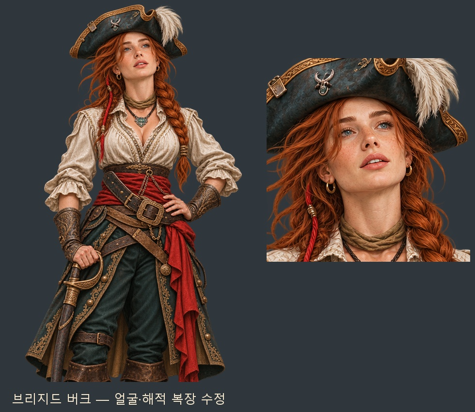

# 브리지드 버크 — 첨부 얼굴·해적 복장 후속 수정

두 번째 첨부의 얼굴·표정·붉은 옆머리 땋기를 반영하고, 세 번째 첨부를 복장 참고로 사용했다. 부드러운 얼굴과 위를 바라보는 눈, 살짝 열린 입술을 표현했다. 풍성한 기존 체형을 기준으로 흰 블라우스의 열린 목선, 청록 삼각모·깃털, 붉은 허리띠, 대각선 가죽 벨트·손목 보호대·커틀러스를 구성했다.

내장 `image_gen`으로 한 장의 인물 원화를 다시 그렸다. 얼굴상은 같은 원화에서 추출해 얼굴·머리·복식이 이어진다. 무릎상은 1024×1536, 얼굴상은 448×448의 투명 WebP다.

- 게임용 무릎상: `images/portraits/rivals/탑성의 여주인 브리지드 버크_corsair20261107_half.webp`
- 게임용 얼굴상: `images/portraits/rivals/탑성의 여주인 브리지드 버크_corsair20261107.webp`
- [수정 이미지·원본·참고 이미지 ZIP](../../artifacts/brigid-corsair-20261107/brigid-corsair-20261107.zip)
- [최종 생성 지시문·원본·참고 이미지 위치](../../tools/brigid_corsair_revision_20261107.json)
- [규격·알파·얼굴 좌표 검사](../../artifacts/brigid-corsair-20261107/asset-checks.json)

기존 논리 열쇠 두 개를 새 파일에 연결하고, 눈·입·얼굴 좌표를 갱신했다. `tools/images.py`의 우선 파일도 갱신해 이미지 목록 재생성과 웹 빌드에서 수정본을 유지한다. 이전 버전은 보존했다.

파일 해독·크기·투명도·무릎상 아래 끝·얼굴 좌표와 빌드 스캔의 연결을 검사했다. `node tests/missing_event_art_20261106_smoke.cjs` 통과: 브리지드 수정본을 포함한 해적 35명·초상 70장·장면 9장의 실제 표시와 사건 종료·오류 뒤 정리를 확인했다. 브라우저 콘솔·페이지 오류 0이며, 검사를 마친 브라우저는 `finally`에서 닫았다.

[검사 결과](../../artifacts/brigid-corsair-20261107/runtime/checks.json) · [실제 무릎상 대화](../../artifacts/brigid-corsair-20261107/runtime/lairchief_north_0_half.png) · [실제 얼굴상 대화](../../artifacts/brigid-corsair-20261107/runtime/lairchief_north_0_face.png).
