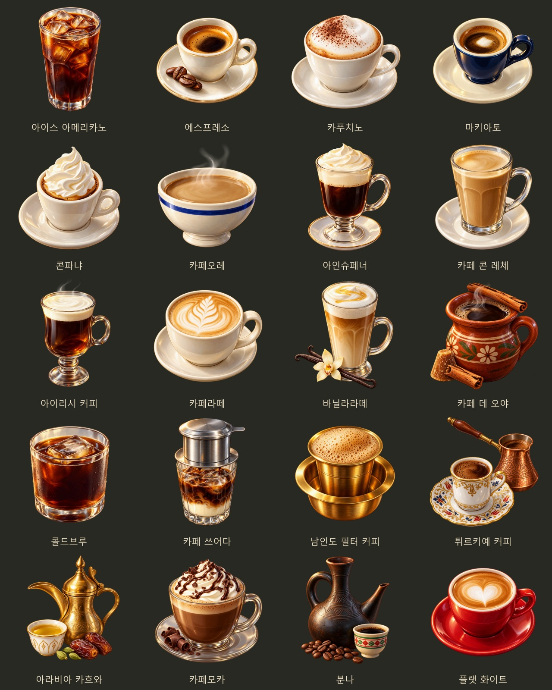

# 커피 차림표 누락 그림 — 2026-10-31

식당 음식 120종은 전용 그림이 모두 있었고, 커피 20종에는 전용 그림과 메뉴 썸네일 연결이 없었다. 내장 ImageGen으로 커피를 각각 한 장씩 그려 기존 음식 아이콘의 따뜻한 회화풍에 맞췄다. 잔·거품·크림·커피 색과 지역별 기물을 구분했다.

## 저장과 연결

- 게임 그림: `images/drinks/<커피ID>.webp`, 512×512, 투명 배경.
- 원본 PNG: `artifacts/menu-art-20261031/sources/` (생성 해상도·알파 보존).
- 전체 지시문·원본·최종 파일 목록: `tools/coffee_menu_art_20261031_prompts.json`.
- 생성 당시 개별 기록: `artifacts/menu-art-20261031/generation/`.
- 전체 미리보기: `docs/art/coffee-menu-20261031-preview.jpg`.
- 내보내기·그림 목록 등록·미리보기 재생성: `node tools/package_coffee_menu_art_20261031.js` (sharp 필요).

`js/city/restaurant.js`의 커피 차림표가 각 메뉴의 `drinks/<id>` 그림을 사용한다. 그림이 없을 때는 기존 잔 아이콘을 사용한다. `tools/images.py`의 유효 파일 이름에도 20종을 등록했다. 메뉴 해금·가격·명성·식사와 음료의 주문 제한은 바꾸지 않았다.

## 제작한 메뉴

| 메뉴 | ID |
| --- | --- |
| 아이스 아메리카노 | `iced_americano` |
| 에스프레소 | `espresso` |
| 카푸치노 | `cappuccino` |
| 마키아토 | `macchiato` |
| 콘파냐 | `con_panna` |
| 카페오레 | `cafe_au_lait` |
| 아인슈페너 | `einspanner` |
| 카페 콘 레체 | `cafe_con_leche` |
| 아이리시 커피 | `irish_coffee` |
| 카페라떼 | `cafe_latte` |
| 바닐라라떼 | `vanilla_latte` |
| 카페 데 오야 | `cafe_de_olla` |
| 콜드브루 | `cold_brew` |
| 카페 쓰어다 | `ca_phe_sua_da` |
| 남인도 필터 커피 | `filter_kaapi` |
| 튀르키예 커피 | `turkish_coffee` |
| 아라비아 카흐와 | `qahwa` |
| 카페모카 | `cafe_mocha` |
| 분나 | `buna` |
| 플랫 화이트 | `flat_white` |

## 확인 결과

- 제작 전 조사: `artifacts/menu-art-20261031/audit.json` — 음식 120종 누락 없음, 커피 20종 전용 그림 누락.
- `node tests/coffee_menu_art_smoke.js`: 음식 120종·커피 20종 실제 해독, 신규 커피 규격·투명도, 15개 문화권 커피 차림표와 음식 4개 도시의 실제 화면 통과. 콘솔 오류 0.
- `node tests/coffee_smoke.js`: 커피 판매로 메뉴 열기, 문화권별 목록, 명성, 이번 입항 중 재주문 제한, 다음 입항의 재주문, 옛 저장 통과. 콘솔 오류 0.
- `node tests/restaurant_smoke.js`, `node tests/restaurant_gallery_smoke.js`: 식당 배치·음식 120종 배정·그림 등록·식사 효과 회귀 검사 통과. 콘솔 오류 0.
- `tools/images.py`의 자료를 읽어 신규 음료 20종의 유효 키 등록 확인. 코드 문법·`git diff --check` 통과.
- 실제 메뉴 화면 19장과 결과: `artifacts/menu-art-20261031/screenshots/`.

모든 브라우저 검사는 `finally`에서 종료한다. 빌드와 런타임 의존성 추가 없이 `file://` 방식으로 동작한다.
