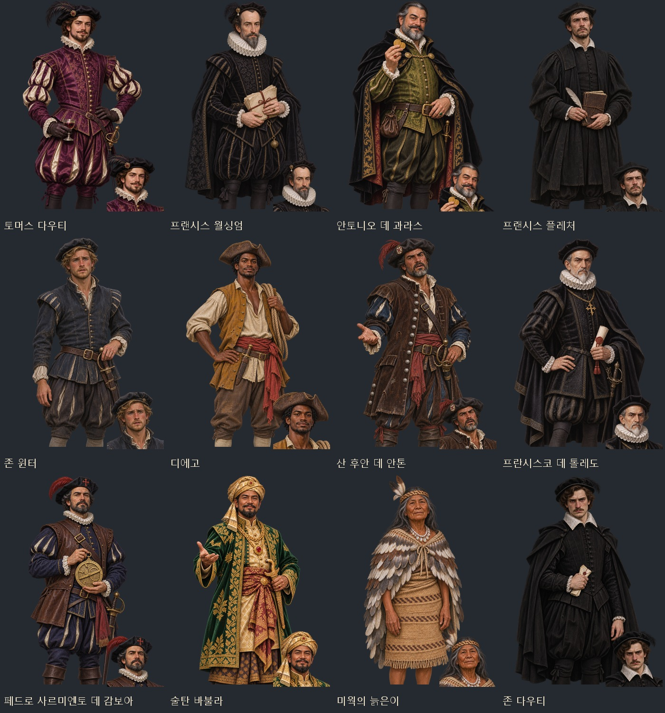
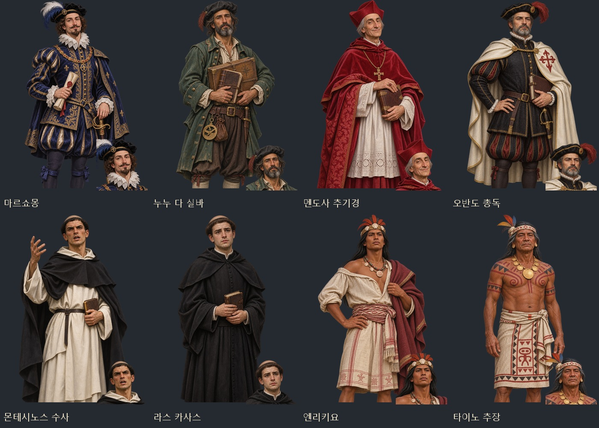
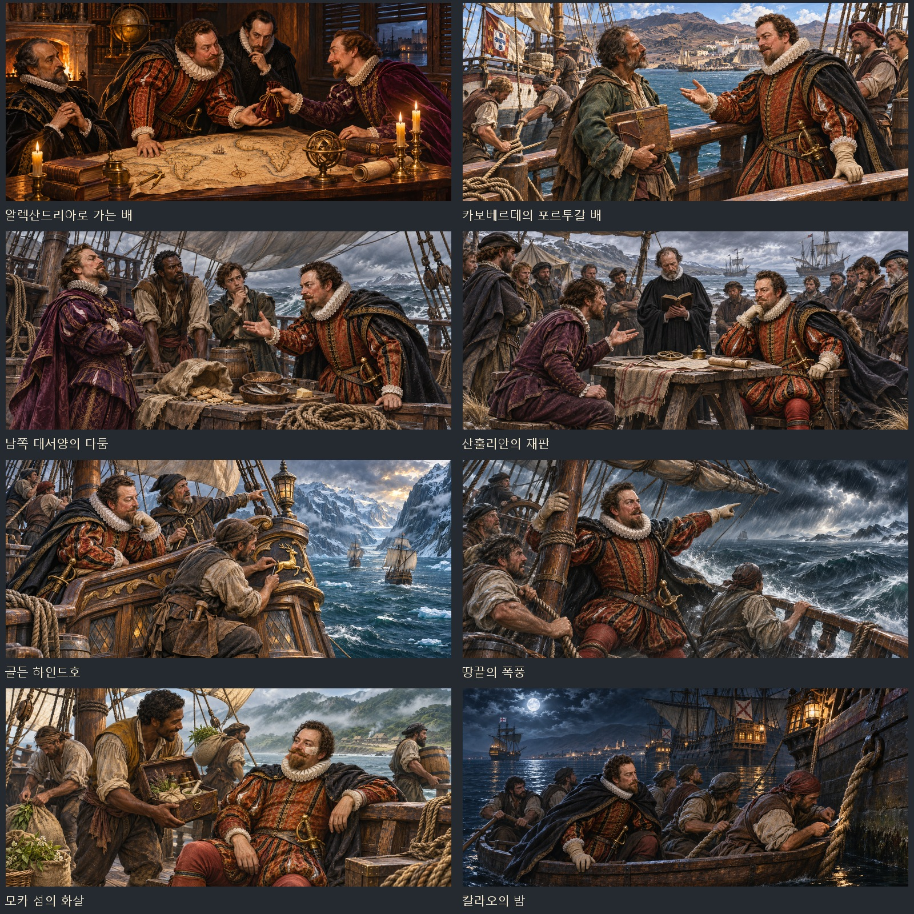
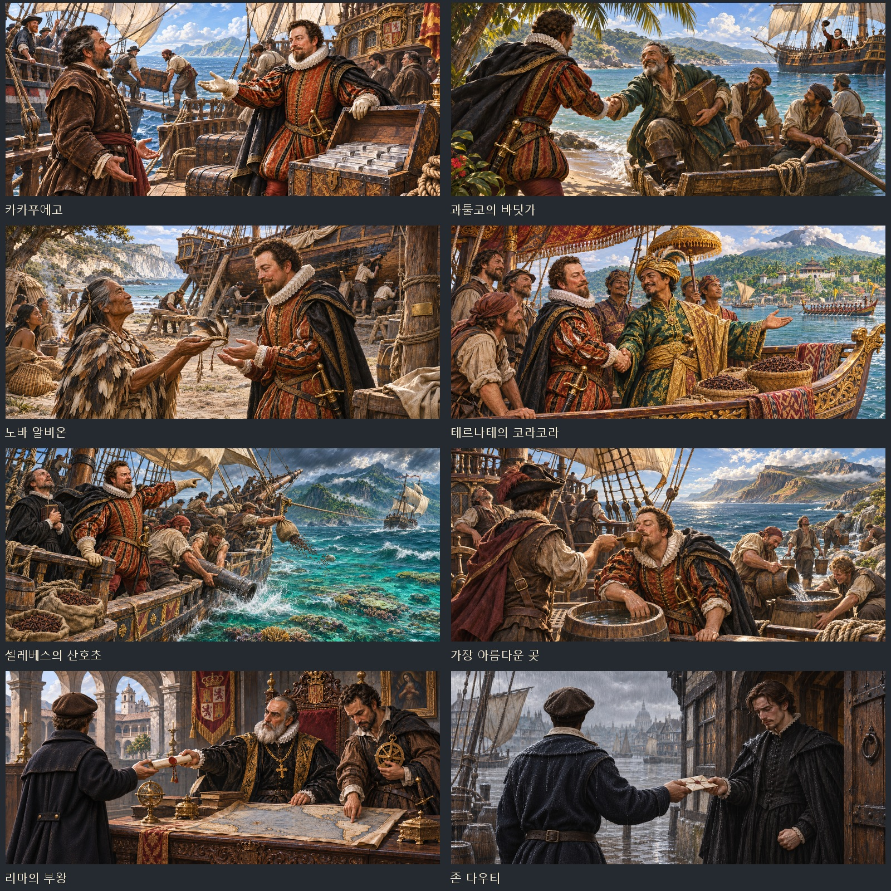
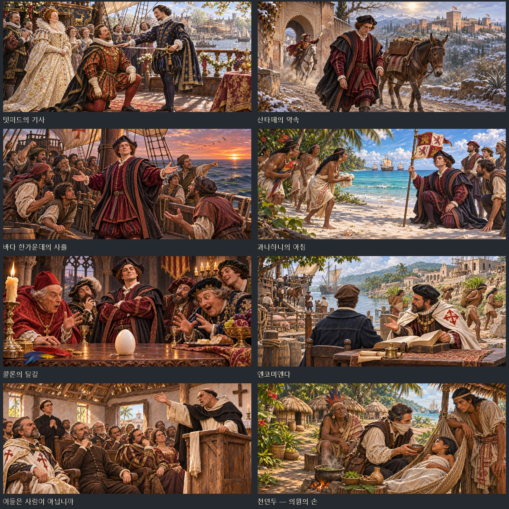

# 드레이크 세계 일주 · 콜럼버스와 신대륙 사건 그림

추가된 `drakecirc`·`newworld` 사건에 맞춰 내장 `image_gen`으로 인물 원화 20종과 사건 원화 24종을 제작했다. 같은 인물 원화에서 얼굴상을 추출해 얼굴·머리·옷이 이어지도록 했다. 드레이크 인물 14명은 신규 그림이며, 신대륙 인물 6명과 사건샷 7종은 기존 원본을 남긴 새 버전이다.

| 사건 | 인물 | 얼굴상·무릎상 | 사건샷 |
|---|---:|---:|---:|
| 드레이크의 세계 일주 | 14명 | 28장 | 17장 |
| 콜럼버스와 신대륙 | 6명 | 12장 | 7장 |
| 합계 | 20명 | 40장 | 24장 |

드레이크와 콜럼버스는 기존 이름별 경쟁 탐험가 초상을 이어 쓴다. 드레이크는 자료에 지정된 동료 초상보다 이름별 초상을 먼저 고르는 게임의 기존 우선순위를 유지한다. 두 경로의 드레이크는 같은 원화다. 기사 서임식의 엘리자베스 1세는 기존 `elizabeth_player` 초상을 연결했다. 누누 다 실바는 사건 동료 표의 초상을 합류 전 대화·합류 뒤 대화·도감에서 함께 쓴다. 기존에는 합류 전 역사 인물 표에서 누누를 찾아 이름과 전용 초상을 받지 못했다.

## 파일과 제작 지시문

- [게임용 64장·미리보기·프롬프트 ZIP](../../artifacts/drake-newworld-art-20261108/drake-newworld-art-20261108.zip)
- [인물·장면별 최종 프롬프트와 원화 경로](../../tools/drake_newworld_art_20261108_prompts.json)
- [원화·생성 기록](../../artifacts/drake-newworld-art-20261108/)
- [파일 규격·투명도 검사](../../artifacts/drake-newworld-art-20261108/asset-checks.json)
- [실제 대화·사건샷 검사](../../artifacts/drake-newworld-art-20261108/runtime/checks.json)

무릎상은 머리부터 무릎 아래까지 담은 1024×1536 투명 WebP, 얼굴상은 같은 원화에서 추출한 448×448 투명 WebP다. 사건샷은 1881×836 WebP다. 게임 파일은 `images/portraits/history/dc_*.webp`·`nw_*_v20261108{,_half}.webp`와 `images/legend-events/dc_*.webp`·`nw_*_v20261108.webp`에 있다. 신대륙의 기존 그림 열쇠는 새 파일로 연결하며 `tools/images.py`의 우선 파일 목록에도 등록해 웹 빌드·이미지 목록 재생성 뒤에도 유지한다. 원화 PNG도 작업 폴더에 보관한다.

## 인물 미리보기

## 사건샷 미리보기

## 재생성과 검증

`python tools/package_drake_newworld_art_20261108.py --faces`는 생성 기록의 원화를 작업 폴더로 복사하고 게임용 WebP·이미지 목록·미리보기·ZIP을 만든다. 기존 원화는 덮어쓰지 않는다. 존 다우티는 초상과 사건샷의 게임 열쇠가 같으므로 생성 기록을 따로 보관한다. `--faces`는 이번 초상 40장을 `portrait_faces.py --merge`로 측정하고 신대륙의 기존 그림 열쇠에도 새 얼굴 좌표를 연결한다. 서로 다른 원화 44종·게임 그림 64장과 각 그림의 해독·규격·투명도를 검사한다.

기존 사건 검사는 `tests/drakecirc_smoke.js`와 `tests/newworld_smoke.js`로 실행한다. 드레이크 검사는 설치된 Playwright Core를 연결하는 `artifacts/drake-newworld-art-20261108/playwright-alias.cjs`를 `node --require`로 읽으며, 두 검사 모두 `BROWSER_EXE`에 Chrome 실행 파일 경로를 지정한다.

새 그림 검사는 `node tests/drake_newworld_art_20261108_smoke.cjs`로 실행한다. 실제 합류 전 누누·기사 서임식 여왕 화자를 받고, 새 초상 20쌍·기존 주인공 초상 2쌍·사건샷 24장·누누의 동료 도감 연결을 확인한다. 실제 항구 화면의 대화·사건샷 캡처와 검사 결과는 `runtime/`에 저장한다.

최종 검사 통과: 인물 20명의 얼굴·무릎 대화 40회, 사건샷 24종의 해독·표시·종료, 장면 중 무릎상 숨김, 누누의 합류 전 초상·동료 도감, 기존 주인공과 여왕의 초상 연결. 콘솔 오류·실패한 이미지 요청 0. 실제 화면 캡처 44장을 남겼으며 검사에 띄운 Chromium과 실행 과정은 모두 종료했다. 기존 드레이크·신대륙 사건 시험도 통과했다.

