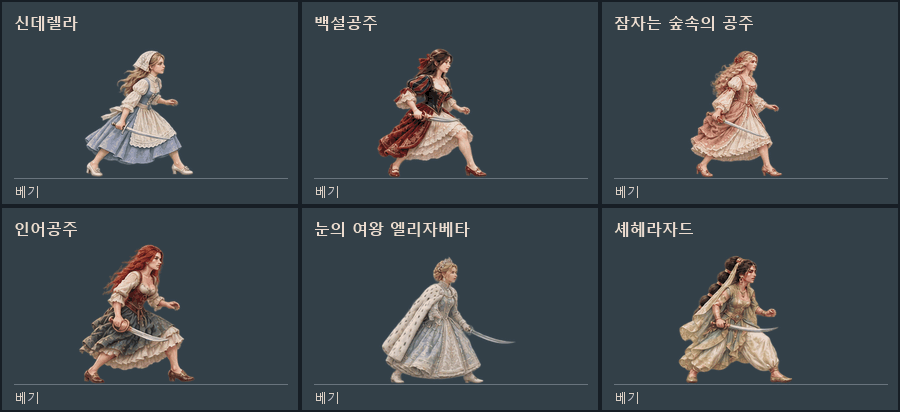
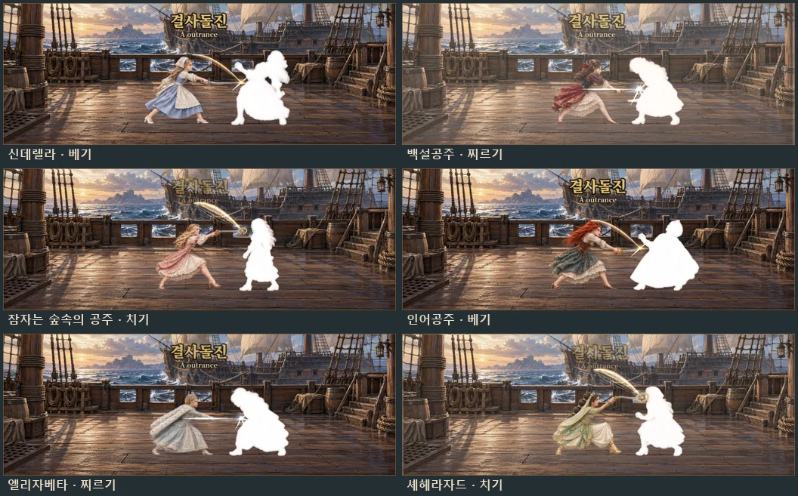
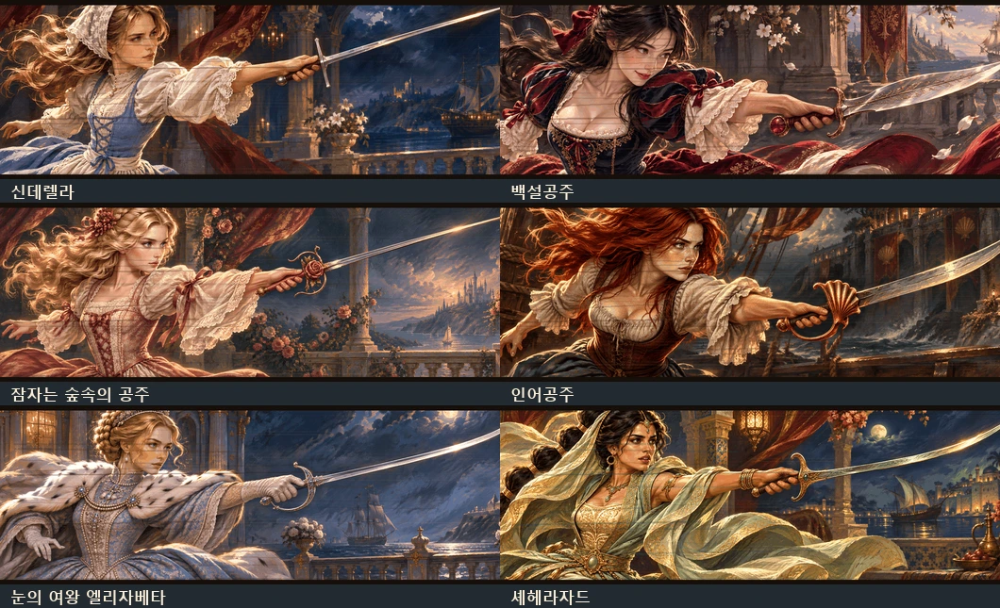
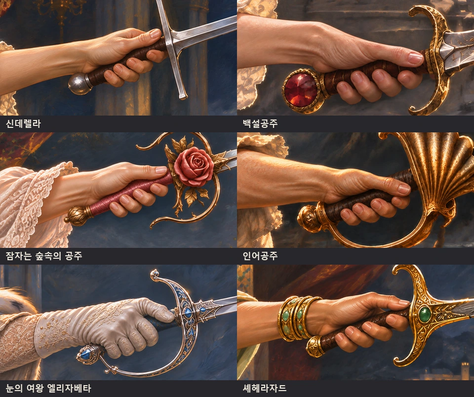
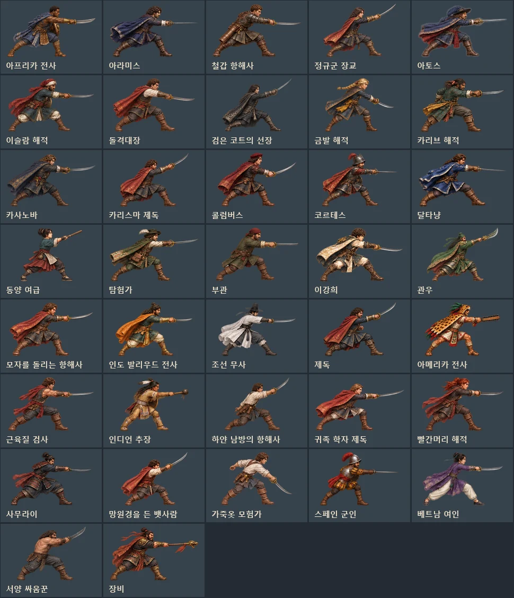

# 일기토 전투원 43명 동작

기존 전투원 37명과 공주 6명에게 공격 24칸과 피격·방어 24칸을 각각 연결했다. 베기·찌르기·치기는 서로 다른 준비 자세에서 시작한다. 필살기의 마지막 올려베기, 패링과 무기가 튕겨 나가는 반동에도 전용 자세를 쓴다.

## 공주 6명

| 게임 속 인물 | 결투 모습 |
|---|---|
| 신데렐라 | 푸른 치마와 앞치마 차림으로 아버지의 곧은 검을 뻗는다. |
| 백설공주 | 붉은 옷과 짧은 사냥검에 맞춰 발을 넓게 벌리고 파고든다. |
| 잠자는 숲속의 공주 | 장미 장식이 달린 궁정검을 들어 치고 자세를 곧게 회복한다. |
| 인어공주 | 다리를 얻은 뒤의 모습으로 짧은 선상도를 쓴다. |
| 눈의 여왕 엘리자베타 | 흰 망토 차림으로 은빛 군도를 뻗는다. |
| 셰헤라자드 | 금빛 손잡이의 페르시아 곡도와 얇은 베일이 함께 움직인다. |

각자 대기, 방어, 호령, 무릎을 꿇고 쓰러지는 자세와 5장면 필살기 컷인이 있다. 부관 대리 출전은 동료 ID로, 상대 출전은 게임 속 이름으로 그림을 찾는다.

필살기 컷인 원화는 `images/duel/cutins/_source/<id>.png`에 있다. 수정한 원화로 `tools/duel_cutins.py`의 다섯 장면을 다시 만들 수 있다.

## 기존 전투원

제독 생김새 13종, 부관, 지역 전사와 해적, 삼총사, 관우와 장비를 포함한다. 기존 대기 그림으로 인물의 키와 발밑을 재고, 새 공격 그림에서 준비 끝과 접촉 순간의 무기 끝을 다시 측정했다.

## 원화와 게임 시트

기존 전투원은 자신의 기본 시트를, 공주는 게임의 초상과 보행 원화를 인물 참조로 썼다. 두 시범 시트는 자세와 칸 배치의 참조로 사용했다. 공격 원화의 행은 내려베기, 수평 찌르기, 내려치기, 올려베기·반동이다. 반응 원화에는 상단·중단 피격, 무릎 꺾임·밀림, 받아넘김·방어 무너짐, 쓰러지기 직전·회피를 담았다.

제작 원본은 `images/_extra/duel_fighters_ext_src/roster/raw/`에 둔다. `tools/duel_roster_sheets.py`가 몸통과 이어진 칼끝을 함께 분리해 432×304칸에 발밑을 맞춘다. 이어서 `tools/duel_contact_points.py`, `tools/duel_fall_geometry.py`, `tools/images.py`로 접점·착지·그림 목록을 갱신한다.

## 확인 결과

- 기본 시트 43장과 추가 시트 86장에서 빈 동작 칸과 경계 넘침이 0건이었다. 착지 외곽과 공격 접점도 시트에서 다시 잰 좌표와 일치했다.
- 실제 갑판 결투에서 공주 6명의 대리 출전, 공격 종류별 접촉 장면, 다음 공주로 교체한 뒤의 공격·피격 시트를 확인했다.
- 보통 속도와 빠른 속도의 피격·승패 착지, 패링·히트스톱, 인물별 필살기와 무덤 결투 회귀 검사가 통과했다.

[타격감 조정값과 시범 결투 GIF](duel-impact-20261109.md) · [게임을 여는 방법](../../README.md)
