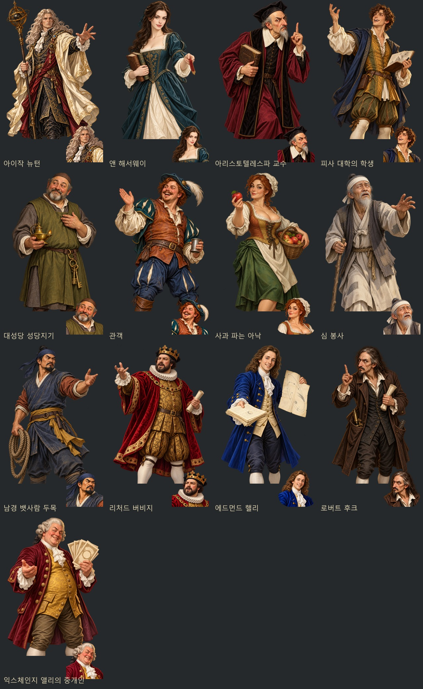
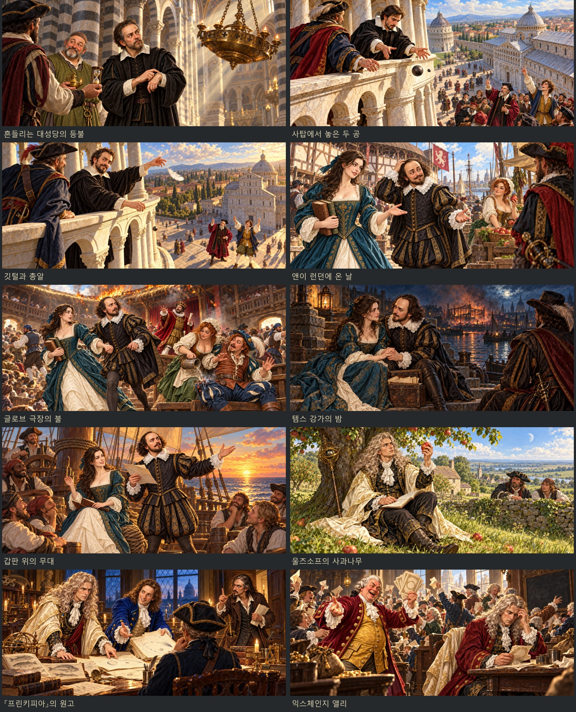

# 누락 이벤트 인물화와 장면 — 2026-10-31

내장 ImageGen으로 뉴턴과 앤 해서웨이, 누락 조연과 잘못 배정된 인물의 초상 26장을 먼저 제작한 뒤 이벤트샷 10장을 제작했다. 얼굴상은 1024×1024, 무릎상은 머리부터 무릎단까지의 1024×1536 투명 WebP, 장면은 1881×836 불투명 WebP다.

뉴턴은 사용자 참고의 은빛 장발·아이보리 학자 망토·검정과 금색 의상·천구의 지팡이를 반영했다. 앤은 참고 사진의 얼굴 분위기와 검은 웨이브 머리를 회화풍으로 옮기고, 시대풍 청록색 드레스에 책과 서표를 들게 했다. 창작 성인 사과 장수는 풍만한 체형과 열린 목선, 활기찬 표정으로 제작했다. 기존 미성년 인물의 외형은 수정하지 않았다.

## 제작 인물 13명

| 인물 | 그림 키 | 내용 |
| --- | --- | --- |
| 아이작 뉴턴 | `portraits/history/newton` | 사용자 참고 반영, 잘못 배정된 초상 교체, 동료 무릎상 연결 교정 |
| 앤 해서웨이 | `portraits/legendary/anne_hathaway` | 사용자 참고 반영, 시대풍 사서 이미지 |
| 아리스토텔레스파 교수 | `portraits/history/gp_professor` | 항의하는 교수 |
| 피사 대학의 학생 | `portraits/history/gp_student` | 환호하는 성인 학생 |
| 대성당 성당지기 | `portraits/history/gp_sexton` | 등불과 열쇠를 지닌 성당지기 |
| 관객 | `portraits/history/globe_audience` | 웃으며 박수치는 관객 |
| 사과 파는 아낙 | `portraits/history/globe_apple_seller` | 사과를 권하는 장수 |
| 심 봉사 | `portraits/history/sim_father` | 딸을 찾아 손을 뻗는 아버지 |
| 남경 뱃사람 두목 | `portraits/history/sim_boatman` | 출항을 재촉하는 뱃사람 |
| 리처드 버비지 | `portraits/history/burbage` | 여성 초상을 남성 배우의 헨리 8세 무대 의상으로 교체 |
| 에드먼드 핼리 | `portraits/history/nt_halley` | 검사풍 초상을 원고와 혜성 궤도도를 든 천문학자로 교체 |
| 로버트 후크 | `portraits/history/nt_hooke` | 여성 초상을 남성 실험 과학자로 교체 |
| 익스체인지 앨리의 중개인 | `portraits/history/nt_broker` | 여성 초상을 주식 증서를 권하는 남성 중개인으로 교체 |

각 키에 `_half`를 붙이면 무릎상이다. 새 조연 7명은 역사 인물 화자 자료에 등록하고 실제 대사에 연결했다. 동료·저장 ID와 이야기의 보상·날짜·선택지는 유지했다. 뉴턴은 기존 `halfOf`가 `history` 경로를 후보에서 제외하므로 동료 자료의 `halfKey`로 전용 무릎상을 명시했다.

## 이벤트샷 10장

| 파일 (`images/legend-events/`) | 장면 |
| --- | --- |
| `nt_apple.webp` | 울즈소프의 사과나무 |
| `nt_principia.webp` | 『프린키피아』의 원고 |
| `nt_bubble.webp` | 익스체인지 앨리 |
| `globe_anne.webp` | 앤이 런던에 온 날 |
| `globe_fire.webp` | 글로브 극장의 불 |
| `globe_thames.webp` | 템스 강가의 밤 |
| `globe_deck.webp` | 갑판 위의 무대 |
| `galileo_lamp.webp` | 흔들리는 대성당의 등불 |
| `galileo_tower.webp` | 사탑에서 놓은 두 공 |
| `galileo_feather.webp` | 깃털과 총알 |

새 인물화와 기존 셰익스피어·갈릴레오 초상을 참조해 장면을 만들었다. 기존 장면 호출 키 그대로 등록했으며, 장면 대화 중에는 무릎상이 그림을 가리지 않는 기존 표시 방식을 사용한다.

## 원본과 도구

- 전체 최종 지시문·참조·파일 목록: `tools/event_art_20261031_prompts.json`
- 생성 원본: `artifacts/event-art-20261031/sources/`
- 사용자 참고와 장면용 인물 참조: `artifacts/event-art-20261031/references/`
- 교체 전 파일: `artifacts/event-art-20261031/before/images/`
- 인물별·장면별 생성 기록: `artifacts/event-art-20261031/generation/`
- 게임용 변환·등록·미리보기 생성: `node tools/package_event_art_20261031.js` (sharp 필요)
- 실행 자료·파일 누락 조사: `node tools/audit_event_art_20261031.js` (Playwright 필요)

투명 생성 원본의 알파를 유지하고 크기와 형식만 변환했다. 얼굴 좌표는 `tools/portrait_faces.py --merge`로 이번 26개 키만 갱신했다.

## 확인 결과

- 기존 역사 인물 182명의 얼굴 비교판을 검토하고 잘못 배정된 5명을 이번 제작에 포함했다. 사건 동료·전설 인물의 전용 초상과 파일도 조사했다.
- 최종 `audit.json`의 `histMissing`, `mateMissing`, `sceneMissing`가 모두 빈 배열이다. 이 조사는 실행 자료에 등록된 역사 인물·전설/사건 동료와 사건 코드의 장면 참조를 대상으로 한다. 공용 역할 초상을 전용 초상으로 세지 않는다.
- `node tests/event_art_20261031_smoke.js`: 13명 실제 화자 선택, 26장 해독·규격·투명도·눈/입 좌표, 10장 장면 표시·종료 정리 통과. 얼굴상·무릎상·장면 화면 36장, 콘솔 오류 0.
- `node tests/newton_smoke.js`, `node tests/globe_smoke.js`, `node tests/galpisa_smoke.js`: 날짜·진행·분기·합류·보상·소식 회귀 검사 통과, 콘솔 오류 0.
- `node tests/simcheong_events_smoke.js`: 기존 심청 초상과 사건 그림 해독 검사 통과.
- 변경 코드·도구·시험 문법 검사와 `git diff --check` 통과.
- 실제 화면과 검증 기록: `artifacts/event-art-20261031/screenshots/`.

브라우저 검사는 모두 `finally`에서 종료한다. 빌드나 런타임 의존성을 추가하지 않았다.
