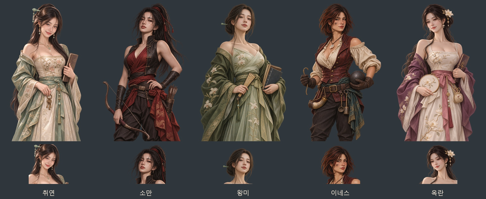

# 첨부 얼굴을 참고한 최근 사건 동료 5명 (2026-11-06)

동림당·영원성·숭정제 사건의 성인 여성 동료 취연·소만·왕미·이네스·옥란을 새로 제작했다. 첨부 9장의 얼굴·표정·머리 모양·장식 분위기를 인물의 성격과 직업에 나누어 반영했다. 풍성한 가슴과 잘록한 허리, 어깨와 목선이 드러나는 과감한 의상으로 만들었다. 취연은 궁중 장부와 열쇠, 소만은 탄궁과 승마복, 왕미는 책과 부채, 이네스는 포수 도구와 포탄, 옥란은 자수틀과 장부를 든다.

## 참고 배분

| 인물 | 참고 첨부 | 얼굴·표정과 복식 |
|---|---|---|
| 취연 `dl_cuiyan` | 38077, 38988 | 부드러운 비대칭 미소·보조개, 비취색 궁중 비단과 섬세한 장신구 |
| 소만 `dl_xiaoman` | 38959 | 긴 검은 머리와 도도한 눈매, 붉은 승마복과 열린 민소매 가죽 조끼 |
| 왕미 `dl_wangwei` | 38472, 38985 | 턱을 살짝 든 사색적인 눈매, 옥비녀와 풀빛 비단 |
| 이네스 `nc_ines` | 38075, 38994 | 붉은 갈색 단발·자신감 있는 표정, 열린 리넨 셔츠와 가죽 조끼 |
| 옥란 `nc_okran` | 37434, 38990 | 단정한 검은 머리와 잔잔한 미소, 목련 자수와 자주색 비단 |

왕관 참고의 얼굴과 보석 장식만 이용하고 동료에게 군주 신분 표식은 붙이지 않았다. 인물은 모두 24~29세 성인으로 지정했다. 기존 인물·사건의 ID와 조건·보상은 그대로다.

## 저장과 연결

- 무릎상: `images/portraits/mates/{id}_ref20261106_half.webp` — 1024×1536, 투명 배경, 무릎 구도.
- 얼굴상: `images/portraits/mates/{id}_ref20261106.webp` — 같은 무릎상에서 추출한 448×448 투명 이미지.
- 기존 `portraits/mates/{id}`·`{id}_half` 키를 `images/manifest.js`에서 새 파일에 연결한다. 기존 이미지 파일은 보존했다.
- `js/data/portraitfaces.js`의 해당 10개 얼굴 좌표를 새 그림에서 다시 검출했다.
- 생성 원화: `artifacts/event-companion-refs-20261106/sources/`.
- 그림 묶음: [게임용 이미지 10장·지시문·미리보기 ZIP](../../artifacts/event-companion-refs-20261106/event-companion-refs-20261106.zip).
- 도구: **내장 image_gen**, 인물별 1회 생성. 전체 최종 프롬프트와 참고 파일명: [제작 지시문 JSON](../../tools/event_companion_refs_20261106_prompts.json).
- 재포장: `python tools/package_event_companion_refs_20261106.py`.

## 검증

`node tests/event_companion_refs_20261106_smoke.cjs` 통과. 실제 `file://` 게임에서 새 이미지 10장의 해독·규격·투명도·얼굴 좌표, 사건 대화와 혼인 후 얼굴 연결, 얼굴상·무릎상 대화 표시와 종료를 확인했다. 콘솔 오류 0건이며 시험 브라우저는 종료했다. 실행 결과는 `artifacts/event-companion-refs-20261106/runtime/checks.json`, 대화 캡처는 같은 폴더의 PNG다.

기존 사건 전체 감사에서는 역사 화자 372개·사건 동료 86명·사건 그림 340개에 누락이 없었다. 이번 작업은 최근 여성 동료 5명의 첨부 참고 재제작 범위다.
