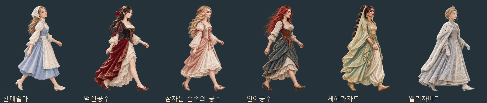

# 공주·이야기 인물·마녀 보행 시트 (2026-11-07)

신데렐라·백설공주·잠자는 숲속의 공주·다리가 생긴 인어공주, 셰헤라자드(셰에라자드), 눈의 여왕 엘리자베타와 현재 게임 명부의 마녀 25명에게 개별 보행 시트를 제작했다. 마녀는 떠도는 마녀 24명과 무도회 마녀 그리젤다를 포함한다.

기존 인물화의 얼굴·머리·복식·장신구를 참고해 전신을 완성했다. 같은 인물의 왼발·오른발 디딤, 무게 받기, 다리 교차, 발을 앞으로 내미는 자세를 연결하고, 팔·머리카락·치맛자락도 걸음에 맞춰 움직인다.



[마녀 보행 미리보기](witch-walks-20261107.gif) · [전체 정지 미리보기](fairy-witch-walks-20261107.jpg) · [PNG·WebP·좌표 JSON 묶음](../../artifacts/fairy-witch-walks-20261107/fairy-witch-walks-20261107.zip).

## 규격과 파일

- 인물마다 투명 배경의 4열×2줄, 8프레임. 총 31시트·248개 보행 자세.
- 시트는 1520×888, 한 칸은 380×444. 순서는 윗줄 왼쪽부터 오른쪽, 다음 아랫줄이다.
- 모든 인물은 오른쪽을 보고 걷는다. 왼쪽으로 걸을 때는 기존 게임의 좌우 반전을 사용한다.
- 인물마다 8프레임 전체에 한 배율을 적용하고, 발이 닿는 바닥선을 맞췄다.
- 게임용: `images/characters/mates/<동료 ID>/walk.webp`.
- 배포용: `artifacts/fairy-witch-walks-20261107/sheets/<동료 ID>_walk.png` · `_walk.json`.
- 참고 인물화: `artifacts/fairy-witch-walks-20261107/references/`.
- 생성 원본: `artifacts/fairy-witch-walks-20261107/sources/`.

## 인물 명부

| 인물 | 동료 ID | 구분 |
|---|---|---|
| 신데렐라 | `cinderella` | 공주·이야기 인물 |
| 백설공주 | `snow_white` | 공주·이야기 인물 |
| 잠자는 숲속의 공주 | `sleeping_beauty` | 공주·이야기 인물 |
| 인어공주 | `little_mermaid` | 공주·이야기 인물 |
| 셰헤라자드 | `scheherazade` | 공주·이야기 인물 |
| 엘리자베타 | `elizaveta` | 공주·이야기 인물 |
| 셀레스티나 | `w_celestina` | 마녀 |
| 모르간 르 페이 | `w_morgan` | 마녀 |
| 키르케 | `w_circe` | 마녀 |
| 메데이아 | `w_medea` | 마녀 |
| 바바 야가 | `w_babayaga` | 마녀 |
| 베파나 | `w_befana` | 마녀 |
| 마더 쉽턴 | `w_shipton` | 마녀 |
| 벨레차 오르시니 | `w_bellezza` | 마녀 |
| 아그네스 워터하우스 | `w_waterhouse` | 마녀 |
| 우르술라 켐프 | `w_kemp` | 마녀 |
| 발푸르가 하우스만닌 | `w_hausmann` | 마녀 |
| 아그네스 샘프슨 | `w_sampson` | 마녀 |
| 게일리스 덩컨 | `w_duncan` | 마녀 |
| 안나 콜딩스 | `w_koldings` | 마녀 |
| 고스탄차 다 리비아노 | `w_gostanza` | 마녀 |
| 메르가 비엔 | `w_bien` | 마녀 |
| 카타리나 케플러 | `w_kepler` | 마녀 |
| 엘리자베스 서던스 | `w_demdike` | 마녀 |
| 앨리스 너터 | `w_nutter` | 마녀 |
| 마리아 데 소소야 | `w_zozaya` | 마녀 |
| 그라시아나 데 바레네체아 | `w_barrenechea` | 마녀 |
| 이소벨 가우디 | `w_gowdie` | 마녀 |
| 카트린 몽부아쟁 | `w_voisin` | 마녀 |
| 티투바 | `w_tituba` | 마녀 |
| 엉겅퀴 마녀 그리젤다 | `w_thistle` | 마녀 |

## 게임 연결과 제작

[동료 보행 자료](../../js/data/matewalks.js)에 각 동료 ID와 시트 열쇠, 칸 규격·프레임 좌표를 등록했다. 게임과 도감 모두 같은 자료를 읽는다.

```js
var info = G.MATE_WALKS.cinderella;
var keys = G.Img.chain.mateWalk('cinderella'); // 동료 객체도 받을 수 있다
// info.rects[0] = [0, 0, 380, 444]
```

내장 **image_gen**을 사용했다. 인물마다 기존 무릎상 한 장을 직접 참고해 개별 시트를 생성했다. 인어공주의 흰 배경과 아그네스 샘프슨의 회색 배경 잔상은 같은 도구로 제거해 투명본으로 다듬었다.

[최종 생성 프롬프트·참고 원화·생성 원본 경로](../../tools/fairy_witch_walks_20261107_prompts.json) · [참고 자료 준비 도구](../../tools/prepare_fairy_witch_walks_20261107.py) · [추출·등록·배포 도구](../../tools/package_fairy_witch_walks_20261107.py).

## 검증

[파일·투명도·발끝·프레임 검사](../../artifacts/fairy-witch-walks-20261107/asset-checks.json) · [실제 렌더러 검사](../../artifacts/fairy-witch-walks-20261107/runtime/checks.json).

`node tests/fairy_witch_walks_20261107_smoke.cjs`는 현재 공주·마녀 명부와 제작 대상의 일치, 동료 ID로 선택한 시트, 기존 인물화와 참고 그림의 일치, 8개 칸의 실루엣·투명도·발끝을 검사한다. 기존 `G.StreetFolk.draw`로 여러 보행 단계와 좌우 방향을 직접 그려 보고 게임·도감의 콘솔 오류와 그림 요청 실패를 확인한다. 시험 끝에 브라우저를 닫는다.

최종 31명·248개 자세 검사 통과. 게임·도감의 콘솔 오류와 그림 요청 실패는 0이다. 31개 시트 모두 이미지 목록을 다시 만들 때 같은 파일로 선택되며, PNG 31장·WebP 31장·프레임 좌표 JSON 31개가 담긴 ZIP의 압축 무결성도 확인했다.
