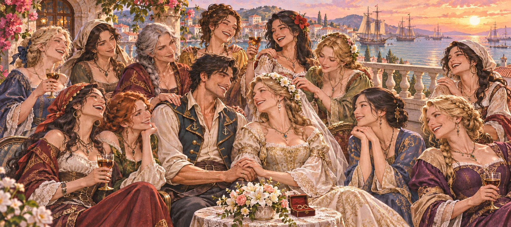
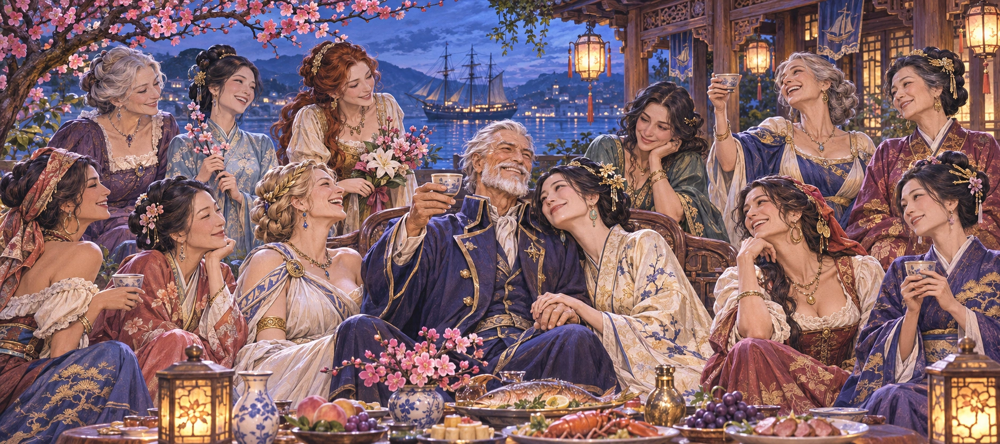
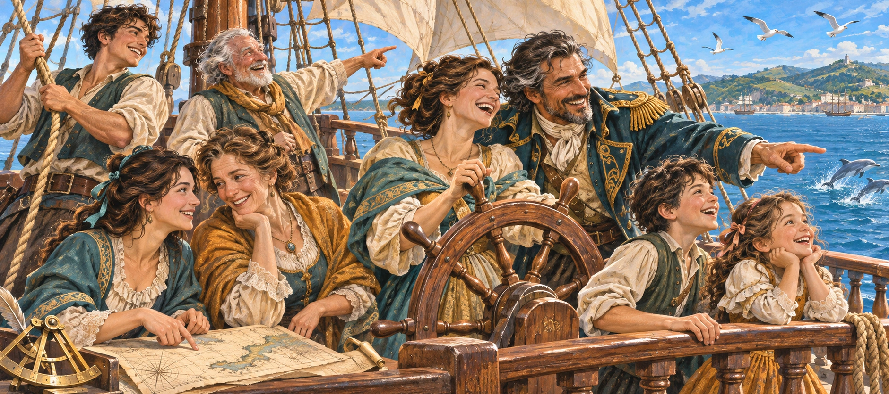
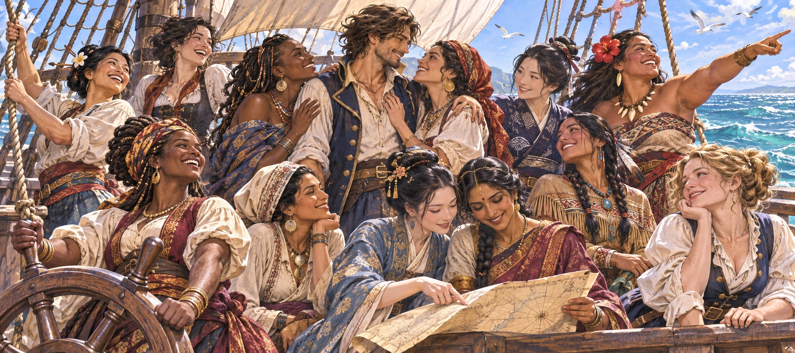

# 혼인·가족 항해 업적 5종 — 2026-11-16

현재 게임의 아내 정원은 본처 포함 12명이다. 새 업적은 기존 수첩·칭호·일회 달성 저장·업적 장면·도감 체계를 공유한다. 수치 보상을 따로 지정하지 않은 요청이므로 추가 금화·명성 없이 업적명과 같은 칭호를 준다.

## 혼인 업적

「카사노바」는 남성 제독이 현재 아내 전원과 만 20~29세에 혼인하고, 첫 혼인일부터 달력상 3년 이내에 정원을 채우면 달성한다. 「의자왕」은 같은 방식으로 혼인이 모두 만 70세 이후여야 한다. 3주년 당일까지 포함하고, 2월 29일의 3주년은 해당 해 2월 말일로 계산한다. 생일 전후의 만 나이를 사용하며 여성 제독과 딸 후계자는 제외한다.

현재 아내의 서로 다른 ID와 실제 혼인일을 사용한다. 본처·둘째 부인, 여급·부하·왕녀·무도회·소꿉친구 혼인 경로에 날짜와 검사 처리를 연결했다. `player.marriageDates`에 실제 혼인 날짜를 저장하고, 제독을 승계하면 새 제독의 기록으로 시작한다. 혼약했던 신부를 승계 시 아내로 맞는 경우는 그때 혼인일을 기록한다.

기존 `wedEver`는 과거 저장에서 현재 배우자를 오늘 날짜로 보충하므로 기한 근거로 쓰지 않는다. 둘째 부인의 실제 경과일 `wed`가 남아 있으면 복구하지만, 본처의 혼인일을 알 수 없는 옛 저장에 임의로 최근 혼인일을 부여하지 않는다. 금액·명성 보상을 중복 지급하지 않으며, 이미 달성한 업적과 칭호는 이후 편성·나이·제독이 바뀌어도 유지한다.

## 항해 업적

「가족 유람단」은 가족 동승자가 한 명 이상이고 이름 있는 동료·동승자가 모두 가족인 편성으로 실제 항해일 90일(3개월)을 채우면 달성한다. 본처·다른 배우자·동승 자녀·성인 자식 항해사·형제자매·사촌·외삼촌을 가족으로 판정한다. 소꿉친구는 친족으로 세지 않는다. 기항일은 더하지 않고, 가족 외 인물과 항해하면 연속 기록을 초기화한다. 저장 복원이나 같은 날 재검사로 날짜를 더하지 않는다.

「사랑은 불가능의 영역」은 제독 외 실제 동료·동승자가 한 명 이상이며 모두 현재 아내인 편성으로 실제 출항하거나 항해하면 달성한다. 항구에서 편성만 해 둔 경우, 아내들이 모두 집에 남은 경우, 미혼 여성이나 자녀가 섞인 경우는 제외한다. 부하 명단에서 사라진 아내의 낡은 동승 표식도 제외한다. 국적·인종은 이 업적의 추가 조건이 아니며 전용 그림의 인물 구성에 반영했다.

두 편성 업적은 제독과 이름 없는 일반 선원 수를 제외한다. 실제 동료 명단과 `wifeAboard`·다른 배우자 동승 상태·자녀 동승 상태를 함께 살펴 가족 그림이나 초상만으로 관계를 추정하지 않는다.

「80일간의 세계일주」는 실제 모항 출항일로부터 80일 이내에 기존 세계일주 조건(누적 경도 한 바퀴)을 채워 같은 모항으로 귀환하면 달성한다. 80일 당일까지 포함하고 중간 기항일도 소요 기간에 들어간다. 출항 준비가 끝나 바다에 나선 날부터 센다. 출항일이 없는 옛 항해에는 날짜를 소급하지 않는다. 이후 새 모항 출항부터 정확히 기록한다.

항해 기록은 제독별 `player.voyageAchievements`, 세계일주 출항일은 `state.circ.started`에 저장한다. 출항과 하루 경과, 실제 세계일주 귀환 처리에 연결했다. 바다에서 달성한 업적샷은 기존 대기열로 보내 다음 입항 때 재생한다.

## 제작 자료와 조정값

그림 5장은 내장 ImageGen으로 제작했다. 얼굴·피부·손·옷감까지 회화 표현을 맞춘 게임 사건샷이며 각 1881×836이다. 「사랑은 불가능의 영역」은 여러 국적·인종의 아름다운 성인 아내들이 키·해도·돛줄을 함께 맡아 항해하는 선상 장면이다.

- 최종 원화: `images/achievement-events/{casanova,uijawang,family_cruise,love_impossible,around_world_80}.webp`.
- 혼인 프롬프트·수정 지시문·원본 대응·해시: [marriage_achievement_20261116_prompts.json](../../tools/marriage_achievement_20261116_prompts.json).
- 항해 프롬프트·원본 대응·해시: [voyage_achievement_20261116_prompts.json](../../tools/voyage_achievement_20261116_prompts.json).
- 원본: `artifacts/marriage-achievements-20261116/sources/`, `artifacts/voyage-achievements-20261116/sources/`.
- 패키징: `python tools/package_marriage_achievement_20261116.py`; 항해 세 장은 인수로 `tools/voyage_achievement_20261116_prompts.json artifacts/voyage-achievements-20261116`을 전달한다.
- 규칙 조정값: `js/data/base.js`의 `G.BALANCE.marriageAchievements`·`voyageAchievements`. 아내 정원은 기존 `G.BALANCE.wives.maxSpouses`를 공유한다.

## 검증

`node tests/family_voyage_achievements_20261116_smoke.cjs`로 실제 Chromium에서 혼인 나이·달력 3년·윤년·정원·실제 본처 및 12번째 여급 혼인, 옛 저장·제독 교체, 동승 관계, 항해 89/90일·기항일·기록 초기화, 세계일주 79/80/81일·같은 모항 귀환을 확인했다. 실제 바다 장면 출항과 하루 경과, 다섯 달성 장면·칭호 창·도감·수첩도 확인했다. 페이지·콘솔 오류와 이미지 요청 실패는 0건이다.

전체 결과는 [report.json](../../artifacts/family-voyage-achievements-20261116/report.json)에, 실제 화면은 같은 폴더의 `<업적ID>-event.png`·`-reward.png`·`-catalog.png`에 보존한다. [아내들 선상 장면](../../artifacts/family-voyage-achievements-20261116/love_impossible-event.png).

기존 해방자 검사와 시장 수집 업적 규칙 검사도 통과했다. 기존 `wives_turn_romance_order_smoke.js`는 이 환경의 설치된 `playwright-core`를 `playwright` 대신 연결하여 실행했고, 둘째 부인의 순번·함께 보내는 시간·동료 연애 검사와 콘솔 오류 0을 확인했다.
