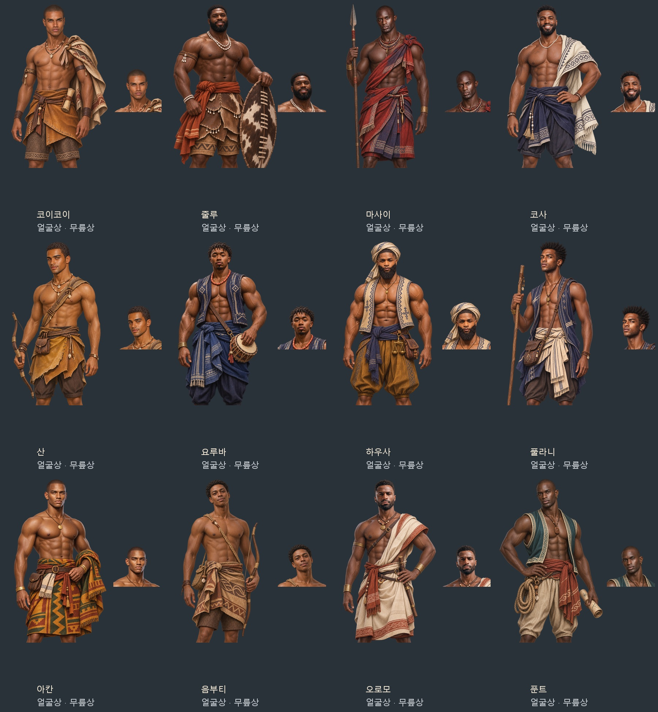

# 아프리카계 민족 발견물 남성 부하 후보 12종

첨부 사진 17장의 얼굴형·표정·머리·수염·체격을 참고해, 민족 발견물에서 배에 태워 달라며 나서는 성인 남성 후보용 원화 12장을 내장 ImageGen으로 제작했다. 각 원화에서 얼굴상을 잘라 총 24장의 게임용 투명 WebP를 만들었다. 얼굴과 몸을 따로 생성하거나 다른 사람의 몸에 얼굴을 합성하지 않았다.

코이코이·줄루·마사이·코사·산·요루바·하우사·풀라니·아칸·음부티·오로모·푼트에 민족마다 한 쌍을 연결한다. 기존 이름 넷과 솜씨 후보는 그대로이며, 한 민족 안의 이름별 독립 초상 48쌍을 만든 작업은 아니다. 여성과 나머지 민족의 기존 그림 선택은 유지한다.

가슴·배·어깨·팔을 드러내는 열린 민소매 조끼, 어깨에 걸친 천, 허리 직물을 사용했다. 근육질·날렵한 체형, 삭발·짧은 곱슬머리·트위스트·수염과 서로 다른 표정으로 인상을 나눴다. 옷과 장신구는 게임용 각색이며 정밀한 역사 복식 복원이 아니다. 현대 옷·기구·이어폰·문신은 옮기지 않았다. 하우사는 첫 결과에 참고 사진의 십자가가 남아 작은 타원형 목걸이로 수정했으나, 수정본에 배경 조각이 생겨 같은 참고와 최종 지시문으로 새로 제작했다. 최초·수정·최종 지시문은 제작 JSON에 보관한다.

| 민족 | 발견물 ID | 첨부 참고 번호 |
| --- | --- | --- |
| 코이코이 | `khoikhoi` | 7·8 |
| 줄루 | `folk_zulu` | 2·4 |
| 마사이 | `folk_maasai` | 13 |
| 코사 | `folk_xhosa` | 1·16 |
| 산 | `folk_san` | 10·11 |
| 요루바 | `folk_yoruba` | 5 |
| 하우사 | `folk_hausa` | 3 |
| 풀라니 | `folk_fulani` | 6 |
| 아칸 | `folk_akan` | 9·12 |
| 음부티 | `folk_mbuti` | 14·15 |
| 오로모 | `folk_oromo` | 17 |
| 푼트 | `punt` | 8·13 |

얼굴상은 512×512, 무릎상은 1024×1536이며 모두 투명 알파를 가진다. 파일은 `images/portraits/folk-african-men/<발견물 ID>.webp`와 `<발견물 ID>_half.webp`다. 원본 PNG 12장은 `artifacts/folk-african-men-20261106/sources/`에 보관한다.

`G.FOLK_JOIN[id].portraits.m`으로 민족별 전용 얼굴을 정한다. `G.FolkJoin.make`는 그 한 쌍이 모두 등록되어 있을 때 고르고, 없으면 기존 역할 초상으로 돌아간다. `G.Wander.fixPortrait`에서 기존 합류 남성의 저장된 얼굴과 무릎상도 함께 교정한다. 동료 ID·이름·능력·임금·발견 확률·합류·거절 규칙은 바꾸지 않는다.

- [게임용 24장·미리보기·전체 지시문 ZIP](../../artifacts/folk-african-men-20261106/folk-african-men-20261106.zip)
- [최초·수정 지시문과 참고·생성 경로](../../tools/folk_african_men_20261106_prompts.json)
- [규격·알파 검사](../../artifacts/folk-african-men-20261106/asset-checks.json)
- [실제 대화 화면과 검사 결과](../../artifacts/folk-african-men-20261106/screenshots/)

변환·등록: `python tools/package_folk_african_men_20261106.py`

얼굴 좌표: `python tools/portrait_faces.py --prefix portraits/folk-african-men --merge`

실제 대화·저장 검사: `node tests/folk_african_men_20261106_smoke.cjs`

검증 완료: 최종 WebP 24장이 모두 규격·투명 알파 검사와 고유 파일 검사를 통과했다. 원본 네 모서리의 알파와 최종 연락판을 확인해 배경 조각을 제거했다. 얼굴 좌표 24개를 등록하고, 실제 `file://` 대화창의 얼굴상·무릎상 화면 24장을 저장했다. 민족별 선택, 옛 저장 얼굴의 짝 교정, 저장·불러오기, 전용 무릎상 누락 시 대체, 다른 민족과 여성의 현재 설정 유지 검사가 통과했다. 콘솔 오류는 0이며 검사 브라우저는 종료했다. ZIP 26개 항목(게임용 그림 24장·미리보기·지시문)의 CRC도 통과했다.

기존 `tests/folkjoin_smoke.js`의 발견·합류·거절·일회 확률·저장 검사도 통과했다. 이 환경에는 `playwright` 모듈이 없어서 실행할 때만 해당 모듈 요청을 저장소의 `tools/procedural_art/node_modules/playwright-core`로 연결하고 설치된 Chrome을 사용했다. 기존 시험 파일은 수정하지 않았다.
