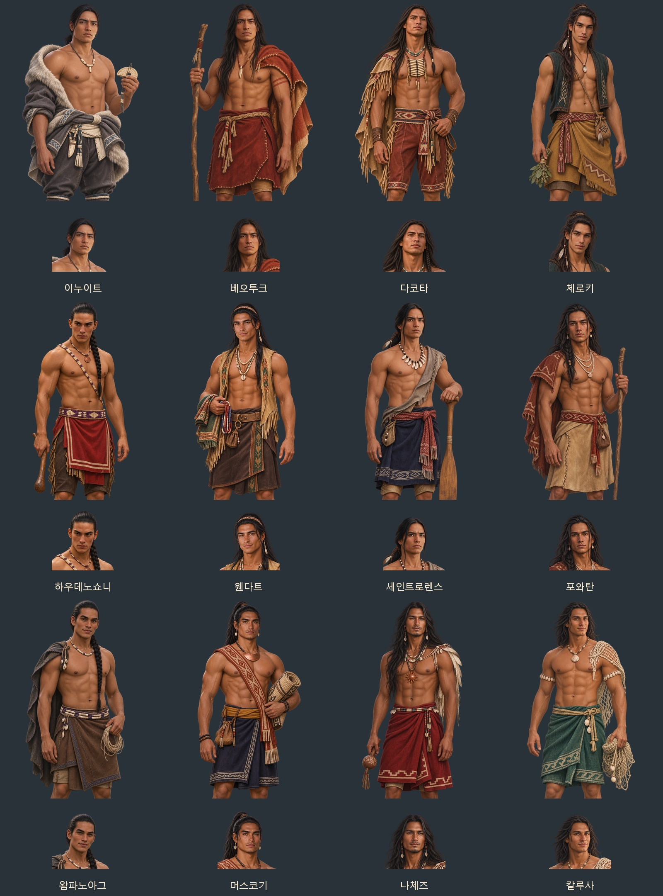
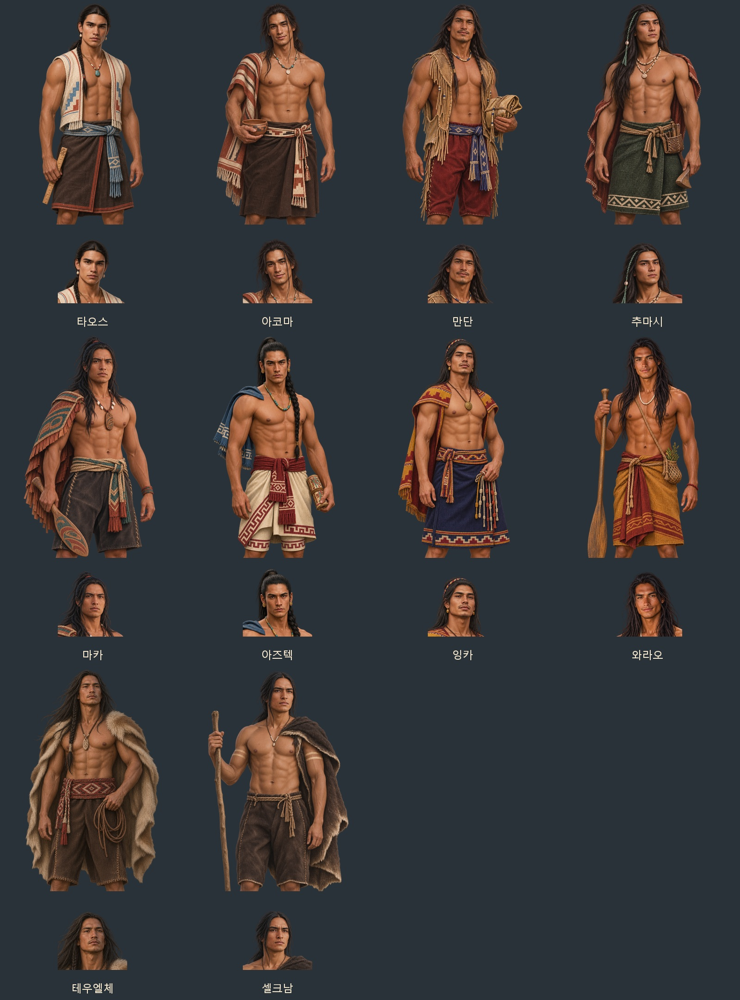

# 아메리카 민족 발견물 남성 후보 — 2026-11-06

첨부 참고 사진 14장의 얼굴 인상·머리 모양·체격을 바탕으로 성인 남성 원화 22종을 내장 ImageGen으로 제작했다. 북미 17·중미 1·남미 4종이며, 같은 민족의 기존 남성 이름 네 후보가 얼굴·무릎상 한 쌍을 함께 쓴다. 상체 노출·열린 조끼·짧은 어깨천·무릎 길이 허리옷으로 요청한 과감한 의상을 반영했다. 지역별 소재·직물·소품을 바탕으로 각색한 게임용 인물화다.

| 민족 | 발견물 ID | 지역 |
| --- | --- | --- |
| 이누이트 | `inuit` | 북미 |
| 베오투크 | `skraeling` | 북미 |
| 다코타 | `folk_dakota` | 북미 |
| 체로키 | `folk_cherokee` | 북미 |
| 하우데노쇼니 | `folk_haudenosaunee` | 북미 |
| 웬다트 | `folk_wendat` | 북미 |
| 세인트로렌스 | `folk_stlawrence` | 북미 |
| 포와탄 | `folk_powhatan` | 북미 |
| 왐파노아그 | `folk_wampanoag` | 북미 |
| 머스코기 | `folk_muscogee` | 북미 |
| 나체즈 | `folk_natchez` | 북미 |
| 칼루사 | `folk_calusa` | 북미 |
| 타오스 | `folk_taos` | 북미 |
| 아코마 | `folk_acoma` | 북미 |
| 만단 | `folk_mandan` | 북미 |
| 추마시 | `folk_chumash` | 북미 |
| 마카 | `folk_makah` | 북미 |
| 아즈텍 | `aztec` | 중미 |
| 잉카 | `inca` | 남미 |
| 와라오 | `blemmyes` | 남미 |
| 테우엘체 | `patagon` | 남미 |
| 셀크남 | `folk_selknam` | 남미 |





얼굴상은 **512×512 투명 WebP**, 무릎상은 **1024×1536 투명 WebP**다. 동일한 원화에서 얼굴을 추출해 얼굴·머리·복식이 일치한다. 다른 얼굴이나 몸통을 합성하지 않는다.

- [전체 ZIP](../../artifacts/folk-american-men-20261106/folk-american-men-20261106.zip): 게임용 WebP 44장·원본 PNG 22장·미리보기 2장·전체 지시문
- [원본 PNG](../../artifacts/folk-american-men-20261106/sources/)
- [참고 이미지 배정·전체 생성 지시문](../../tools/folk_american_men_20261106_prompts.json)
- 게임 파일: `images/portraits/mates/folk_<발견물ID>_m.webp`, `folk_<발견물ID>_m_half.webp`

`G.FOLK_JOIN[id].portraits.m`에 등록해 새 후보와 기존 저장에서 합류한 아메리카 남성이 같은 전용 얼굴·무릎상을 쓴다. 이름·능력·언어·품삯·합류 확률은 기존대로다. 여성과 다른 지역의 초상 설정을 보존한다.

```text
python tools/package_folk_american_men_20261106.py
python tools/portrait_faces.py --keys-file artifacts/folk-american-men-20261106/keys.json --merge
node tests/folk_american_men_20261106_smoke.cjs
```

규격·투명 알파 검사 결과는 `artifacts/folk-american-men-20261106/asset-checks.json`, 실제 대화창과 게임 연결 검사 결과는 같은 폴더의 `screenshots/`에 보관한다.

검증 완료: 22종·44장 모두 크기·투명 알파·얼굴 좌표 검사를 통과했다. 실제 `file://` 게임에서 새 남성 후보와 기존 저장 불러오기 뒤 전용 초상 선택, 여성·다른 민족 보존, 한 쪽 이미지가 없을 때의 대체를 확인했다. 얼굴상·무릎상 대화창 44장을 저장했으며 콘솔 오류는 0이다. 검사 브라우저는 종료했다.
