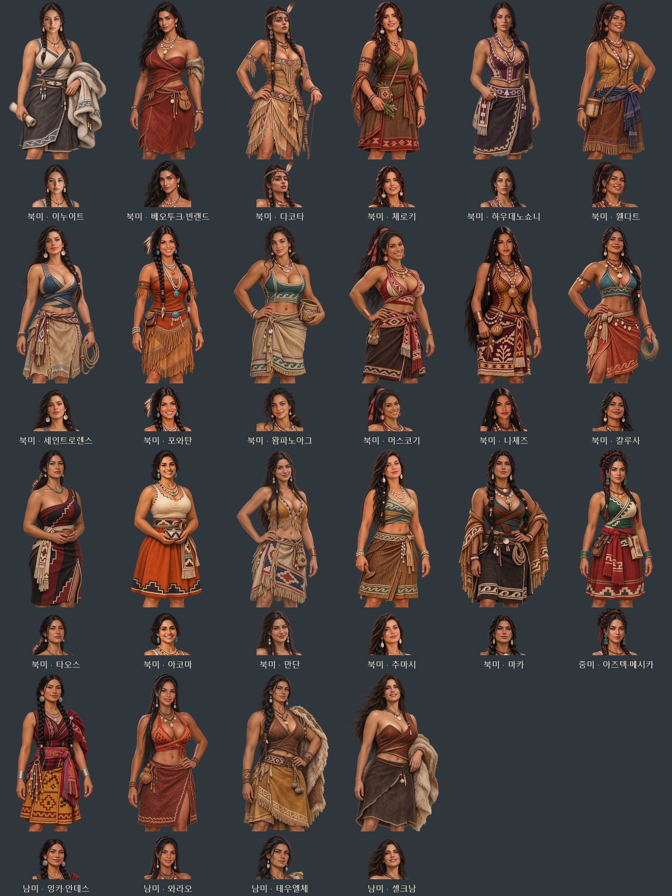

# 아메리카 민족 발견물 여성 후보 초상 — 2026-11-06

후속 첨부 얼굴 수정: 다코타·이누이트는 아래 v1 경로 대신 `_f_amer_v2.webp`·`_f_amer_v2_half.webp`를 사용한다. 미리보기와 44장 ZIP도 최신 두 얼굴을 반영했다. [두 인물 수정·발견물/아이템/교역품 누락 점검](american-face-revision-20261106.md).

첨부 사진 26장의 얼굴 인상·표정·머리·장신구와 복식 요소를 참고해 가상의 성인 여성 후보 22종을 내장 `image_gen`으로 제작했다. 큰 바스트의 풍성한 체형과 어깨·팔·목선·허리가 드러나는 의상을 반영했다. 지역별 직물·가죽·조개·구슬·금속 장식에 착안한 게임용 창작 의상이며 역사 복식 재현 자료는 아니다. 사진 속 사람의 민족을 판별하거나 실제 인물을 그대로 복제하지 않았다.

게임의 아메리카 민족 발견물 부하 후보 전체인 북미 17종·중미 1종·남미 4종을 포함한다. 같은 민족의 여성 이름 넷은 한 쌍을 함께 쓰므로 개별 이름마다 다른 얼굴을 만든 작업은 아니다.

| 지역 | 발견물 ID | 민족·후보 | 참고 이미지 |
|---|---|---|---|
| 북미 | inuit | 이누이트 | 1, 5 |
| 북미 | skraeling | 베오투크·빈랜드 | 2, 9 |
| 북미 | folk_dakota | 다코타 | 14, 15, 19 |
| 북미 | folk_cherokee | 체로키 | 3, 16 |
| 북미 | folk_haudenosaunee | 하우데노쇼니 | 8, 20 |
| 북미 | folk_wendat | 웬다트 | 7, 13 |
| 북미 | folk_stlawrence | 세인트로렌스 | 4, 24 |
| 북미 | folk_powhatan | 포와탄 | 11, 25 |
| 북미 | folk_wampanoag | 왐파노아그 | 6, 21 |
| 북미 | folk_muscogee | 머스코기 | 10, 23 |
| 북미 | folk_natchez | 나체즈 | 12, 18 |
| 북미 | folk_calusa | 칼루사 | 22, 26 |
| 북미 | folk_taos | 타오스 | 15, 20 |
| 북미 | folk_acoma | 아코마 | 1, 17 |
| 북미 | folk_mandan | 만단 | 2, 14 |
| 북미 | folk_chumash | 추마시 | 4, 16 |
| 북미 | folk_makah | 마카 | 5, 26 |
| 중미 | aztec | 아즈텍·메시카 | 8, 12, 23 |
| 남미 | inca | 잉카·안데스 | 7, 20, 25 |
| 남미 | blemmyes | 와라오 | 6, 21, 22 |
| 남미 | patagon | 테우엘체 | 9, 13, 24 |
| 남미 | folk_selknam | 셀크남 | 3, 18 |

파일은 `images/portraits/folk-join/<ID>_f_amer_v1.webp`(얼굴 448×448)와 `<ID>_f_amer_v1_half.webp`(무릎 1024×1536)이다. 투명 PNG 원본의 알파를 그대로 보존한 WebP 44장이며, 얼굴상은 동일 무릎 원화에서 추출해 얼굴·몸·의상이 일치한다. 무릎 구도로 발·신발은 포함하지 않는다.

- [그림 44장·미리보기·최종 지시문 ZIP](../../artifacts/folk-american-women-20261106/folk-american-women-20261106.zip)
- [최종 프롬프트·참고 파일 대응](../../tools/folk_american_women_20261106_prompts.json)
- [북미 미리보기](folk-american-women-20261106-north-preview.jpg) · [중미 미리보기](folk-american-women-20261106-central-preview.jpg) · [남미 미리보기](folk-american-women-20261106-south-preview.jpg)
- 원본 PNG: `artifacts/folk-american-women-20261106/sources/`
- 첨부 참고 원본 26장 보존: `artifacts/folk-american-women-20261106/references/`
- 생성 결과 대응: `artifacts/folk-american-women-20261106/generation-results.json`
- 저장·등록 도구: `tools/package_folk_american_women_20261106.py`
- 규격·투명도·알파 보존 검사: `artifacts/folk-american-women-20261106/asset-checks.json`

초기 생성에서 일부 요청이 도구에서 거절되거나 결과 없이 종료되어, 이누이트·체로키·포와탄·아코마·추마시·아즈텍·잉카는 성인 체형을 유지하면서 가슴선과 체형 강조를 완화한 최종 지시문으로 제작했다. 초기 지시문과 변경 사유도 프롬프트 파일에 보존했다. 기존 원화는 덮어쓰지 않고 새로운 이름으로 저장했다.

`js/data/folkjoin.js`의 민족별 여성 전용 목록에 연결했다. 기존 `G.FolkJoin.faces`·`fixPortrait` 경로가 신규 후보와 기존 저장의 해당 여성 동료에 같은 전용 한 쌍을 고른다. 얼굴상·무릎상이 모두 있어야 선택되고 한쪽이 빠지면 지역 공용 초상으로 돌아간다.

검증: `node tests/folk_american_women_20261106_smoke.cjs` 통과. 북미·중미·남미 전체 포함, 신규 후보의 이름·솜씨·모국어, 기존 저장 직렬화·복원, 얼굴·무릎상 선택, 44장 규격·해독·얼굴 좌표, 한쪽 누락 시 공용 대체, 남성·태평양 후보 보존, 실제 얼굴·무릎 대화창 44개를 확인했다. `pageerror`·`console.error`는 0이다. 전체 미리보기와 북미 다코타·중미 아즈텍·남미 잉카의 실제 무릎 대화창 캡처를 눈으로 확인했다. 44장 모두 투명 알파 보존 검사도 통과했다.

검증 결과와 화면은 `artifacts/folk-american-women-20261106/screenshots/`에 저장했다. 시험 브라우저는 `finally`에서 종료했으며 해당 시험의 브라우저·Node 과정이 남아 있지 않음을 확인했다.
