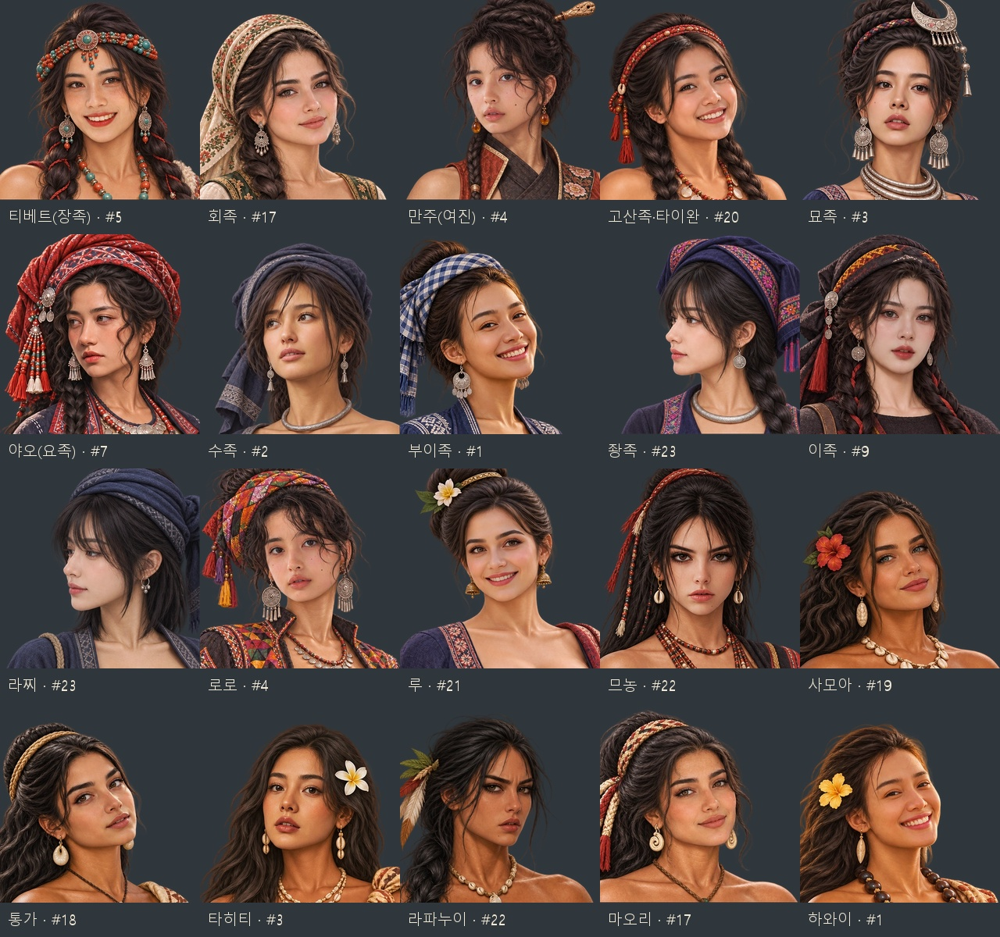

# 중국·동남아·폴리네시아 여성 얼굴·표정 교체 — 2026-11-07

이 문서는 v2 얼굴 편집 기록이다. 후속 요청에 따라 8종은 원 캡처를 기준으로 몸 전체와 머리·신체 비율을 다시 구성한 v3로 교체했다. [최신 8종 자세·얼굴 비교](folk-asia-pose-20261107.md).

20종의 기존 얼굴이 비슷하고 첨부 사진의 표정이 약했던 문제를 수정했다. 인물마다 **한 장의 주 참고 사진**을 정하고 눈·코·입·볼·턱 비율, 입꼬리, 시선과 고개 방향을 별도로 지정하여 내장 `image_gen`으로 다시 편집했다. 같은 PNG 원화에서 얼굴상과 무릎상을 내보내므로 두 그림은 같은 얼굴을 쓴다.

기존 민족별 복식·장신구·소품과 체형, 폴리네시아의 그을린 피부를 유지했다. 이족은 얼굴 편집 출력이 거절되어 마지막 제작 지시문에서 가슴을 쇄골까지 덮는 검정 안감과 양어깨 망토를 명시했다. 교복 또는 어려 보이는 참고 6·8·10~16은 사용하지 않았다. 안전한 14장의 사진을 20종에 배정했으므로 일부는 같은 주 참고를 쓴다. 민족 이름은 게임 캐릭터 배정이며, 사진 속 사람의 실제 민족을 판정한 것은 아니다.

[전체 참고·수정 전·수정 후 비교](folk-asia-pacific-faces-20261107-comparison.jpg) · [중국](folk-asia-pacific-faces-20261107-china-comparison.jpg) · [동남아](folk-asia-pacific-faces-20261107-seasia-comparison.jpg) · [폴리네시아](folk-asia-pacific-faces-20261107-polynesia-comparison.jpg) · [얼굴상·무릎상 40장 ZIP](../../artifacts/folk-asia-pacific-faces-20261107/folk-asia-pacific-faces-20261107.zip)

| 지역 | 민족 | 첨부 참고 번호 | 반영한 표정·방향 |
|---|---|---|---|
| 중국 | 티베트(장족) | 5 | 치아가 보이는 미소·살짝 기울인 고개 |
| 중국 | 회족 | 17 | 입을 다문 잔잔한 미소·오른쪽 3/4 |
| 중국 | 만주(여진) | 4 | 눈을 크게 뜬 시선·살짝 벌린 입 |
| 중국 | 고산족·타이완 | 20 | 볼이 올라가는 밝은 미소 |
| 중국 | 묘족 | 3 | 웃지 않는 호기심 어린 표정·살짝 벌린 입 |
| 중국 | 야오(요족) | 7 | 왼쪽을 보는 사색하는 표정·다문 입 |
| 중국 | 수족 | 2 | 왼쪽 위를 보는 시선·살짝 벌린 입 |
| 중국 | 부이족 | 1 | 뒤돌아보는 밝은 미소 |
| 중국 | 좡족 | 23 | 왼쪽 옆얼굴·다문 입 |
| 중국 | 이족 | 9 | 차분하고 진지한 시선·살짝 벌린 입 |
| 동남아 | 라찌 | 23 | 왼쪽 옆얼굴·차분한 표정 |
| 동남아 | 로로 | 4 | 기울인 고개·크게 뜬 눈 |
| 동남아 | 루 | 21 | 눈웃음과 치아가 보이는 미소 |
| 동남아 | 므농 | 22 | 정면의 진지한 시선·다문 입 |
| 폴리네시아 | 사모아 | 19 | 입을 다문 반미소 |
| 폴리네시아 | 통가 | 18 | 뒤돌아보는 시선·살짝 벌린 입 |
| 폴리네시아 | 타히티 | 3 | 턱을 든 호기심 어린 표정 |
| 폴리네시아 | 라파누이 | 22 | 강한 눈썹·진지한 옆 시선 |
| 폴리네시아 | 마오리 | 17 | 기울인 고개·부드러운 반미소 |
| 폴리네시아 | 하와이 | 1 | 뒤돌아보며 치아가 보이는 밝은 미소 |

제작 모드는 참고 얼굴을 기존 원화에 적용하는 편집이다. [실제 최종 프롬프트·참고 경로·이전 버전](../../tools/folk_asia_pacific_faces_20261107_prompts.json)에 20종을 기록했다. 원본 PNG는 `artifacts/folk-asia-pacific-faces-20261107/sources/`에 보관했다. 최신 파일은 `images/portraits/folk-join/<ID>_f_20261107_v2.webp`(얼굴 448×448)와 `_v2_half.webp`(무릎 1024×1536)다. 이전 v1 그림과 PNG는 보존했다.

게임의 민족별 여성 초상 선택과 기존 저장 복원에서 v2 한 쌍을 선택한다. `node tests/folk_asia_pacific_women_20261107_smoke.cjs` 통과. 새 후보 생성·이전 v1 저장 복원·민족·성별·초상 짝 누락 대체, 파일 40장의 규격·해독·얼굴 좌표와 실제 얼굴·무릎 대화창 40개를 확인했다. `pageerror`·`console.error` 0. PNG→WebP 투명 알파 보존 40장과 ZIP 무결성도 통과했다. 결과는 `artifacts/folk-asia-pacific-women-20261107/screenshots/checks.json`에 저장했다. 비교판 20종과 묘족·좡족·사모아의 실제 대화창을 눈으로 확인했다.
