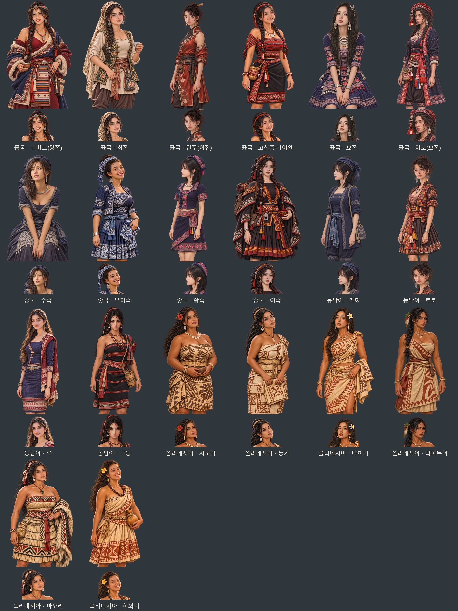

# 중국·동남아·폴리네시아 여성 민족 후보 — 2026-11-07

20종의 얼굴·표정을 v2로 편집한 뒤, 만주·묘족·야오·좡족·로로·라찌·수족·루 8종은 원 캡처를 기준으로 몸 방향·동작·머리와 신체 비율까지 다시 구성한 v3로 교체했다. [최신 8종 자세·얼굴 비교](folk-asia-pose-20261107.md) · [이전 v2 기록](folk-asia-pacific-faces-20261107.md). 아래 미리보기와 최초 제작 묶음도 최신 그림 40장을 담으며, 이전 파일은 보존했다.

새 중국 10종·동남아 4종·폴리네시아 4종과 기존 마오리·하와이 2종, 총 20종의 성인 여성 얼굴상·무릎상 40장을 내장 `image_gen`으로 제작했다. 첨부 중 성인으로 보이는 인물의 얼굴 분위기·머리·표정과 복식·장신구를 참고했으며, 어려 보이거나 교복 차림인 참고는 사용하지 않았다. 사용 참고 번호는 1~5·7·9·17~23이며, 6·8·10~16은 제외했다.

풍성한 성인 체형과 큰 바스트를 반영하고, 민족별 겹쳐 여미는 옷·짧은 겉옷·주름치마·쪽빛 천·나무껍질 천·식물섬유 직조의 구조를 살렸다. 전통 복식을 바탕으로 옷깃·소매·어깨·허리 드러남을 조정한 게임용 변형이다. 지역·시대의 정확한 복식 고증을 주장하는 재현 자료는 아니다. 폴리네시아 6종은 얼굴·목·팔·몸·무릎을 일관된 따뜻한 갈색·구릿빛으로 표현했다.

| 갈래 | 발견물 ID | 민족 | 주요 복식·장식 |
|---|---|---|---|
| 중국 | folk_tibet | 티베트(장족) | 겹쳐 여미는 추바, 줄무늬 앞치마, 터키석·산호 |
| 중국 | folk_hui | 회족 | 튜닉·자수 조끼·머릿수건, 넓힌 목선 |
| 중국 | folk_manchu | 만주(여진) | 옆여밈 승마복·비단 자수·허리띠 |
| 중국 | folk_gaoshan | 고산족·타이완 | 붉은색·검정 직조 랩과 조개·구슬 |
| 중국 | folk_miao | 묘족 | 짧은 쪽빛 자수 겉옷·주름치마·은 장식 |
| 중국 | folk_yao | 야오(요족) | 긴 쪽빛 겉옷·붉은 깃·머릿수건 |
| 중국 | folk_shui | 수족 | 쪽빛 옆여밈·앞치마 자수·은 목걸이 |
| 중국 | folk_buyei | 부이족 | 쪽빛·흰색 납염 무늬·체크 머릿수건 |
| 중국 | folk_zhuang | 좡족 | 쪽빛 짧은 겉옷·수구·자수 허리띠 |
| 중국 | folk_yi | 이족 | 검정·빨강·노랑 자수·망토·겹주름 치마 |
| 동남아 | folk_lachi | 라찌 | 간결한 쪽빛 긴 겉옷·바지·허리띠 |
| 동남아 | folk_lolo | 로로 | 다색 삼각 조각천 장식·짧은 겉옷 |
| 동남아 | folk_lue | 루 | 사선 여밈 짧은 상의·통치마·직물 |
| 동남아 | folk_mnong | 므농 | 검정·붉은색 직조 랩·씨앗 구슬·바구니 |
| 폴리네시아 | folk_samoa | 사모아 | 시아포 나무껍질 천·라바라바식 랩·조개 |
| 폴리네시아 | folk_tonga | 통가 | 응아투 나무껍질 천·직조 허리 장식 |
| 폴리네시아 | folk_tahiti | 타히티 | 타파 천을 어깨에 묶은 상의·랩 치마 |
| 폴리네시아 | folk_rapanui | 라파누이 | 마후테 나무껍질 천·섬유 허리끈 |
| 폴리네시아 | folk_maori | 마오리 | 식물섬유 직조·랩·망토·녹색 돌 목걸이 |
| 폴리네시아 | folk_hawaii | 하와이 | 카파 나무껍질 천·파우식 랩 치마·씨앗 목걸이 |

최신 파일은 `images/portraits/folk-join/<ID>_f_20261107_v2.webp` 또는 몸까지 다시 그린 8종의 `_v3.webp`(얼굴 448×448)와 같은 이름의 `_half.webp`(무릎 1024×1536)다. 같은 무릎 원화에서 얼굴을 추출하고 투명 알파를 보존했다. 같은 민족의 여성 이름 넷은 한 쌍을 함께 쓴다. 인물을 실제 사진 속 사람으로 식별하거나 사진 속 사람의 민족을 판정하지 않았다.

- [그림 40장·미리보기·최종 지시문·검사 ZIP](../../artifacts/folk-asia-pacific-women-20261107/folk-asia-pacific-women-20261107.zip)
- [중국 10종 미리보기](folk-asia-pacific-women-20261107-china-preview.jpg) · [동남아 4종](folk-asia-pacific-women-20261107-seasia-preview.jpg) · [폴리네시아 6종](folk-asia-pacific-women-20261107-polynesia-preview.jpg)
- [내장 ImageGen 최종 프롬프트·참고 파일](../../tools/folk_asia_pacific_women_20261107_prompts.json)
- 원본 PNG: `artifacts/folk-asia-pacific-women-20261107/sources/`
- 사용 참고 14장: `artifacts/folk-asia-pacific-women-20261107/references/`
- 보완 전 원본: `artifacts/folk-asia-pacific-women-20261107/revisions/`
- 저장·미리보기·등록: `tools/package_folk_asia_pacific_women_20261107.py`
- 규격·투명도·알파 검사: `artifacts/folk-asia-pacific-women-20261107/asset-checks.json`

회족·묘족·수족은 첫 출력의 옷깃이 높아 전통 옷 구조·표정·자수·소품을 보존하는 편집으로 보완했다. 좡족·타히티와 회족·묘족의 일부 시도는 도구에서 거절되어, 체형·노출 강조를 완화한 최종 지시문으로 제작했다. 선택된 최종 프롬프트와 보완 전 원본의 대응은 제작 명세에 남겼다.

`js/data/folkjoin.js`에 여성 전용 한 쌍을 등록했다. 기존 신규 후보 선택·저장 복원 경로가 같은 민족의 전용 그림을 사용하며, 한쪽 파일이 없으면 지역 공용 초상으로 돌아간다.

## 참고한 복식 자료

그림은 아래 소장품·기술 자료의 옷 형태와 직물 구분을 참고해 게임용으로 변형했다. 사진 자체를 복사해 사용하지 않았다.

- [Met: 묘족 여성 복식](https://www.metmuseum.org/art/collection/search/85275)
- [Met: 티베트 추바](https://www.metmuseum.org/art/collection/search/70360)
- [Te Papa: 사모아 시아포](https://collections.tepapa.govt.nz/topic/1954)
- [Te Papa: 통가 응아투](https://collections.tepapa.govt.nz/object/1346071)
- [Te Papa: 타히티 타파](https://collections.tepapa.govt.nz/topic/1956)
- [Te Papa: 마오리 직조](https://www.tepapa.govt.nz/digital-museum/explore-digital-museum/maori/maori-weaving)

검증: `node tests/folk_asia_pacific_women_20261107_smoke.cjs` 통과. 중국 10·동남아 4·폴리네시아 6종의 전체 포함, 기존 이름·솜씨·모국어, 신규 후보 선택, 직렬화·기존 저장 복원, 실제 얼굴·무릎상 파일 선택, 40장 규격·해독·얼굴 좌표, 한쪽 누락 대체, 남성과 기존 아메리카 후보 보존, 실제 얼굴/무릎 대화창 40개를 확인했다. `pageerror`·`console.error` 0. 투명 알파 보존 40장·ZIP 무결성 검사도 통과했다. 전체 점검판과 티베트·로로·타히티의 실제 무릎 대화창을 눈으로 확인했다.

실행 검사와 화면은 `artifacts/folk-asia-pacific-women-20261107/screenshots/`에 기록했다. 시험 브라우저는 `finally`에서 종료했으며 해당 검사 과정이 남아 있지 않음을 확인했다.
