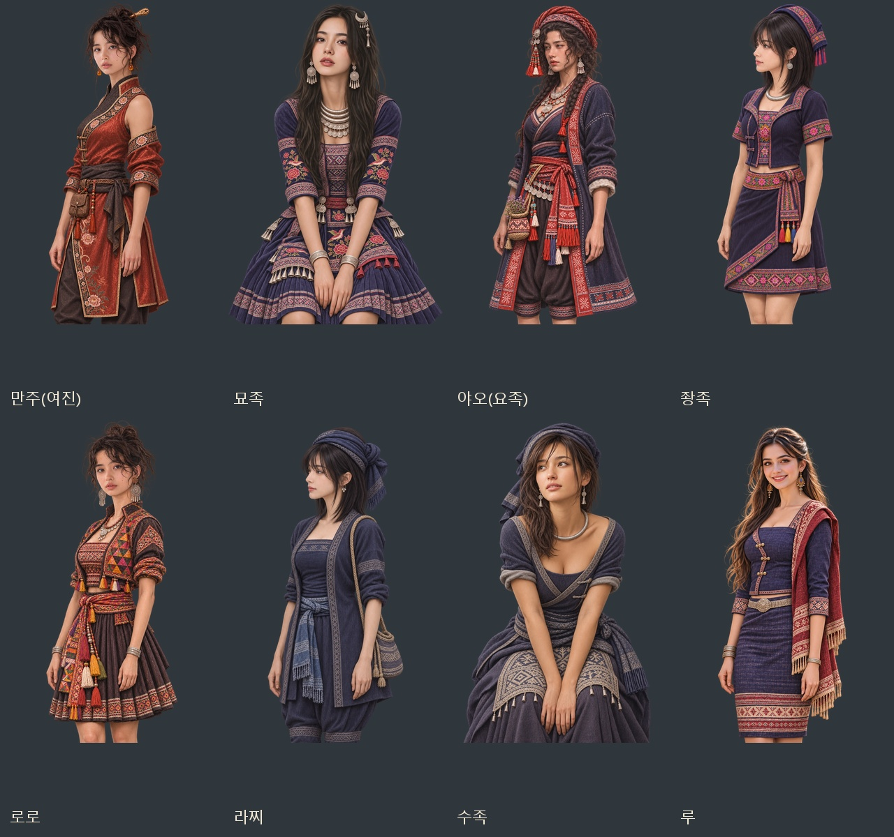

# 원 캡처 자세·얼굴·신체 비율 재제작 — 2026-11-07

만주·묘족·야오·좡족·로로·라찌·수족·루 8종의 얼굴상·무릎상 16장을 다시 제작했다. 기존 몸에 얼굴을 끼워 맞추던 방식에서 벗어나, **원 캡처를 편집 기준으로 삼고 기존 원화에서는 민족 의상만 참고**했다. 원 캡처의 얼굴 방향·표정·시선·고개 기울기와 어깨·상체·팔 동작을 연결해 무릎까지 다시 구성했다. 사진에서 보이지 않는 팔·다리는 보이는 자세를 바탕으로 자연스럽게 이어 그렸다.

머리가 몸에 비해 크게 보이지 않도록 성인 머리·목·어깨 비율과 전체 실루엣을 함께 조정했다. 균형 잡힌 체형을 기준으로 하되, 원래 얼굴의 눈·코·입 비율을 미형이라는 이유로 일괄 교체하지 않도록 지시했다. 두 원 캡처를 공유하던 만주/로로, 좡족/라찌는 각각 같은 사진의 방향을 따르며 의상으로 구분한다.

[원 캡처·이전 v2·몸 재제작 v3 자세 비교](folk-asia-pose-20261107-pose-comparison.jpg) · [얼굴 확대 비교](folk-asia-pose-20261107-face-comparison.jpg) · [얼굴상·무릎상 16장 ZIP](../../artifacts/folk-asia-pose-20261107/folk-asia-pose-20261107.zip)

| 첨부한 수정 대상 순서 | 민족 | 최초 원 캡처 | 다시 구성한 자세 |
|---|---|---|---|
| 1 | 만주(여진) | 4 | 왼쪽으로 향한 상체·오른쪽의 가까운 어깨·카메라를 돌아보는 얼굴 |
| 2 | 묘족 | 3 | 앉아서 앞으로 숙인 상체·아래로 내려오는 팔·원본의 살짝 벌린 입 |
| 3 | 야오(요족) | 7 | 왼쪽 3/4 상체·어깨·허리와 같은 방향의 얼굴·사색하는 옆 시선 |
| 4 | 좡족 | 23 | 왼쪽 옆얼굴에 맞춘 상체·골반·무릎·어깨 길이의 원본 머리 |
| 5 | 로로 | 4 | 카메라 쪽으로 돌아보는 얼굴과 사선 어깨·상체·자연스러운 팔 |
| 6 | 라찌 | 23 | 왼쪽 옆얼굴과 같은 쪽으로 향한 상체·팔·다리 |
| 7 | 수족 | 2 | 앉아서 앞으로 숙인 몸·무릎 사이로 내려온 팔·왼쪽 위 시선 |
| 8 | 루 | 21 | 원본의 사선 몸 방향·양옆으로 내려온 팔·긴 반묶음 머리·미소 |

내장 `image_gen` 편집 모드로 각 원 캡처와 의상 참고 두 장을 전달했다. [실제 프롬프트·참고 경로·이전 버전](../../tools/folk_asia_pose_20261107_prompts.json)을 보관했다. 원 캡처·이번 첨부 의상 참고·투명 원본 PNG는 `artifacts/folk-asia-pose-20261107/`에 저장했다.

8종은 `images/portraits/folk-join/<ID>_f_20261107_v3.webp`(얼굴 448×448)와 `_v3_half.webp`(무릎 1024×1536)를 사용한다. 같은 PNG 원화에서 얼굴상을 추출한다. 다른 12종은 기존 v2를 유지하고 v1/v2 파일은 보존한다. 민족 ID·이름·솜씨·성별·저장 형식은 유지한다.

검증: `node tests/folk_asia_pacific_women_20261107_smoke.cjs` 통과. 20종 최신 40장의 새 후보 생성·저장 복원·민족/성별 선택·한쪽 누락 대체·크기·해독·얼굴 좌표 및 실제 대화창 40개를 확인했다. 특히 수정 8종은 이전 v2 저장에서 v3 한 쌍으로 바뀌는 것을 확인했다. `pageerror`·`console.error` 0. PNG→WebP 알파 보존 16장, 다른 12종 v2 선택 유지, 기존 v2 파일 보존, 원 캡처·의상 참고·원본 보관, ZIP 16장 무결성 검사를 통과했다. 자세/얼굴 비교판과 만주·묘족·수족의 실제 무릎상 대화창을 눈으로 확인했다. 테스트 브라우저는 `finally`에서 닫았다.
