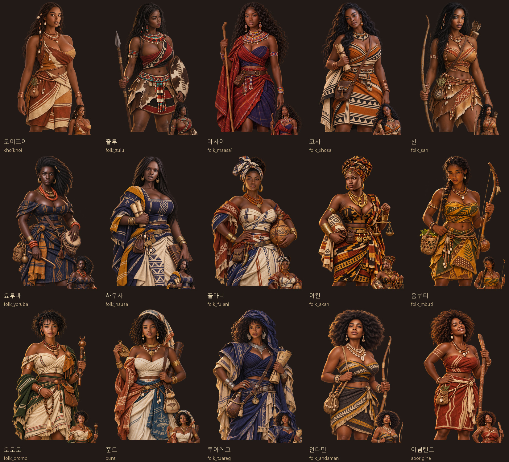

# 흑인계 민족 발견물 여성 동료 초상 15종 (2026-11-06)

첨부한 15장의 인물 사진은 얼굴형·헤어·표정·피부색 참고로만 사용하고, 실존 인물의 정체성·현대 의상·배경은 복제하지 않았다. 모든 캐릭터는 25세 이상의 성인으로 새로 설계했다.

- 대상: 코이코이, 줄루, 마사이, 코사, 산, 요루바, 하우사, 풀라니, 아칸, 음부티, 오로모, 푼트, 투아레그, 안다만, 아넘랜드
- 얼굴상: 512×512 WebP, 투명 배경
- 무릎상: 1024×1536 WebP, 투명 배경
- 화풍: 기존 게임 초상과 맞춘 반실사 역사 모험 회화
- 복식: 문화권별 직물·장신구·역할 소품을 구분했으며, 대담한 실루엣이지만 불투명 천으로 완전히 고정·가림
- 원본 보관: `artifacts/folk-black-women-20261106/sources/`
- 생성 명세: `tools/folk_black_women_20261106_prompts.json`
- 패키징: `tools/package_folk_black_women_20261106.py`

