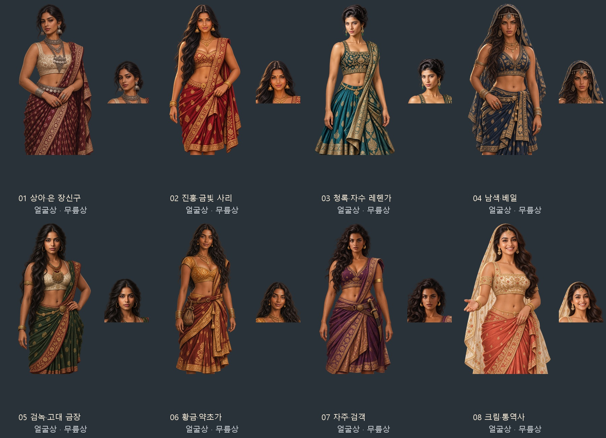

# 인도 출신 여성 항해사 후보 8종

첨부 참고 이미지의 얼굴형·피부톤·머리·장신구를 바탕으로 성인 인도 여성 후보 8명의 원화를 내장 ImageGen으로 제작했다. 사용자 확인에 따라 인도 출신 여성 항해사 후보에 연결한다. 여성마다 같은 원화에서 얼굴상을 추출하여 얼굴과 무릎상의 머리·의상·장신구를 일치시켰다.

풍만한 성인 체형, 어깨와 복부를 드러내는 촐리·사리·레헨가, 은과 금 장신구를 사용했다. 역사풍 게임 의상으로 각색했으며 정확한 시대 복식 복원은 아니다. 참고 사진을 수정한 결과물이 아니라 참고를 조합한 새 인물화다. 첨부 14·18번은 참고로 사용하지 않았다. 초기 생성에서 안전 필터 차단이 있어 체형과 목선의 강조를 줄인 복식 중심 지시문으로 완성했다.

| 번호 | 의상·인상 | 참고 번호 |
| --- | --- | --- |
| 01 | 상아 촐리·은 장신구·묶은 머리 | 1·2 |
| 02 | 진홍 사리·금 장신구·긴 웨이브 | 3·4 |
| 03 | 청록 레헨가·자수·올린 머리 | 5·7 |
| 04 | 남색 베일·이마 장식·헤이즐 눈 | 8·9 |
| 05 | 검녹 사리·상아 촐리·큰 금 펜던트 | 10·11 |
| 06 | 황금 촐리·곱슬머리·허리 주머니 | 12·13 |
| 07 | 자주 사리·검집·당당한 표정 | 15·16 |
| 08 | 크림 베일·산호색 사리·밝은 미소 | 17·19 |

얼굴상은 512×512, 무릎상은 1024×1536의 투명 WebP다. 게임 파일은 `images/portraits/folk-indian-women/01.webp`부터 `08.webp`, 무릎상은 같은 번호의 `_half.webp`다. 원본 PNG는 `artifacts/folk-indian-women-20261106/sources/`에 보관했다.

`G.WANDER_PORTRAITS.in.f`에 8종을 등록한다. 기존 얼굴 선택과 저장 교정 경로를 이용해 새 후보·기존 인도 여성 항해사·인도 지역 여성 후보가 같은 얼굴상과 무릎상 한 쌍을 쓴다. 기존 인도 남성 전용 목록도 보존한다.

- [게임용 16장·미리보기·지시문 ZIP](../../artifacts/folk-indian-women-20261106/folk-indian-women-20261106.zip)
- [최초·최종 지시문과 참고 경로](../../tools/folk_indian_women_20261106_prompts.json)
- [규격·투명 알파 검사](../../artifacts/folk-indian-women-20261106/asset-checks.json)
- [실제 대화 화면](../../artifacts/folk-indian-women-20261106/dialog-preview.png)
- [실행 검사 결과](../../artifacts/folk-indian-women-20261106/runtime-checks.json)

다시 저장·등록: `python tools/package_folk_indian_women_20261106.py`

얼굴 좌표: `python tools/portrait_faces.py --prefix portraits/folk-indian-women --merge`

실행 검사: `node tests/indian_women_portraits_20261106_smoke.cjs`
