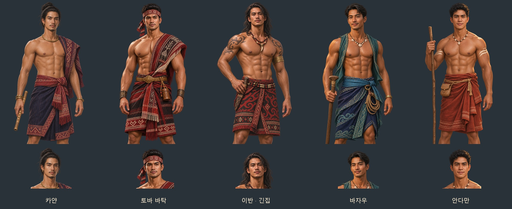

# 동남아 민족 발견물 남성 후보 — 2026-11-06

첨부 참고 사진 17장의 얼굴 인상·머리 모양·체격과 직물·장신구를 바탕으로 성인 남성 원화 5종을 내장 ImageGen으로 제작했다. 민족마다 기존 남성 이름 네 후보가 한 쌍을 함께 쓴다. 게임용 반실사 인물화이며, 상체 노출·열린 조끼·한쪽 어깨 직물·무릎 길이 허리옷으로 사용자가 요청한 과감한 의상을 반영했다. 복식은 민족별 직물과 소품에서 착안한 게임용 각색이다.

| 민족 | 발견물 ID | 얼굴·복식·소품 |
| --- | --- | --- |
| 카얀 | `padaung` | 올린 장발·가는 수염·붉은 어깨 직물·남색 허리옷·대나무 피리 |
| 토바 바탁 | `cannibal` | 짧은 머리·강한 턱선·울로스풍 붉고 검은 직물·약통 |
| 이반·긴집 | `orangutan` | 흐르는 장발·어깨 문신·붉은 허리옷·칼집 |
| 바자우 | `folk_bajau` | 부드러운 짧은 머리·열린 청록 조끼·조개 목걸이·노와 밧줄 |
| 안다만 | `folk_andaman` | 짧은 곱슬머리·간결한 조개 장신구·적갈색 허리옷·나무 지팡이 |



얼굴상은 **512×512 투명 WebP**, 무릎상은 **1024×1536 투명 WebP**다. 한 사람의 원화에서 얼굴상을 잘라 얼굴·머리·의상이 일치한다. 무릎상에 다른 몸이나 얼굴을 합성하지 않았다.

- [전체 파일 ZIP](../../artifacts/folk-seasia-men-20261106/folk-seasia-men-20261106.zip): 게임용 WebP 10장·원본 PNG 5장·미리보기·전체 지시문
- [원본 PNG](../../artifacts/folk-seasia-men-20261106/sources/)
- [참고 이미지 배정·전체 생성 지시문](../../tools/folk_seasia_men_20261106_prompts.json)
- 게임 파일: `images/portraits/mates/folk_<발견물ID>_m.webp`, `folk_<발견물ID>_m_half.webp`

`G.FOLK_JOIN[id].portraits.m`에 등록해 새 후보와 기존 저장에서 합류한 남성이 같은 전용 얼굴·무릎상을 사용한다. 여성이나 다른 민족의 초상은 이 남성 그림을 쓰지 않는다. 후보 이름·능력·언어·품삯·합류 확률은 유지한다.

제작·검사 명령:

```text
python tools/package_folk_seasia_men_20261106.py
python tools/portrait_faces.py --keys-file artifacts/folk-seasia-men-20261106/keys.json --merge
node tests/folk_seasia_men_20261106_smoke.cjs
```

파일 규격·투명 알파 검사 결과는 `artifacts/folk-seasia-men-20261106/asset-checks.json`, 실제 대화창 화면과 게임 연결 검사 결과는 같은 폴더의 `screenshots/`에 보관한다.

검증 완료: 5종·10장 모두 규격·알파·얼굴 좌표 검사를 통과했다. 실제 `file://` 게임에서 새 후보 생성, 기존 저장 불러오기 뒤 전용 초상 선택, 다른 성별·민족 보존, 한 쪽 이미지 누락 시 대체를 확인했다. 얼굴상·무릎상 대화창 10장을 저장했으며 콘솔 오류는 0이다. 검사 브라우저는 종료했다.
