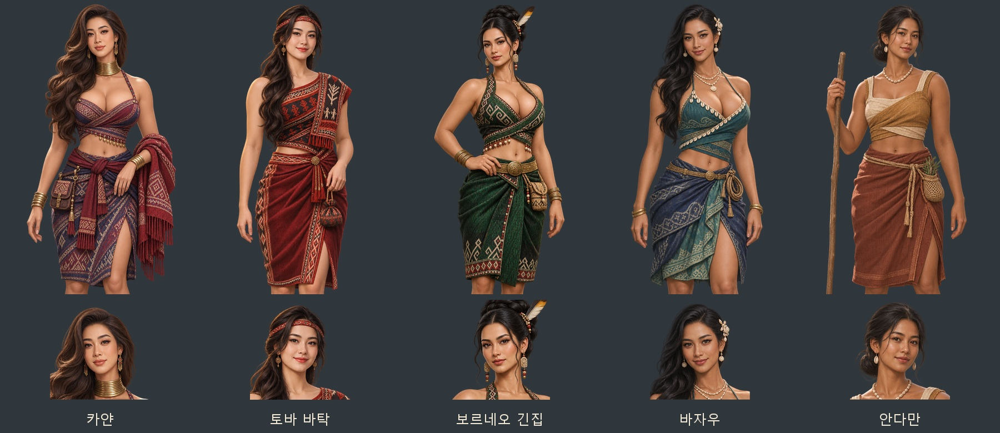

# 동남아 민족 발견물 여성 후보 초상 — 2026-11-06

첨부 사진 21장의 얼굴 인상·머리·표정과 의상 요소를 참고해 가상의 성인 여성 후보 5종을 제작했다. 풍성한 체형과 어깨·허리선이 드러나는 직물 의상을 사용한다. 지역 장식에서 착안한 게임용 창작 의상이며 역사 복식의 재현 자료는 아니다.

| 발견물 ID | 후보 | 참고 이미지 | 디자인 |
|---|---|---|---|
| padaung | 카얀 | 1~4 | 긴 웨이브 머리, 자주·남색 직물, 놋쇠 목고리 |
| cannibal | 토바 바탁 | 9~12 | 붉은 머리띠, 검정·붉은 기하무늬 직물, 약초 주머니 |
| orangutan | 보르네오 긴집 | 13~17 | 올림머리, 녹색 직물, 구슬·깃털 장식 |
| folk_bajau | 바자우 | 18~21 | 긴 검정 머리, 청록·남색 직물, 조개·진주, 뱃줄 |
| folk_andaman | 안다만 | 5~8 | 낮은 묶음머리, 황토·흙빛 직물, 조개, 나무 지팡이 |

각 민족의 여성 이름 네 개가 한 쌍을 공용한다. 실제 사진 속 인물을 그대로 복제하지 않고 인상을 참고했다. 오세아니아 후보와 남성 후보의 선택은 해당 자료를 따른다.

파일은 `images/portraits/folk-join/<ID>_f_v1.webp`와 `<ID>_f_v1_half.webp`이다. 얼굴상은 448×448, 무릎상은 1024×1536 투명 WebP다. 무릎 원화에서 얼굴을 잘라 얼굴·목·의상의 접합 흔적을 만들지 않는다. 무릎 구도로 발·신발은 표시하지 않는다.

- [그림 10장·미리보기·최종 지시문 ZIP](../../artifacts/folk-seasia-women-20261106/folk-seasia-women-20261106.zip)
- [내장 image_gen 최종 프롬프트·참고 파일 대응](../../tools/folk_seasia_women_20261106_prompts.json)
- 원본 PNG: `artifacts/folk-seasia-women-20261106/sources/`
- 저장·등록 도구: `tools/package_folk_seasia_women_20261106.py`
- 파일 검사: `artifacts/folk-seasia-women-20261106/asset-checks.json`

내장 image_gen으로 민족별 원화 한 장씩 생성했다. 바탁·안다만은 초기 출력이 도구에서 거절되어 가슴선 표현을 완화한 최종 프롬프트로 제작했다. 기존 원화는 덮어쓰지 않았다.

`js/data/folkjoin.js`의 여성 전용 목록에 등록했고, 민족·성별 전용 목록을 우선하는 기존 선택·복원 경로를 사용한다. 전용 얼굴상과 무릎상이 모두 있어야 선택되므로 한쪽이 없으면 공용 후보로 돌아간다. 옛 저장은 불러올 때 같은 민족의 여성 전용 한 쌍으로 복원된다. 얼굴 좌표는 `tools/portrait_faces.py --prefix portraits/folk-join --merge`로 10장을 측정했다.

검증: `node tests/folk_seasia_women_20261106_smoke.cjs` 통과. 새 후보·기존 이름/솜씨/모국어·직렬화/복원·이미지 규격/해독·얼굴 좌표·한쪽 누락 대체·남성/태평양 후보 보존·실제 얼굴/무릎 대화창 10개를 확인했다. pageerror·console.error 0. 시험 브라우저는 종료했다. 화면과 기록은 `artifacts/folk-seasia-women-20261106/screenshots/`에 있다.
