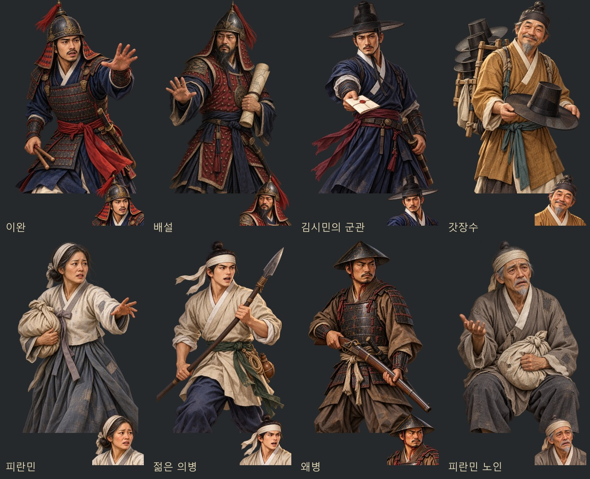
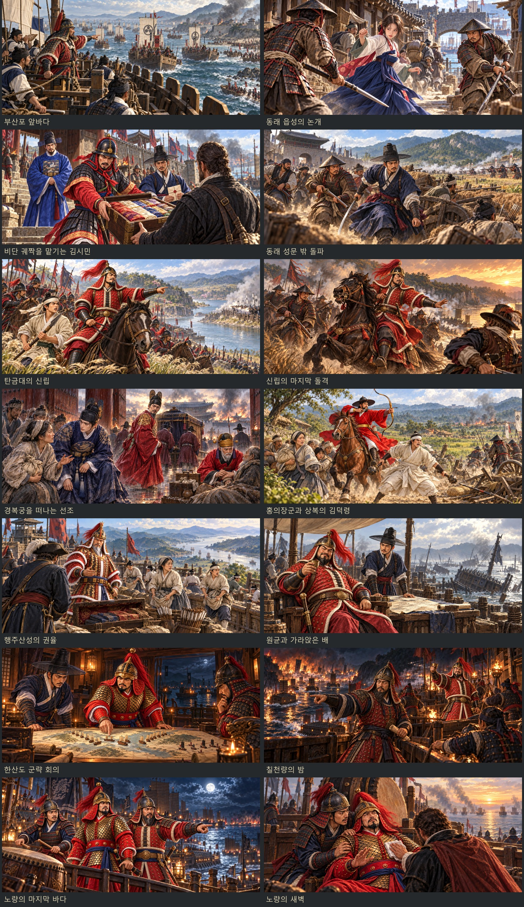

# 임진왜란 누락 초상과 이벤트샷 — 2026-10-31

내장 ImageGen으로 누락 화자 8명의 얼굴상·무릎상 16장을 먼저 제작하고, 완성된 인물화를 참조해 이벤트샷 14장을 제작했다. 얼굴과 표정, 자세를 구분한 채 기존 역사 모험 게임의 회화풍을 유지했다. 이벤트샷의 이순신은 젊은 얼굴과 짧은 검은 수염, 붉은색·금색 갑옷을 사용한다.

## 누락 인물

| 인물 | 그림 키 (`portraits/history/` 아래) |
| --- | --- |
| 이완 | `yiwan` |
| 배설 | `baeseol` |
| 김시민의 군관 | `imjin_officer` |
| 갓장수 | `imjin_peddler` |
| 피란민 | `imjin_refugee` |
| 젊은 의병 | `imjin_youth` |
| 왜병 | `imjin_soldier` |
| 피란민 노인 | `imjin_elder` |

각 키는 1024×1024 얼굴상, `_half` 접미사는 1024×1536 무릎상이다. 모두 투명 배경 WebP이며, 인물 데이터와 실제 대사의 화자를 연결했다. 신규 동료는 추가하지 않았다. 여성 피란민과 노인 피란민의 대사에는 각각 별도의 초상을 사용한다.

## 이벤트샷

1881×836 WebP를 `images/legend-events/`에 저장하고 기존 `withPic` 호출에 연결했다.

| 장면 | 파일 이름 |
| --- | --- |
| 부산포 앞바다 | `imjin_busan.webp` |
| 동래 읍성의 논개 | `imjin_dongnae.webp` |
| 비단 궤짝을 맡기는 김시민 | `imjin_kimsimin.webp` |
| 동래 성문 밖 돌파 | `imjin_breakout.webp` |
| 탄금대의 신립 | `imjin_tangeum.webp` |
| 신립의 마지막 돌격 | `imjin_sinrip.webp` |
| 경복궁을 떠나는 선조 | `imjin_flight.webp` |
| 홍의장군과 상복의 김덕령 | `imjin_gwak.webp` |
| 행주산성의 권율 | `imjin_haengju.webp` |
| 원균과 가라앉은 배 | `imjin_wongyun.webp` |
| 한산도 군략 회의 | `imjin_hansan_council.webp` |
| 칠천량의 밤 | `imjin_chil.webp` |
| 노량의 마지막 바다 | `imjin_noryang.webp` |
| 노량의 새벽 | `imjin_yisunsin.webp` |

## 원본과 재현

- 지시문·참조 인물·원본·내보낸 파일 목록: `tools/imjin_missing_art_20261031.json`
- 생성 원본 PNG: `artifacts/imjin-missing-art-20261031/sources/`
- 장면 제작에 사용한 인물 참조 PNG: `artifacts/imjin-missing-art-20261031/references/`
- 변환·등록·미리보기 재생성: `node tools/package_imjin_missing_art.js` (sharp 필요)
- 얼굴 좌표: `tools/portrait_faces.py --merge`로 신규 16개 키만 갱신

생성 원본의 투명도를 유지하며 형식·크기만 변환했다. 이벤트 장면에서는 기존 장면 대화 모드를 사용해 무릎상이 그림을 가리지 않도록 한다.

## 검증

- `node tests/imjin_missing_art_smoke.js`: 8명 실제 화자 선택, 16장 해독·규격·투명도·눈/입 좌표, 14장 장면 해독·표시·종료 정리 통과. 대화·장면 스크린샷 22장, 콘솔 오류 0.
- `node tests/imjin_smoke.js`: 동래부터 노량까지 진행·분기, 실제 입항과 해전 연결 통과. 콘솔 오류 0.
- `node tests/imjin_portraits_smoke.js`: 기존 주요 인물 15명의 초상 30장과 대화 화면도 재확인. 콘솔 오류 0.
- `node --check`로 변경한 실행 코드·변환 도구·검증 스크립트 문법 확인, `git diff --check` 통과.
- 실제 화면과 검증 결과: `artifacts/imjin-missing-art-20261031/screenshots/`.
