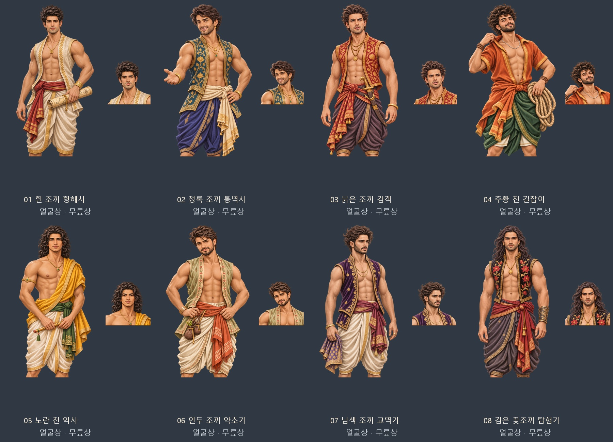

# 첨부 참고 인도계 일반 남성 후보 8명

사용자가 최종 지정한 범위는 「기존 인도계 일반 부하 후보에 연결」이다. 첨부 사진 16장의 얼굴형·헤어·수염·표정을 두 장씩 참고해 성인 남성 8명을 제작했다. 최종 화풍 지시 「게임 속 마녀들과 후견인 플레이어 기준으로 맞춰줘」에 따라, 실제 게임에 등록된 플레이어 2종·마녀·후견인 원화를 직접 참고해 부드러운 명암과 섬세한 머리카락·자수를 가진 반실사 2D 게임 일러스트로 수정했다. 사진 같은 피부 표현과 굵은 외곽선·각진 명암을 줄이고, 열린 조끼·맨어깨 드레이프·깊게 열린 면 상의와 장신구를 유지했다.

| 번호 | 디자인 | 참고 사진 번호 |
| --- | --- | --- |
| 01 | 흰 조끼 항해사 | 1, 12 |
| 02 | 청록 조끼 통역사 | 2, 4 |
| 03 | 붉은 조끼 검객 | 3, 13 |
| 04 | 주황 천 길잡이 | 5, 6 |
| 05 | 노란 천 악사 | 7, 8 |
| 06 | 연두 조끼 약초가 | 9, 10 |
| 07 | 남색 조끼 교역가 | 11, 14 |
| 08 | 검은 꽃조끼 탐험가 | 15, 16 |

디자인 이름은 검수용이며 실제 후보의 이름·능력·직업은 기존 생성 규칙을 따른다. 의상은 게임 시대에 어울리게 각색한 창작 복식이다.

- 내장 `image_gen`으로 한 명씩 생성하고, 같은 도구로 화풍을 다시 그렸다. CLI/API 대체 경로는 사용하지 않았다.
- 직접 참조한 화풍 원화: `portraits/player/navigator_white.png`, `portraits/player/charismatic_admiral.png`, `portraits/witches/witch_07_half.png`, `portraits/sponsors/in_vakil_half.webp`. [같은 크기 얼굴 비교](../../artifacts/indian-men-illustrated-20261106/style-comparison.jpg).
- 최종 그림: `images/portraits/mates/indian-men/01.webp`부터 `08.webp`까지 얼굴상 512×512, 같은 경로의 `_half.webp` 무릎상 1024×1536. 배경은 실제 알파 투명이다.
- 얼굴상은 해당 무릎상의 얼굴을 잘라 만들고, 플레이어 초상처럼 머리 전체와 어깨를 위한 여백을 확보했다. 얼굴과 다른 몸을 합성하지 않았다.
- 원본 PNG 8장: `artifacts/indian-men-illustrated-20261106/sources/`.
- 이전 굵은 선·색면 버전은 같은 아티팩트 폴더의 `previous-graphic-style/`에 보존했다.
- [전체 ZIP](../../artifacts/indian-men-illustrated-20261106/indian-men-illustrated-20261106.zip), [최초 생성·화풍 수정 지시문 전체](../../tools/folk_indian_men_20261106_prompts.json).

`G.WANDER_PORTRAITS.in.m`에 새 8종을 지정했다. 인도 양식(`in`) 남성 일반 후보는 갈래와 관계없이 이 묶음에서 얼굴을 고르고, 옛 저장의 떠돌이·고장 후보도 같은 한 쌍으로 교정한다. 새 민족 발견물이나 이름 있는 사건 동료는 추가하지 않았다. 여성 후보와 다른 지역의 선택은 기존 규칙을 따른다.

검증 도구: `python tools/package_indian_men_20261106.py`, `python tools/portrait_faces.py --prefix portraits/mates/indian-men --merge`, `node tests/indian_men_portraits_20261106_smoke.cjs`, `node tests/wanderer_portrait_mapping_smoke.js`. 규격·투명도 기록은 `artifacts/indian-men-illustrated-20261106/asset-checks.json`, 브라우저 검증은 `runtime-checks.json`, 실제 대화 화면은 `dialog-preview.png`에 저장한다.

결과: 새 그림 16장 규격·투명도·얼굴 좌표와 8쌍의 실제 로딩·대화 연결, 인도 남성 전 갈래 선택, 고장 후보 32명 생성 가운데 남성 전원의 새 그림 배정, 옛 고장 후보 교정·반복 안정성 검사 통과. 기존 철새 후보 196쌍의 회귀 검사에서 누락 0쌍. 브라우저 `pageerror`·`console.error` 0건이며 검사 브라우저는 종료했다.
