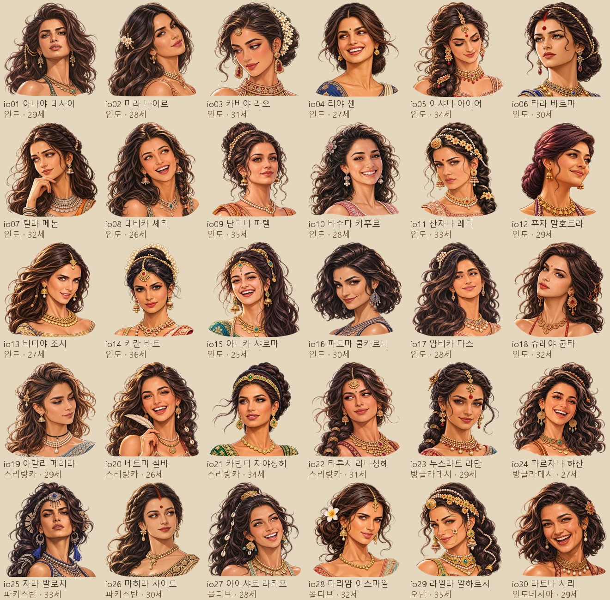
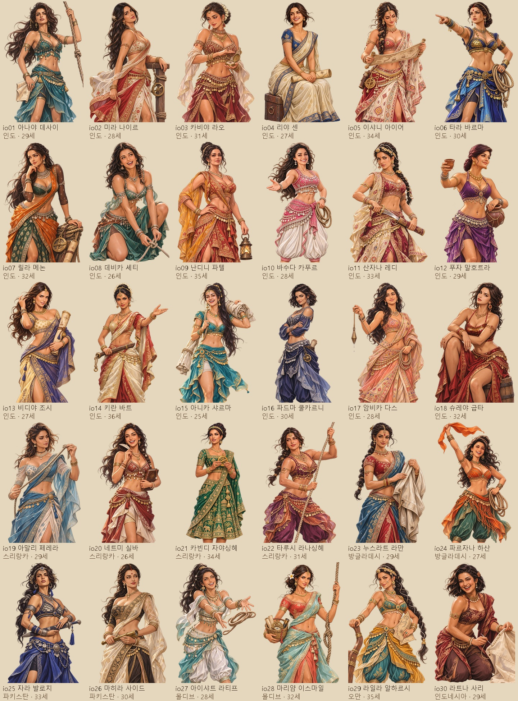

# 인도양 여성 항해사 30명의 얼굴상·무릎상

2026-11-16 제작 시작, 2026-11-17 게임 연결과 검증 완료. 내장 ImageGen으로 성인 여성 30명의 무릎상과 같은 인물의 얼굴상을 각각 생성했다. 얼굴·손·머리·옷을 같은 게임 회화풍으로 맞추고, 활짝 웃는 표정·눈웃음·잔잔한 미소·자신감 있는 시선을 섞었다.

처음 첨부한 사진은 얼굴과 표정의 참고이며, 뒤에 첨부한 복식 사진은 옷의 형태만 참고했다. 동전 장식 상의, 허리띠, 하렘 바지, 트임 치마, 사리의 주름, 자수와 얇은 겉소매를 인물마다 나눴다. 주된 가슴·골반 부분은 불투명한 천으로 표현했다. 젖은 천의 반짝임, 작은 땀방울과 소금 자국, 바람에 흩날리는 머리로 항해 뒤의 분위기를 냈다. 밧줄 당기기·신호·측심·돛 수선·일지 쓰기·물 건네기·휴식 등 서로 다른 동작을 쓴다.

## 구성과 실제 등장

- 인도 18명, 스리랑카 4명, 방글라데시·파키스탄·몰디브 각 2명, 오만·인도네시아 각 1명. 모두 25~36세 창작 성인이다.
- 인물 ID는 `monsoon_io01~30`, 그림 열쇠는 `portraits/mates/indian-ocean-windsalt/io01~30`이다.
- 특기 3~6개와 언어 3~5개를 주고, 각 인물의 능력치·급료·설명·고향·활동 항구를 등록했다.
- 인도항로가 발견된 날부터 5년마다 최대 3명씩, 40년마다 다시 추첨한다. 한 주기에는 8차례·최대 24명이 등장한다. 현재 동료·혼인 중인 인물·퇴장한 인물은 제외한다.
- 인도 해안·콜롬보·벵골만·무스카트·아체의 기존 항구를 쓴다. 몰디브 항구가 없는 현재 지도에서는 몰디브 출신을 유지하면서 콜롬보·코친·캘리컷에서 만난다. 파키스탄 출신은 디우·무스카트 항로, 방글라데시 출신은 기존 캘커타 항구를 이용한다.

출신 국가는 지리적 구분을 현대 국가 이름으로 적은 것이다. 복식은 참고 옷을 조합한 창작 게임 디자인이며 특정 시대의 고증 복식으로 제시하지 않는다.

[두 집단의 발견·추첨·저장 규칙](../discovery-crew-20261117.md)

## 그림과 생성 기록

- 얼굴상: `images/portraits/mates/indian-ocean-windsalt/io01~30.webp`, 각 512×512 투명 WebP.
- 무릎상: 같은 이름의 `_half.webp`, 각 1024×1536 투명 WebP.
- 무릎상·얼굴상을 각각 내장 ImageGen으로 생성했다. 내보내기에서는 크기 조정과 WebP 변환만 했다. `io10`의 전신 초안은 원본을 보존한 뒤 ImageGen으로 무릎 구도를 수정했다.
- [최종 프롬프트·참고 사진·인물 대응·원본 경로·해시](../../tools/indian_ocean_windsalt_20261116_prompts.json)
- [보존·내보내기·미리보기·ZIP 도구](../../tools/package_indian_ocean_windsalt_20261116.py)
- 원본과 전달 묶음: 저장소 상위 `output/indian-ocean-women-30-20261116/`. 원본 PNG는 `sources/face/`·`sources/knee/`, 최종 프롬프트는 `prompts-final.json`, 게임용 60장 묶음은 `indian-ocean-women-30-game-ready.zip`이다.
- `images/manifest.js`와 대화 리그용 얼굴 자리 `js/data/portraitfaces.js`에 60개를 등록했다.

## 검증

60장의 규격·투명 알파·고유 해시와 ZIP 무결성을 확인했다. `node tests/monsoon_crew_20261116_smoke.cjs`에서 아프리카 남성 30명까지 포함한 120장의 실제 이미지 읽기와 얼굴 자리, 모집 카드·대화·도감을 확인했다. 발견 전 미등장, 발견일과 5주년 경계, 늦은 발견, 40년마다 재추첨, 게임별 난수, 고용·혼인 제외, 저장 복원, 지역 밖 고용 차단을 포함해 264개 검사를 통과했다. `pageerror`·`console.error`·이미지 요청 실패는 0건이며 브라우저는 `finally`에서 종료했다.

[검사 결과](../../artifacts/monsoon-crew-20261116/report.json) · [모집 카드](../../artifacts/monsoon-crew-20261116/recruit-card.png) · [무릎상 대화](../../artifacts/monsoon-crew-20261116/dialogue-half.png) · [인물 도감](../../artifacts/monsoon-crew-20261116/catalog-character.png)
