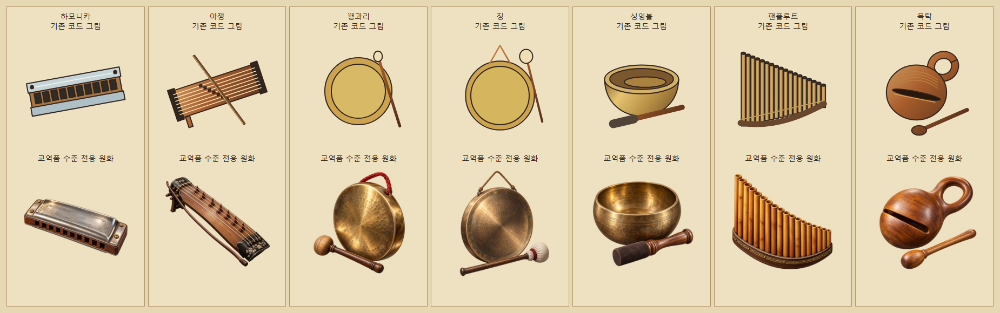
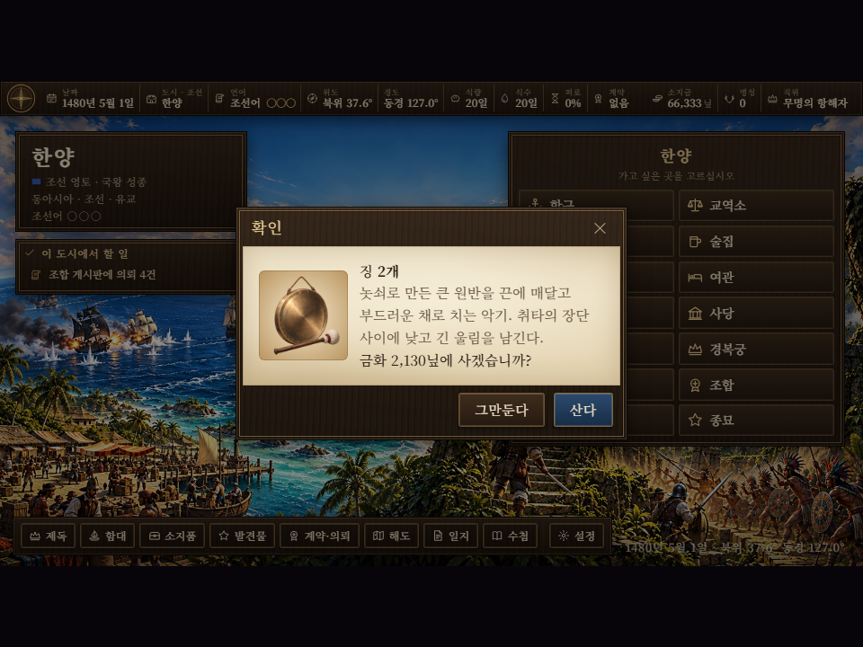
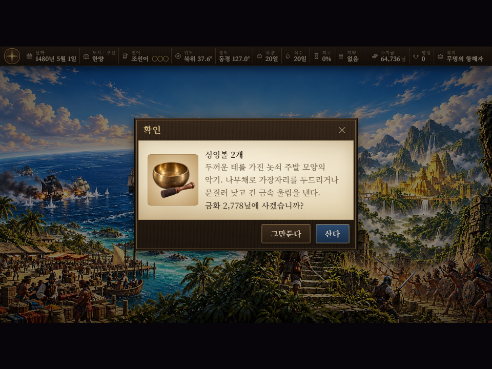
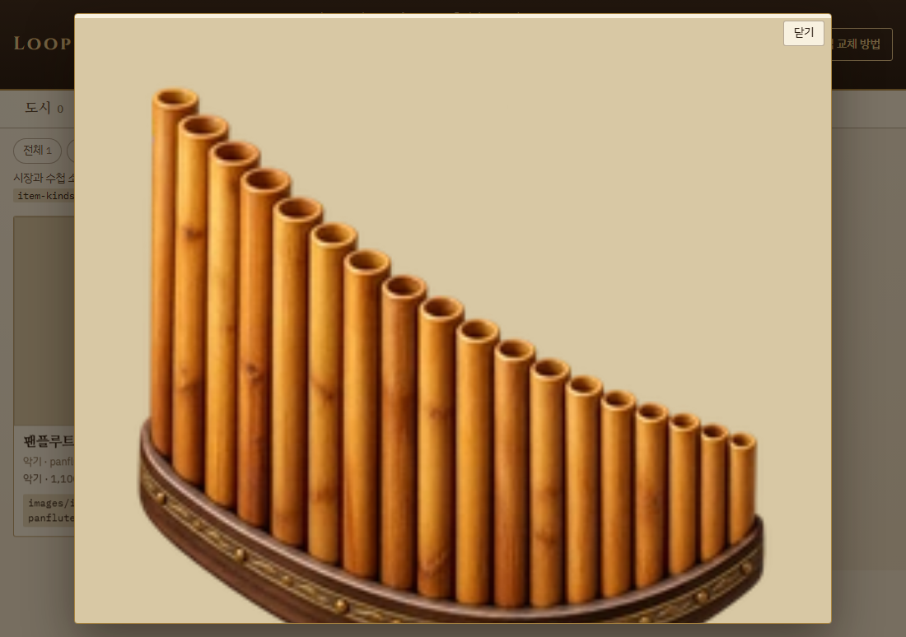

# 시장 악기 일곱 종 상세 외형

후속 작업에서 종 계열·소형 타악기 18종에 전용 원화를 추가해 전체 전용 악기 그림은 25종이 되었다. [추가 품목·외형·참고 자료·지시문](bells-small-percussion-20261101.md).

기존 교역품의 도자기·보석 그림처럼 재질과 입체감이 보이는 전용 원화를 만들었다. 전용 원화 적용 대상은 하모니카·아쟁·꽹과리·징·싱잉볼·팬플루트·목탁 7종이다.

| 악기 | 외형 | 게임 파일 |
|---|---|---|
| 하모니카 | 은빛 금속 덮개·나무 몸체·입구와 나사 | `images/items/harmonica.webp` |
| 아쟁 | 긴 목재 울림통·현·이동 받침·나무 활 | `images/items/ajaeng.webp` |
| 꽹과리 | 작은 청동 몸체·두꺼운 테·붉은 손잡이 끈·짧은 나무채 | `images/items/kkwaenggwari.webp` |
| 징 | 넓은 청동 면·매다는 끈·천을 감싼 큰 채 | `images/items/jing.webp` |
| 싱잉볼 | 속이 빈 놋쇠 주발·두꺼운 테·가죽을 감싼 나무채 | `images/items/singingbowl.webp` |
| 팬플루트 | 길이가 다른 나무 관 한 줄·곡선 받침·열린 취구 | `images/items/panflute.webp` |
| 목탁 | 속을 비운 둥근 목재 몸통·울림 틈·고리 손잡이·나무채 | `images/items/moktak.webp` |

일곱 파일 모두 256×256 RGBA WebP다. 생성된 투명도를 유지하고 물체 전체를 줄여 가운데 배치했다. 가장자리에는 최소 16px 여백을 두었다. 개별 파일 용량과 해시는 변환 기록에 남긴다.

`G.Img.chain.item`의 품목별 그림 경로를 사용한다. 시장 구입·매각 목록, 구매 확인, 소지품 수첩과 도감에서 같은 원화를 읽는다. 기본 코드 그림도 유지한다.

## 제작과 재현

내장 `image_gen` 도구로 품목별로 한 장씩 생성했다. [전체 생성 지시문](instrument-item-prompts-20261101.json)에 원본 경로와 출력 파일을 기록했다. 원본은 `artifacts/instrument-item-art-20261101/raw/`에도 보존한다.

```powershell
python tools/instrument_item_art.py
python tools/images.py
node tests/instrument_market_smoke.js
```

변환 도구는 투명 경계와 크기·여백을 검사하고 `artifacts/instrument-item-art-20261101/assets.json`에 원본 크기·파일 용량·해시를 기록한다.

## 검증

`node tests/instrument_market_smoke.js`에서 일곱 품목의 전용 WebP 선택과 실제 시장 구매 확인 그림의 주소·원본 크기를 검사한다. 구매·저장·매각 뒤 수량과 금액을 확인하고, 소지품과 도감 상세의 그림을 전용 원화와 픽셀 단위로 비교한다. 목탁은 한양, 싱잉볼은 라사, 팬플루트는 파리에서 거래하며 「팬플룻」 검색도 확인한다. 전체 악기 186종의 판매처·지역별 최소 진열·코드 그림 검사를 함께 실행한다.

결과: 전체 시험 통과, `pageerror`·`console.error` 0건, `git diff --check` 통과. 시험용 브라우저는 종료했다.

싱잉볼은 인도·중앙아시아에서 기본값 1,400닢, 팬플루트는 북유럽·지중해에서 기본값 1,100닢에 판다. 실제 시장 가격은 기존 시세 규칙을 따른다. 팬플루트의 검색 별칭은 「팬플룻」「팬 플루트」「팬파이프」「판플루트」다.

목탁은 조선 시장에서 기본값 550닢에 판다. 불교 의식에 쓰는 악기라는 설명을 붙이되 시장 종교로 판매를 제한하지 않는다. 손잡이가 달린 휴대용 목탁을 그렸으며, 형태와 용도는 [한국민족문화대백과사전의 목탁 항목](https://encykorea.aks.ac.kr/Article/E0018712)을 참고했다.










