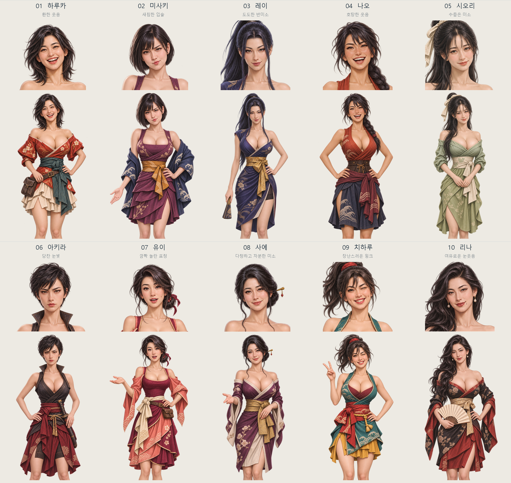

# 일본 여성 항해사 10명 — 1550년부터 5년 주기

새로 제작한 미형 얼굴·가녀린 체형의 일본 여성 후보 10명을 일반 항해사로 등록했다. 1550년부터 5년마다 10명 중 2명을 뽑고, 추첨된 사람 중 아직 고용하지 않은 후보를 일본 도시의 술집·여관에서 만난다.

## 등장과 모집

- 첫 기간은 1550~1554년, 다음은 1555~1559년이다. 기간 안에서는 같은 두 명이 후보로 남는다.
- 한 저장의 시작 난수로 순서를 섞어 25년 동안 10명이 한 번씩 배정된다. 다음 25년에는 새 순서로 섞는다.
- 나가사키·사카이·쿄토 안에서 기존 항해사 이동 규칙에 따라 머물거나 이웃 도시로 옮긴다.
- 1550년 전이나 추첨되지 않은 기간에는 모집·행방·재고용 후보로 나오지 않는다. 일반 철새는 이 전용 얼굴을 빌리지 않는다.
- 고용한 동료는 다음 기간에도 함대에 남으며 모집 명단에 중복으로 나타나지 않는다. 짧게 고용한 뒤 해고한 사람의 재고용은 원래 규칙과 해당 등장 기간을 함께 따른다.
- 추첨 결과는 저장 복원이나 연도 건너뛰기로 바뀌지 않는다. 별도의 저장 필드를 추가하지 않아 옛 저장에도 적용된다.

조정값은 `js/data/base.js`의 `G.BALANCE.japanCrew = { start: 1550, years: 5, count: 2 }`에 모았다. 인물·초상 연결과 추첨은 `js/data/japancrew.js`이며 게임과 도감에 모두 연결했다.

| 번호 | 동료 ID | 이름 | 주된 솜씨 |
| --- | --- | --- | --- |
| 01 | jpcrew_haruka | 하루카 | 항해·운용 |
| 02 | jpcrew_misaki | 미사키 | 회계·웅변 |
| 03 | jpcrew_rei | 레이 | 측량·항해 |
| 04 | jpcrew_nao | 나오 | 포술·운용 |
| 05 | jpcrew_shiori | 시오리 | 의술·과학 |
| 06 | jpcrew_akira | 아키라 | 검술·운용 |
| 07 | jpcrew_yui | 유이 | 요리·음악 |
| 08 | jpcrew_sae | 사에 | 웅변·회계, 중국·조선 말 |
| 09 | jpcrew_chiharu | 치하루 | 음악·웅변 |
| 10 | jpcrew_rina | 리나 | 세공·회계 |

## 초상과 제작 기록

얼굴상은 `images/portraits/mates/jpcrew_<이름>.webp`의 512×512 투명 WebP, 같은 원화의 무릎상은 `_half.webp`의 1024×1536 투명 WebP다. 이미지 목록과 리그 얼굴 자리 20개도 등록했다.

- [내장 ImageGen 수정본의 최종 프롬프트·원본 대응·파일 목록](../../tools/japan_crew_20261114_assets.json)
- 등록 도구: `python tools/register_japan_crew_20261114.py`
- 얼굴 자리: `python tools/portrait_faces.py --keys-file tools/japan_crew_20261114_keys.json --merge`
- 원본과 이전 버전: 저장소 상위 `output/japanese-companion-candidates-20261114-v2/`, `output/japanese-companion-candidates-20261114/`

## 검증

- `node tests/japan_crew_rotation_smoke.cjs` 통과: 10명·초상 20장·얼굴 자리 20개, 1550년부터 7주기·35개 기간, 일본 내 모집, 기간 밖·중복 고용 차단, 동료 유지, 해고 후 복귀, 옛 저장과 저장 복원.
- `node tests/china_crew_rotation_smoke.cjs` 통과: 기존 중국 24명의 10년 주기·모집·저장 복원 유지.
- 두 검사 모두 게임·도감의 `pageerror`·`console.error` 0건. 검사 브라우저는 종료했다.
- [실제 인물 카드](../../artifacts/japan-crew-20261114/recruit-card.png) · [기간별 추첨과 검사 결과](../../artifacts/japan-crew-20261114/report.json)
