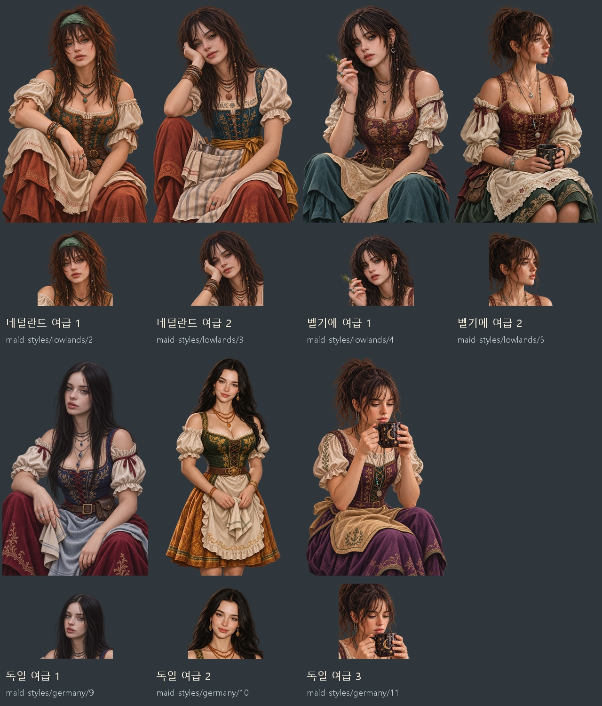

# 네덜란드·벨기에·독일 여급 초상 7쌍 — 2026-11-09

첨부한 일곱 사진을 각각 주 참고로 삼아 네덜란드 2명·벨기에 2명·독일 3명의 게임용 얼굴상·무릎상 14장을 제작했다. 이벤트 샷은 제외했다. 원 캡처의 표정·시선·고개 방향·머리 모양·손동작에 맞춰 몸을 무릎까지 구성하고, 게임의 기존 저지대·독일 여급 그림을 화풍 참고로 사용했다.

의상은 항해 게임의 술집 여급 역할에 맞춘 창작 복식이다. 색이 선명한 자수 보디스·치마·앞치마와 장신구를 조합하고, 열린 목선·어깨와 불투명한 옷감으로 풍성한 성인 체형을 표현한다. 얼굴 크기는 목·어깨·몸에 맞춘다. 사진 속 사람의 실제 국적을 판정한 것은 아니며, 지역은 게임 의상 분류다.

[원 캡처와 얼굴 비교](lowlands-german-maids-20261109-face-comparison.jpg) · [원 캡처와 자세 비교](lowlands-german-maids-20261109-pose-comparison.jpg) · [14장 ZIP](../../artifacts/lowlands-german-maids-20261109/lowlands-german-maids-20261109.zip)

| 지역·순서 | 그림 키 | 참고 사진에서 유지하는 특징 |
|---|---|---|
| 네덜란드 1 | maid-styles/lowlands/2 | 초록 머릿수건·헝클어진 앞머리·살짝 벌린 입·세운 무릎 위 팔 |
| 네덜란드 2 | maid-styles/lowlands/3 | 한 손에 기댄 뺨·작은 반미소·기울인 고개·구슬을 단 가는 땋은 머리 |
| 벨기에 1 | maid-styles/lowlands/4 | 비스듬한 몸·주근깨·살짝 벌린 입·얼굴 곁으로 올린 손과 허브 가지 |
| 벨기에 2 | maid-styles/lowlands/5 | 오른쪽을 보는 옆얼굴·높이 묶은 헝클어진 머리·양손에 든 달무늬 잔 |
| 독일 1 | maid-styles/germany/9 | 가운데 가르마의 긴 생머리·차분한 시선·무릎 위 팔과 접은 행주 |
| 독일 2 | maid-styles/germany/10 | 검은 물결 머리·다문 입의 부드러운 미소·기울인 고개 |
| 독일 3 | maid-styles/germany/11 | 잔을 향한 아래 시선·낮춘 턱·입 가까이 양손으로 든 잔·앉아 숙인 몸 |

[네덜란드 2쌍](lowlands-german-maids-20261109-netherlands-preview.jpg) · [벨기에 2쌍](lowlands-german-maids-20261109-belgium-preview.jpg) · [독일 3쌍](lowlands-german-maids-20261109-germany-preview.jpg)

내장 **image_gen 편집 모드**를 사용했다. [실제 프롬프트·참고 사진·생성 원본](../../tools/lowlands_german_maids_20261109_prompts.json) · [명세 준비](../../tools/prepare_lowlands_german_maids_20261109.py) · [추출·등록·검증·묶음](../../tools/package_lowlands_german_maids_20261109.py). 네덜란드 2·독일 3은 최초 출력이 생성 도구에서 노출 표현으로 거부되어, 가슴을 덮는 불투명 블라우스와 자연스러운 체형으로 조정한 프롬프트를 사용했다. 원래 얼굴·표정·동작은 유지했다.

얼굴상은 각각의 무릎상과 같은 PNG 원화에서 추출한다. 얼굴상은 448×448 투명 WebP, 무릎상은 1024×1536 투명 WebP다. 새 번호를 `lowlands`·`germany` 지역 여급 묶음에 추가하고 기존 그림과 저장 인물 ID를 보존한다. 원본 PNG·참고 사진은 `artifacts/lowlands-german-maids-20261109/sources/`·`references/`에 보관한다.

검증: `node tests/lowlands_german_maids_20261109_smoke.cjs` 통과. 암스테르담·앤트워프·함부르크의 지역 묶음, 14개 파일 규격과 해독·얼굴 좌표·얼굴과 무릎상의 연결·대화창 14개·도감을 확인했다. `pageerror`·`console.error`·이미지 요청 실패는 0이다. 투명 알파 14장 보존, 새 키만 추가, 참고 사진 7장·PNG 원화 7장 보관, ZIP 무결성·14개 WebP를 확인했다. 전체 미리보기와 얼굴 비교판, 벨기에 2·독일 3 무릎 대화창과 네덜란드 2 얼굴 대화창을 눈으로 확인했다. 시험은 대화 구성요소에 그림을 직접 연결해 표시를 확인하며, 기존 저장 인물을 강제로 교체하지 않는다. 브라우저는 `finally`에서 닫았다. [검사 결과](../../artifacts/lowlands-german-maids-20261109/runtime/checks.json)와 화면은 같은 폴더에 보관했다.
