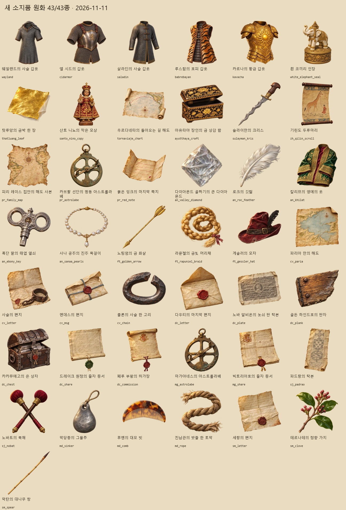

# 새 소지품 원화 43종 (2026-11-11)

게임에 등록되어 있으나 전용 그림이 없던 43종을 내장 ImageGen으로 각각 제작했다. 전설 갑옷 5종, 소중한 물건 16종, 서적·해도 2종, 사건 물품 20종이다. 게임 데이터의 ID·효과는 바꾸지 않았다.

- 게임 그림: `images/items/<아이템ID>.webp` — 256×256, 실제 투명 배경, 가장자리 여백 13px 이상.
- [43종 이름·설명·생성 프롬프트](new-item-prompts-20261111.json).
- [생성 PNG 원본](../../artifacts/new-item-art-20261111/raw/) · [항목별 생성 기록](../../artifacts/new-item-art-20261111/records/) · [결과 목록·해시](../../artifacts/new-item-art-20261111/assets.json).
- [어두운 바탕 검수표](../../artifacts/new-item-art-20261111/preview-dark.jpg). 술라이만의 크리스에 남은 배경 얼룩은 수정 생성했으며, 이전 원화와 수정 프롬프트도 보존했다.

## 검증

`python tools/package_new_item_art_20261111.py`로 43종의 크기·알파·여백을 확인했다. 밝고 어두운 바탕에서 전체 원화를 살폈고, 작업 전 존재하던 `images/items`의 436개 파일은 SHA-256이 모두 같다. `python tools/images.py`로 그림 목록을 갱신했다.

`node tests/new_item_art_20261111_smoke.cjs` 통과: 43종의 실제 게임 이미지 경로·디코딩·크기·투명 배경, 소지품 창, 도감 상세 표시를 확인했다. 콘솔 오류는 0건이다. [실행 결과](../../artifacts/new-item-art-20261111/browser-check.json) · [갑옷 소지품 화면](../../artifacts/new-item-art-20261111/wayland-inventory.png) · [사건 물품 소지품 화면](../../artifacts/new-item-art-20261111/sm_clove-inventory.png) · [해도 도감 화면](../../artifacts/new-item-art-20261111/pr_family_map-catalog.png).

처음 조사한 소지품 1,598종의 누락은 43종에서 0종으로 줄었다. 제작 도중 다른 작업에서 발견 유물 23종이 추가되어 최종 등록 수는 1,621종이었다. 이 23종은 별도로 진행 중인 [발견 원화 제작 목록](../../tools/discovery_art_20261111/prompts.json)에 모두 포함되어 있으며, 이번 43종과 중복 생성하지 않았다. 위 시험은 최초 조사 목록의 누락 0건과 새 23종의 별도 제작 목록 포함 여부를 각각 확인한다.

다시 점검하려면 `node tools/audit_item_art.cjs --out artifacts/new-item-art-20261111/after`를 실행한다. 전체 등록 목록의 결과는 병행 중인 발견 원화 제작의 진행 상태에 따라 달라질 수 있다.
