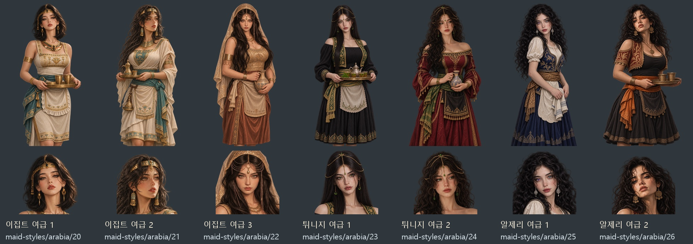

# 이집트·튀니지·알제리 여급 7쌍 — 2026-11-09

첨부 참고 7장의 얼굴형·눈·입·표정·시선·머리 모양을 각각 반영한 게임용 여급 초상이다. 이집트 3명·튀니지 2명·알제리 2명이며 복식은 지역 요소를 활용한 게임용 창작 변형이다. 참고 인물의 실제 국적을 판정한 것은 아니다.

내장 `image_gen`으로 투명 무릎상 원화를 만들고, 게임의 기존 얼굴 추출 도구로 같은 원화의 얼굴상을 내보냈다. 얼굴상은 448×448, 무릎상은 1024×1536 투명 WebP다. 같은 쌍의 얼굴·표정·의상과 생성 원화의 알파를 보존한다. 성인 여급의 역할에 맞는 자수 의상·허리 앞치마·서빙 소품을 사용했으며, 여섯 번째 참고는 자연스러운 체형과 가슴을 덮는 의상으로 구성했다.

| 첨부 순서 | 지역 | 얼굴상 키 | 특징 |
|---|---|---|---|
| 1 | 이집트 | `maid-styles/arabia/20` | 검은 단발·가늘게 뜬 눈·살짝 든 턱·아이보리와 청록 |
| 2 | 이집트 | `maid-styles/arabia/21` | 긴 웨이브·오른쪽 시선·살짝 열린 입·청록과 금 장식 |
| 3 | 이집트 | `maid-styles/arabia/22` | 긴 흑발·차분한 정면 시선·금빛 머리 체인·도자기 물병 |
| 4 | 튀니지 | `maid-styles/arabia/23` | 긴 생머리·초록 눈·기울인 고개·검정과 초록 자수 |
| 5 | 튀니지 | `maid-styles/arabia/24` | 풍성한 곱슬·주근깨·옆 시선·와인색과 금 자수 |
| 6 | 알제리 | `maid-styles/arabia/25` | 검은 곱슬·서로 다른 눈 색·조용한 표정·아이보리와 청색 |
| 7 | 알제리 | `maid-styles/arabia/26` | 풍성한 검은 곱슬·짙은 눈썹·든 턱·검정과 적갈색 |

각 키의 `.webp`가 얼굴상, `_half.webp`가 무릎상이다. 기존 아랍·북아프리카 지역 여급 후보 묶음에 추가한다. 기존 인물의 지정 초상이나 저장 자료는 교체하지 않는다. 얼굴 위치 자료는 `js/data/portraitfaces.js`, 이미지 목록은 `images/manifest.js`에 등록한다.

[14장 ZIP](../../artifacts/northafrica-maids-20261109/northafrica-maids-20261109.zip) · [최종 생성 프롬프트 7개](../../tools/northafrica_maids_20261109_prompts.json) · [내보내기·등록 도구](../../tools/package_northafrica_maids_20261109.py)

원본과 첨부 참고는 `artifacts/northafrica-maids-20261109/sources/`와 `references/`에 보관한다. 배경 포함 시안은 최종 자산에 포함하지 않는다. 이벤트샷은 제작하지 않았다.

검증: `node tests/northafrica_maids_20261109_smoke.cjs` 통과. 7명·14장의 지역 묶음 등록, 파일 해독·규격, 얼굴 좌표와 같은 원화의 얼굴/무릎 짝, 실제 대화창 14개와 도감 목록을 확인했다. 콘솔 오류·이미지 요청 실패 0이며 브라우저는 `finally`에서 닫았다. 전체 미리보기와 튀니지 2의 실제 무릎 대화창·이집트 1의 얼굴 대화창을 눈으로 확인했다. 생성 원화의 투명 알파를 14장 모두 보존했다. 결과는 `artifacts/northafrica-maids-20261109/asset-checks.json`과 `runtime/checks.json`에 저장했다.
