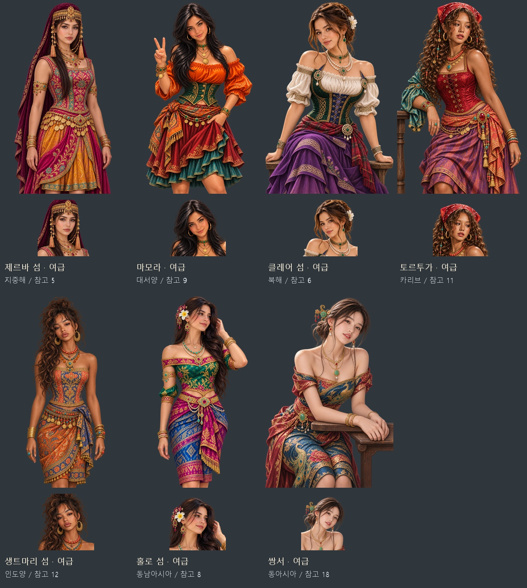

# 일곱 해적섬 여급 — 참고 얼굴·표정·자세·화려한 의상

제르바·마모라·클레어·토르투가·생트마리·홀로·쌍서의 여급 7명에게 전용 얼굴상·무릎상 14장을 제작했다. 첨부 사진 중 성인으로 보이는 서로 다른 인물 7명을 주 참고로 정했다. 원 캡처의 눈·코·입·얼굴형, 웃음과 다문 입, 시선·고개·어깨 방향, 손 동작과 머리 모양을 기준으로 몸을 무릎까지 이어 그렸다. 얼굴상은 같은 원화에서 추출했다.

선명한 비단·자수와 금장·보석·동전·진주 장신구, 성인 곡선 체형과 균형 잡힌 머리·신체 비율을 반영했다. 처음의 노출 강조 시안 7장은 생성 도구의 출력 단계에서 거절되어, 가슴·허벅지는 불투명 천으로 덮고 어깨·팔이나 좁은 허리 틈을 드러내는 패션으로 조정했다. 최종 지시문과 최초 시도도 제작 명세에 구분해 보관했다.

[원 캡처·이전 여급·새 여급 자세 비교](pirate-island-maids-20261107-pose-comparison.jpg) · [얼굴 확대 비교](pirate-island-maids-20261107-face-comparison.jpg) · [그림·원본·참고·제작 지시문 ZIP](../../artifacts/pirate-island-maids-20261107/pirate-island-maids-20261107.zip)

| 섬 | 지역 키 | 첨부 참고 | 얼굴·머리·자세 | 색·장신구 |
|---|---|---|---|---|
| 제르바 섬 | med | 5 | 차분한 정면 시선·다문 입·긴 생머리·보라색 베일 | 자홍·청록·금색, 보석 이마 장식·긴 금술·동전 허리띠 |
| 마모라 | atl | 9 | 기울인 고개·반미소·검은 웨이브·V자 손 | 주황·초록·진홍, 큰 금 귀걸이·동전 목걸이·보석 팔찌 |
| 클레어 섬 | north | 6 | 부드러운 미소·꽃을 꽂은 올림머리·앉은 자세 | 초록·남색·보라·타탄, 진주·에메랄드·켈트 매듭 |
| 토르투가 | amer | 11 | 옆 시선·살짝 벌린 입·긴 곱슬머리·붉은 두건·기댄 팔 | 빨강·청록·산호색·보라, 금·산호·구슬·보석 허리띠 |
| 생트마리 섬 | ind | 12 | 기울인 고개·차분한 눈·한쪽으로 흐르는 곱슬 올림머리 | 산호색·코발트·금색, 세공 금 귀걸이·호박·터키석 |
| 홀로 섬 | sea | 8 | 오른쪽 시선·미소·긴 웨이브·머리를 만지는 손·흰 꽃 | 옥색·자홍·파랑, 금세공·진주·루비·팔 장식 |
| 쌍서 | east | 18 | 기울인 고개·살짝 벌린 미소·낮은 쪽머리·탁자에 기댄 팔 | 공작 파랑·빨강·금색, 옥 비녀·진주·금 목걸이 |

내장 `image_gen` 편집 모드로 제작했다. [최종 프롬프트·참고·생성 원본 경로](../../tools/pirate_island_maids_20261107_prompts.json) · [저장·검증·등록 도구](../../tools/package_pirate_island_maids_20261107.py).

원본 PNG와 참고 사진은 `artifacts/pirate-island-maids-20261107/sources/`와 `references/`에 보관한다. 게임 파일은 `images/portraits/npc/pirate-islands/<지역>/servant_ref20261107_v1.webp`(얼굴 448×448)와 `servant_ref20261107_v1_half.webp`(무릎 1024×1536)다. 투명 알파를 보존한다. 기존 `servant`·`servant_half` 논리 키 14개를 새 버전 파일로 연결하므로 술집 패널·여급 대화·거리 대화가 같은 한 쌍을 선택한다. 기존 원본은 보존한다.

`tools/images.py`의 우선 교체 목록에도 등록하여 이미지 목록을 다시 만들어도 최신 파일을 선택한다. 다른 다섯 직업의 초상과 섬·여급의 저장 ID는 유지한다.

검증: `node tests/pirate_island_maids_20261107_smoke.cjs` 통과. 일곱 섬 저장 복원 후 여급 선택, 얼굴·무릎상 규격과 해독·얼굴 좌표, 술집 패널 7개, 실제 얼굴·무릎 대화 14개, 거리 여급의 같은 초상 선택, 다른 직업 원화 유지와 도감의 새 파일 연결을 확인했다. `pageerror`·`console.error`·이미지 요청 실패 모두 0. PNG→WebP 투명 알파 보존 14장, 기존 논리 키와 우선 교체 목록의 파일 일치, ZIP 14장 무결성 검사도 통과했다. 전체 미리보기·얼굴 비교판과 마모라·클레어·쌍서의 실제 패널/대화창을 눈으로 확인했다. 브라우저는 `finally`에서 닫았다. 결과와 화면은 `artifacts/pirate-island-maids-20261107/runtime/`에 보관했다.
