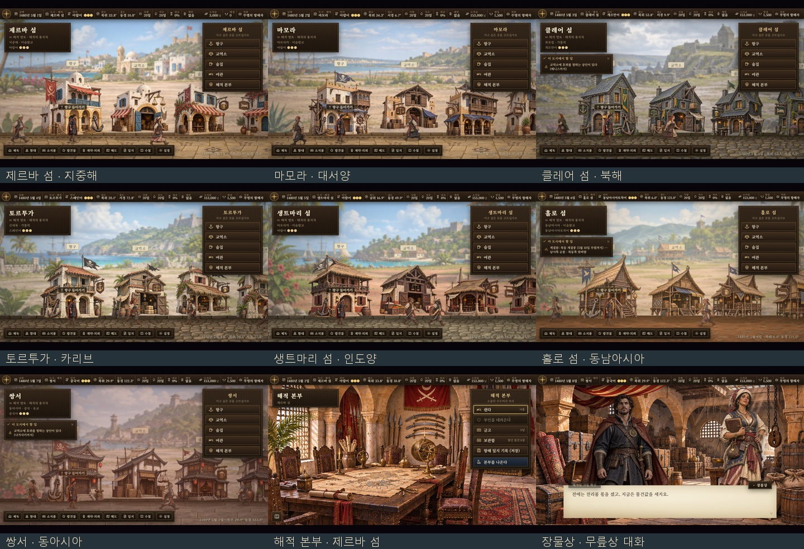

# 일곱 해적섬 — 건물 외부·내부와 해적 출신 주민

제르바 섬·마모라·클레어 섬·토르투가·생트마리 섬·홀로 섬·쌍서에 전용 거리, 건물과 주민을 연결했다.

각 섬에 항구·교역소·술집·여관·해적 본부의 외관과 실내를 하나씩 만들었다. 외관 35장, 실내 35장, 거리 배경 7장이다. 해적 본부는 술집 그림 대신 전용 작전 회의실을 사용한다.

| 섬 | 건축과 주민의 특징 |
|---|---|
| 제르바 섬 · 지중해 | 흰 회벽·작은 돔·푸른 덧문, 터번과 곡도를 지닌 바르바리 해적 출신 |
| 마모라 · 대서양 | 모로코 요새와 잉글랜드·네덜란드식 목조 발코니, 낡은 해적 모자와 긴 조끼 |
| 클레어 섬 · 북해 | 짙은 석조 탑성·슬레이트 지붕·이끼, 켈트 브로치·모직 망토와 붉은 머리 |
| 토르투가 · 카리브 | 바랜 목재·산호석·럼주 통, 삼각모·두건·커틀러스의 버커니어 |
| 생트마리 섬 · 인도양 | 산호석·열대 목재·야자 지붕, 말라가시·스와힐리 계통의 직물·구슬 장신구 |
| 홀로 섬 · 동남아시아 | 대나무·기둥 위의 목조 가옥·파랑새 깃발, 술루·이라눈식 두건·직물·크리스 |
| 쌍서 · 동아시아 | 기와·흰 벽·검은 목재·붉은 등, 상투·머리띠·덧입은 저고리의 밀무역선 출신 |

각 섬의 주민은 항구지기·장물상·술집 주인·여관 안주인·갑판장·여급 여섯 명이다. 전직 돌격대장, 전리품을 나누던 경리, 노련한 해적, 항해사와 망꾼의 흔적을 옷·소품·흉터·문신에 반영했다. 총 42명이며 얼굴상 42장, 무릎상 42장, 8단계 보행 시트 42장(336개 보행 자세)을 사용한다. 게임용 그림은 모두 합해 **203개**다.

얼굴상은 같은 무릎 원화에서 추출했다. 보행은 해당 무릎 원화를 참고해 같은 얼굴·머리·옷으로 별도 제작했다. 걷는 동안 발을 번갈아 딛고 팔을 반대로 흔들며, 왼쪽으로 갈 때는 게임의 기존 좌우 반전 처리를 사용한다. 거리 대화에도 지역별 해적 생활과 현재 직업에 관한 말을 연결했다.

- [건물 외부·내부 전체 미리보기](pirate-island-environments-20261107.jpg)
- [42명 얼굴상·무릎상 전체 미리보기](pirate-island-npcs-20261107.jpg)
- [42명 보행 애니메이션](pirate-island-walks-20261107.gif)
- [실제 무릎상 대화](../../artifacts/pirate-islands-20261107/runtime/npc_dialogue.png)

## 파일과 제작

내장 **image_gen**으로 7지역 × 외관·실내·주민·보행 원화 시트, 총 28장을 제작했다. 게임 파일은 다음 경로에 있다.

- `images/pirate-islands/<지역>/exterior/<건물>.webp` — 768×768, 투명 외관
- `images/pirate-islands/<지역>/interior/<건물>.webp` — 1600×900 실내
- `images/pirate-islands/<지역>/street.webp` — 1600×900 거리 배경
- `images/portraits/npc/pirate-islands/<지역>/<역할>.webp` · `_half.webp` — 얼굴 448×448, 무릎상 1024×1536, 투명
- `images/street-folk/pirate-islands/<지역>/<역할>.webp` — 4열×2줄, 1520×888, 투명 보행 시트

지역 키는 `med`, `atl`, `north`, `amer`, `ind`, `sea`, `east`다. 역할 키는 `harbormaster`, `trader`, `tavernkeeper`, `innkeeper`, `boatswain`, `servant`다.

[최종 생성 지시문·원본 경로](../../tools/pirate_island_art_20261107_prompts.json) · [원화 28장](../../artifacts/pirate-islands-20261107/sources/) · [추출·등록 도구](../../tools/package_pirate_island_art_20261107.py) · [게임 연결](../../js/systems/pirate_island_art.js).

시트 경계를 넘은 손·칼·깃대와 옆 인물 조각을 구별해 투명 실루엣별로 나눴다. 보행은 사람마다 같은 배율을 유지하고 발끝을 같은 바닥선에 맞췄다. 새 그림은 전용 경로로 저장하며 기존 두목·간부 원화는 그대로 둔다. 이미지 목록 재생성도 전용 파일을 자동으로 찾는다.

## 검증

[203개 파일의 규격·투명도 검사](../../artifacts/pirate-islands-20261107/asset-checks.json) · [실제 게임·도감 검사 결과](../../artifacts/pirate-islands-20261107/runtime/checks.json).

`node tests/pirate_island_art_20261107_smoke.cjs`는 file://에서 일곱 섬의 실제 그림 선택과 해독, 건물별 내부, 주민 생성·보행 갱신·그리기, 얼굴과 무릎상 연결, 첫 대화, 해적 본부 진입과 갑판장 초상을 검사한다. 일반 도시의 외관과 주민 선택도 확인한다. 브라우저는 시험 끝에 닫는다.

`node tests/pirate_lair_smoke.js`는 기존 해적 소굴의 발견·점령·저장 호환·부인과 아이의 이사·해적왕 업적·본가 공주 기능을 검사한다.

두 시험 모두 통과했다. 게임·도감의 `pageerror`·`console.error`와 그림 요청 실패는 0이며, 새 그림 203개의 이미지 목록 재생성 경로 불일치도 0이다.
