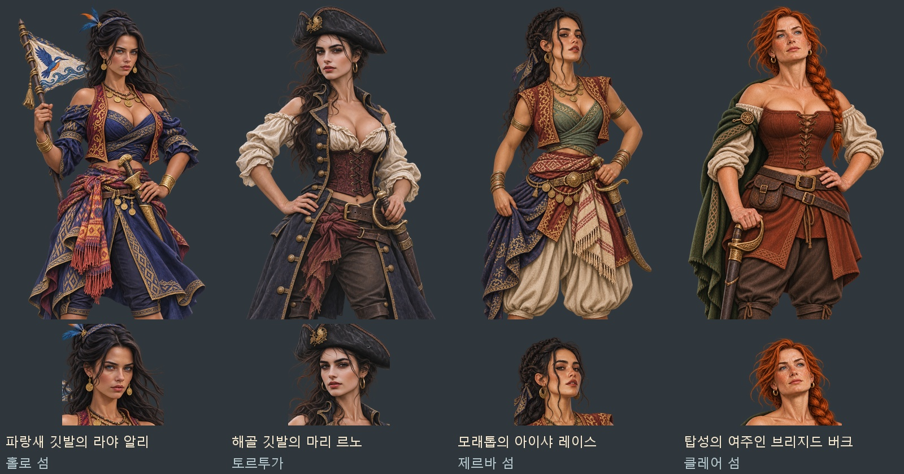

# 여성 해적 네 명 — 첨부 얼굴·표정·헤어 수정

첨부한 네 참고 이미지의 얼굴·표정·머리를 지역별 여성 해적에게 반영했다. 풍성한 체형과 가슴선, 어깨·목선·허리 일부가 드러나는 복식으로 조정했다. 기존 게임의 반실사 그림체와 지역별 직물·장신구·무기를 이어 쓴다.

| 지역·인물 | 참고 얼굴·머리 | 복식·소품 |
|---|---|---|
| 술루·홀로 섬 — 라야 알리 | 검은 반묶음·바람에 흩날리는 머리, 정면을 보는 또렷한 눈매 | 파랑·자주·금색 직물, 어깨를 드러낸 감싼 상의, 파랑새 깃발·크리스 |
| 카리브·토르투가 — 마리 르노 | 검은 삼각모, 늘어진 곱슬머리, 차분한 표정 | 남색 긴 조끼·아이보리 블라우스·자주색 코르셋·커틀러스 |
| 지중해·제르바 — 아이샤 레이스 | 검은 땋은 올림머리, 얼굴 옆 잔머리, 턱을 살짝 든 표정 | 청록색 상의·적갈색 볼레로·금화 장식·곡도 |
| 북해·클레어 — 브리지드 버크 | 붉은 옆머리 땋기, 푸른 눈과 주근깨, 위를 바라보는 표정 | 초록 망토·청동 켈트 브로치·적갈색 코르셋·커틀러스 |

## 파일과 게임 연결

얼굴상은 448×448, 무릎상은 1024×1536의 투명 WebP다. 각 얼굴상은 같은 수정 무릎상 원화에서 추출해 얼굴·목·복식이 일치한다.

게임용 파일은 `images/portraits/rivals/<인물 이름>_ref20261107.webp`와 `_ref20261107_half.webp`다. 기존 논리 열쇠 `portraits/rivals/<인물 이름>`·`_half` 8개를 새 파일에 연결했다. `tools/images.py`의 `PREFERRED_FILES`에도 등록했으므로 이미지 목록을 다시 만들거나 웹판을 빌드해도 새 버전을 쓴다. 눈·입·얼굴 위치 자료도 새 원화 기준으로 갱신했다.

내장 `image_gen`으로 수정했다. 기존 원화·게임 파일은 보존했고, 새 원본과 참고 이미지는 `artifacts/pirate-women-revision-20261107/sources/`·`references/`에 있다.

- [얼굴·무릎상 8장과 원본 ZIP](../../artifacts/pirate-women-revision-20261107/pirate-women-revision-20261107.zip)
- [최종 생성 지시문·입력 이미지·파일 위치](../../tools/pirate_women_revision_20261107_prompts.json)
- [파일·투명도·얼굴 좌표 검사](../../artifacts/pirate-women-revision-20261107/asset-checks.json)
- [수정 전 이미지 연결](../../artifacts/pirate-women-revision-20261107/previous-mapping.json)

## 검증

8장의 파일 해독·규격·투명 알파·무릎상 아래 끝·얼굴 좌표를 확인했다. 네 사람의 원화·얼굴 추출 미리보기와 실제 대화 화면도 눈으로 확인했다.

`node tests/missing_event_art_20261106_smoke.cjs` 통과: 해적 35명의 얼굴상·무릎상 70장과 사건·업적 장면 9장 표시, 현재 두목·간부 명부 연결, 사건 종료와 오류 뒤 그림 정리를 검사했다. 역사 인물 372명·사건 동료 86명·업적 101종의 파일 누락도 0이며, 브라우저 `pageerror`·`console.error`는 0이다. 검사 브라우저는 `finally`에서 닫았다.

새 버전 8개는 `images.scan()`으로 다시 찾은 결과와 현재 manifest가 모두 일치한다. 이 확인은 실제 manifest를 다시 쓰지 않고 수행했다.

[검사 결과](../../artifacts/pirate-women-revision-20261107/runtime/checks.json) · [실제 무릎상 대화](../../artifacts/pirate-women-revision-20261107/runtime/lairchief_sea_1_half.png) · [실제 얼굴상 대화](../../artifacts/pirate-women-revision-20261107/runtime/lairchief_north_0_face.png).
