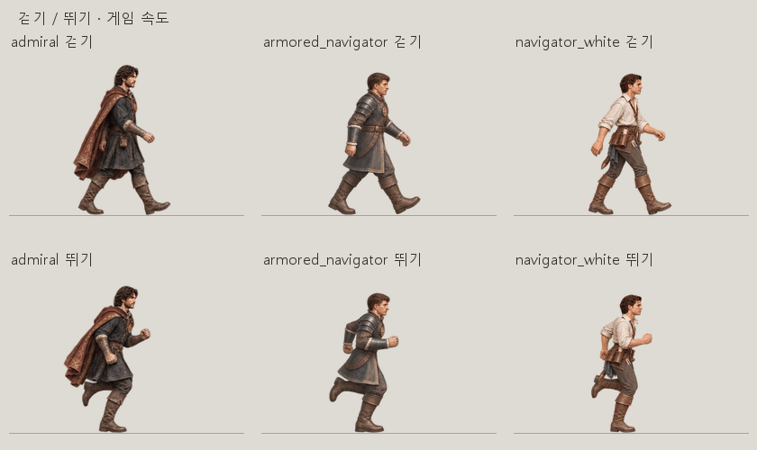

# 플레이어 걷기·뛰기 재구성 · 2026-11-07

이전 보강판은 무릎을 접어 낮아진 자세도 전체 키를 똑같이 맞추면서 몸통까지 커졌다. 픽셀 변화량으로 시간을 정한 방식도 발 디딤의 박자를 흐트러뜨렸다. 이번에는 14종의 걷기·뛰기 원화를 다시 만들고 기존 순환 시트 28장을 교체했다.

[절반 속도](player-gait-20261107-slow.gif) · [걷기 전체 칸](player-gait-20261107-walk.jpg) · [뛰기 전체 칸](player-gait-20261107-run.jpg)

[실제 게임 화면](player-gait-20261107-town.png) · [브라우저 검사 결과](../qa/player-gait-20261107.json)

걷기는 접지→무게 받기→발 교차→발끝으로 밀기, 뛰기는 착지→압축→차기→공중의 순서를 양발에 번갈아 적용한다. 8개 기준 자세와 새로 그린 중간 자세를 사용한다. 다리가 녹거나 몸통이 부푸는 중간 칸은 제외했다. 최종 426칸은 기준 자세 224칸, 새 중간 원화 196칸, 검수한 신경망 보간 6칸이다. 마지막은 다음 착지 직전 자세이며 첫 자세를 중복해 멈추지 않는다.

키포즈 판 전체에 같은 배율 하나를 적용한다. 걷기와 뛰기도 이 배율을 공유한다. 중간 원화는 판의 해상도 차이만 머리 폭의 중앙값으로 한 번 보정한다. 무릎을 접은 공중 자세의 실루엣은 낮아지지만 몸통을 확대하지 않는다. 얼굴은 기존 걷기 기준 칸을 정수 좌표로 옮긴다. 실행 중 보행에 추가하던 세로 눌림과 띄우기를 끄고, 공중 구간은 원화의 발 위치와 그림자로 표현한다.

게임의 기준 표시 배율은 원본 300px당 178px이다. 새 칸 높이는 공중 자세의 여백을 포함해 360px이며 표시 배율을 그대로 유지한다. 시간표는 자세 순서의 진행도이고, 실제 이동 거리에 따라 넘긴다. `G.FX.heroGait`의 한 주기 거리는 걷기 300px, 뛰기 440px, 초당 상한은 각각 1.35·2.2주기다. 이동 속도 300·680px/s일 때 발 디딤은 약 2·3.09걸음/s다. Shift 전환은 같은 발 교대 진행도를 이어받는다.

참고: [첫 영상](https://youtube.com/shorts/xyCP3__cAxk), [걷기 팁](https://youtu.be/BhCCOsR-TfM), [워킹 사이클 설명](https://youtube.com/shorts/bD8bOmxzkI4). 확인한 워킹 사이클 설명의 접지·다운·패싱·업 구분을 원화 제작 지시문에 반영했다.

제작에는 기본 ImageGen을 사용했다. [제작 지시문](../../tools/player_gait_20261107_prompts.json), [제작 도구](../../tools/build_player_gait07.py), [등록 도구](../../tools/install_player_gait07.py), [미리보기 도구](../../tools/preview_player_gait07.py), [시트별 검사 명세](player-gait-20261107.json). 원화·제작 중간물·교체 전 시트는 `artifacts/player-gait-20261107/`에 보관한다.

검증:

- `python -X utf8 tests/player_gait_20261107.py`: 14종·28시트·426칸. 같은 배율, 키포즈 몸통 픽셀, 얼굴 픽셀, 접지·공중, 발 교대 순서, 원본 보존 통과. 굽힌 무릎의 전체 높이를 같게 만드는 검사는 폐기했다.
- `HERO_MOTION=walk/run node tests/player_loop_20261106_browser.cjs`: 두 동작 각각 14종을 `file://` 실제 거리에서 검사. 모든 칸 선택, 마지막→첫 칸, Shift 전환, 정지·벽 앞 정지, 대기 동작 우선권 통과. 실제 Canvas 변환 행렬도 모든 프레임에서 같은 배율이며 콘솔 오류 0. 시험 브라우저 종료 확인.
- `python -X utf8 tests/player_motion_faces.py`: 기존 원본 얼굴 686칸·993,720픽셀 일치. 경치 구경·귀족 인사·스트레칭 원본 시트 해시도 그대로다.

종전의 2,458칸 보강판과 그 검수 기록은 제작 이력이다. 현재 게임은 이 문서의 426칸을 사용한다.
