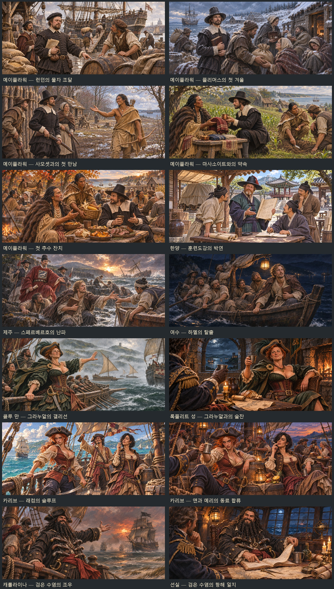

# 바다의 사람들 — 이벤트 샷 14장

메이플라워·스페르베르·하멜·박연·여해적·검은 수염 이벤트의 장면 14장을 제작했다. 2026-11-05 완료. 내장 ImageGen으로 장면별 원화를 생성하고 1881×836 WebP로 저장했다. 모두 같은 반실사 수작업풍이며, 앞서 확정한 인물 원화를 얼굴·복식 참고로 사용했다.

| 그림 ID | 장면 |
| --- | --- |
| `rv_supply` | 런던 부두에서 마틴이 밀·맥주를 조달하는 메이플라워 물자 장면 |
| `rv_winter` | 눈 덮인 플리머스의 첫 겨울, 브래드퍼드와 식량·약재를 받는 사람들 |
| `rv_samoset` | 봄의 마을에서 사모셋과 순례자들이 처음 만나는 순간 |
| `rv_treaty` | 마사소이트와의 선물 교환, 스콴토의 농경 설명 |
| `rv_feast` | 가을 들판에서 함께 음식을 나누는 첫 추수 잔치 |
| `rv_weltevree` | 훈련도감 마당에서 박연이 조선인 동료들과 도면을 보며 설명하는 장면 |
| `rv_sperwer` | 폭풍 뒤 제주 바위 해안의 스페르베르 난파·하멜 구조·이원진 |
| `rv_hamel` | 여수 앞바다의 밤, 작은 배로 탈출하는 하멜과 일곱 동료 |
| `rv_omalley` | 클루 만에서 갤리선을 지휘하며 길을 막는 오말리 |
| `rv_omalley_friends` | 록플리트 성에서 오말리와 술잔을 나누는 친교 |
| `rv_bonny` | 카리브 슬루프 갑판의 앤 보니·메리 리드·잭 래컴 |
| `rv_bonny_friends` | 해전 뒤 앤·메리와 두 배 선원들이 함께하는 갑판의 술자리 |
| `rv_teach` | 캐롤라이나 앞바다의 함선과 도화선 연기에 싸인 검은 수염 |
| `rv_teach_friends` | 선실에서 검은 수염이 항해 일지를 펼쳐 보이는 친교 |

앤 보니는 사용자가 확정한 붉은 머리·삼각모·붉은 조끼·바지 차림을, 메리 리드는 마지막에 확정한 검은 단발·나른한 표정·연초를 든 손과 갈색 코르셋 복장을 참고했다. 오말리는 기존 40대 얼굴과 녹색 의상·금 브로치를 유지한다. 이원진도 교정한 중앙 흉배·품대·사모가 있는 관복을 사용한다. 주인공의 얼굴은 고정하지 않고 화면 가장자리의 손·어깨 또는 장면 바깥 시점으로 처리했다.

오말리 조우 장면은 초안의 롱십에 가까운 배를 라틴 돛·긴 노·곧은 선수의 갤리선으로 내장 ImageGen에서 교정했다. 초안도 원본 폴더에 보관했다. 훈련도감의 첫 출력은 이미지 도구의 안전 검사에서 거절되어, 노출된 무기 대신 도면 설명과 동료 간 대화를 중심으로 구성했다. 원래 지시문과 조정 지시문을 함께 기록했다.

- [게임용 WebP 14장·미리보기·전체 지시문 ZIP](../../artifacts/rovers-event-shots-20261104/rovers-event-shots-20261104.zip)
- [원본 PNG 폴더](../../artifacts/rovers-event-shots-20261104/sources/)
- [최초·조정 지시문과 인물 참고 경로](../../tools/rovers_event_shots_20261104_prompts.json)
- 저장 경로: `images/legend-events/<그림 ID>.webp`
- 변환·등록·미리보기·ZIP: `python tools/package_rovers_event_shots_20261104.py`
- 실제 화면 검사: `node tests/rovers_event_shots_20261104_smoke.cjs`
- 실제 화면·검사 결과: `artifacts/rovers-event-shots-20261104/screenshots/`

그림은 `images/manifest.js`에 등록한다. `js/systems/rovers.js`에 이미 있던 `withPic`과 해적 친교의 `_friends` 경로를 그대로 사용하므로 이벤트 대사·진행·보상·동료 합류 규칙을 변경하지 않는다. 기존 인물 초상도 수정하지 않는다.

검증: 14개 그림 ID를 기존 이벤트의 직접 경로 8개·해적 조우 3개·친교 3개와 대조하여 누락이 없음을 확인했다. 14장 모두 1881×836 WebP 해독에 성공했고, 실제 `file://`에서 장면 표시·화자 얼굴·대화 종료·그림틀 제거를 통과했다. 사건 그림이 뜰 때 무릎상이 그림을 가리지 않는 것도 확인했다. 화면 14장을 저장했고 콘솔 오류는 0이다. 등록부·검사 스크립트 문법과 변경 파일의 공백 검사도 통과했다. 검사 브라우저는 종료했다.
