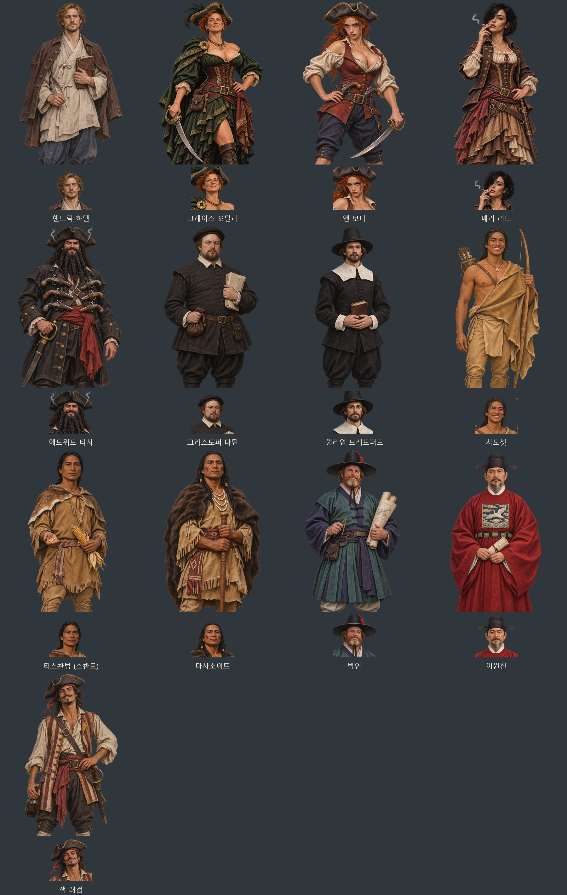

# 바다의 사람들 — 인물별 얼굴상·무릎상

2026-11-04 요청에 따라 메이플라워·스페르베르·하멜·박연·해적 사건에 등장하는 13명에게 개별 무릎상과 얼굴상 총 26장을 제작했다. 내장 ImageGen으로 한 명씩 투명 원화를 생성하고, 각 원화에서 얼굴상을 추출해 두 그림의 얼굴·표정·복식이 일치하도록 했다. 기존 전설·역사 인물과 맞춘 반실사 수작업풍 게임 일러스트다.

| 인물 | 이미지 경로의 ID | 구분 |
| --- | --- | --- |
| 헨드릭 하멜 | `hamel` | 스페르베르·하멜, 동료 |
| 그레이스 오말리 | `omalley` | 아일랜드 해적, 동료 |
| 앤 보니 | `bonny` | 카리브 해적, 동료 |
| 메리 리드 | `mread` | 카리브 해적, 동료 |
| 에드워드 티치 | `blackbeard` | 검은 수염, 동료 |
| 크리스토퍼 마틴 | `rv_cmartin` | 메이플라워 물자 조달 |
| 윌리엄 브래드퍼드 | `rv_bradford` | 플리머스의 겨울 |
| 사모셋 | `rv_samoset` | 원주민과의 만남 |
| 티스콴텀 (스콴토) | `rv_squanto` | 약속·농경 |
| 마사소이트 | `rv_massasoit` | 왐파노아그·추수 잔치 |
| 박연 (얀 얀서 벨테브레이) | `rv_weltevree` | 한양 훈련도감·통역 |
| 이원진 | `rv_yiwonjin` | 제주 목사·난파 생존자 |
| 잭 래컴 | `rv_rackham` | 보니·리드 사건 |

동료 5명의 그림은 `images/portraits/legendary/`, 다른 8명은 `images/portraits/history/`에 있다. 얼굴상은 `<ID>.webp`(448×448), 무릎상은 `<ID>_half.webp`(1024×1536)다. 26장 모두 투명 알파를 보존한다. 앤 보니와 메리 리드는 별개 원화·파일이며 하멜은 낡은 조선 옷과 일지, 박연은 조선 무관 복식·붉은 수염·설계도로 구분했다. 사모셋·스콴토·마사소이트도 얼굴·표정·소지품을 구분했다.

`images/manifest.js`에 등록하여 기존 `G.Hist.speaker`와 `G.Art.mateSpec`·`G.Img.chain.mateHalf` 경로로 사용한다. 기존 그림을 덮어쓰지 않고 비어 있던 전용 경로에 추가했다. 사건·동료 자료에 이미 지정된 경로를 사용하므로 사건의 진행 규칙은 바꾸지 않는다. 메이플라워와 스페르베르는 배·사건 이름이므로 해당 사건의 등장인물을 대상으로 했다.

- [게임용 이미지 26장·미리보기·전체 생성 지시문 ZIP](../../artifacts/rovers-portraits-20261104/rovers-portraits-20261104.zip)
- [원본 PNG 13장](../../artifacts/rovers-portraits-20261104/sources/)
- [전체 생성 지시문과 원본 경로](../../tools/rovers_portraits_20261104_prompts.json)
- 변환·등록: `python tools/package_rovers_portraits_20261104.py`
- 얼굴 좌표: `python tools/portrait_faces.py --keys-file artifacts/rovers-portraits-20261104/keys.json --merge`
- 실제 대화창·동료 연결 검사: `node tests/rovers_portraits_20261104_smoke.cjs`
- 실제 화면·검사 결과: `artifacts/rovers-portraits-20261104/screenshots/`

외형은 프로젝트에 있는 인물·복식 설명을 바탕으로 한 게임용 해석이다. 전체 프롬프트에 제작 방식·화풍·구도·인물별 조건을 기록했다.

검증: 26장 모두 크기·투명 알파·얼굴 좌표 검사를 통과했다. `file://`에서 사건 인물 13명의 전용 그림 선택과 실제 대화창 얼굴상·무릎상 표시, 동료 5명의 얼굴·무릎상 연결을 확인했다. 실제 대화창 화면 26장을 저장했고 콘솔 오류는 0이다. 이미지 등록부·얼굴 좌표 자료·검사 스크립트의 JavaScript 문법과 변경 파일의 공백 검사도 통과했다. 검사 브라우저는 종료했다.

후속 수정 요청: 이원진은 얼굴·수염·두루마리를 든 손을 유지하며 사모의 크기와 양옆 날개, 가슴 중앙의 큰 흉배, 품대의 연속 장식판을 바로잡는다. 관복의 기본 구성은 사모·단령·각대로 잡았다. [국사편찬위원회 우리역사넷 복식 설명](https://contents.history.go.kr/front/km/print.do?levelId=km_009_0050_0010_0020&whereStr=).

앤 보니는 사용자가 마지막에 「그대로」 확정한 붉은 머리·삼각모·붉은 조끼·바지 차림의 PNG를 그대로 원본으로 쓴다. 앤은 첫 번째 얼굴 참고의 눈매·표정을 반영했다. 메리 리드는 마지막에 별도로 첨부한 흡연 인물의 검은 단발·나른한 눈매·살짝 벌린 입술과 연초를 손가락 사이에 든 자세로 수정했다. 두 사람은 각각 20대 후반 성인으로 해석했다. 메리의 의상 시안 하나가 이미지 도구의 안전 검사에서 거절되어, 갈색 코르셋·블라우스는 가슴 노출을 줄인 버전을 사용했다. 오말리는 기존 40대 얼굴과 짧은 붉은 머리를 유지하고, 풍성한 가슴과 낮은 목선, 녹색 블라우스·코르셋·비대칭 치마로 의상 참고를 반영했다. 앤 보니는 의상 참고보다 나중에 확정한 그림을 우선한다.

- [수정한 네 인물의 얼굴·무릎상 미리보기](rovers-costume-face-revision-20261104-preview.jpg)
- [수정 지시문·참고 이미지·최종 선택 기록](../../tools/rovers_portraits_20261104_revisions.json)
- 직전 PNG·WebP 보관: `artifacts/rovers-portraits-20261104/before-costume-face-revision/`
- 지정한 인물 재출력: `python tools/package_rovers_portraits_20261104.py --refresh-id bonny --refresh-id mread --refresh-id omalley --refresh-id rv_yiwonjin`

수정본 검증도 완료했다. 사용자 확정 앤 보니 PNG와 최종 원본의 SHA-256이 일치한다. 수정한 4명의 PNG·WebP 12개를 이전 상태로 보관했으며 새 얼굴 좌표를 등록했다. 전체 13명·26장 규격·투명도·실제 대화창 표시와 동료 5명 연결 검사를 다시 통과했고 콘솔 오류는 0이다. 전체 ZIP에는 최종 게임용 이미지 26장·미리보기 2장·최초와 수정 지시문이 들어 있다.
