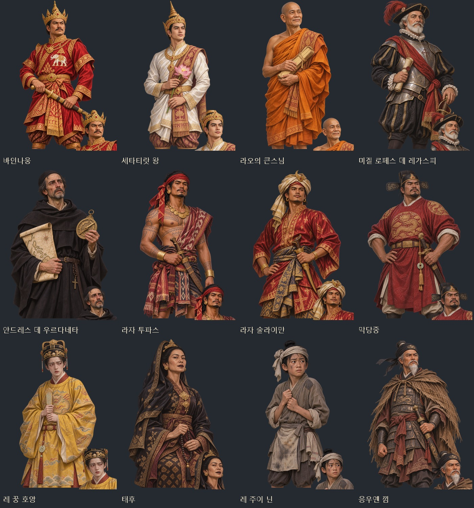
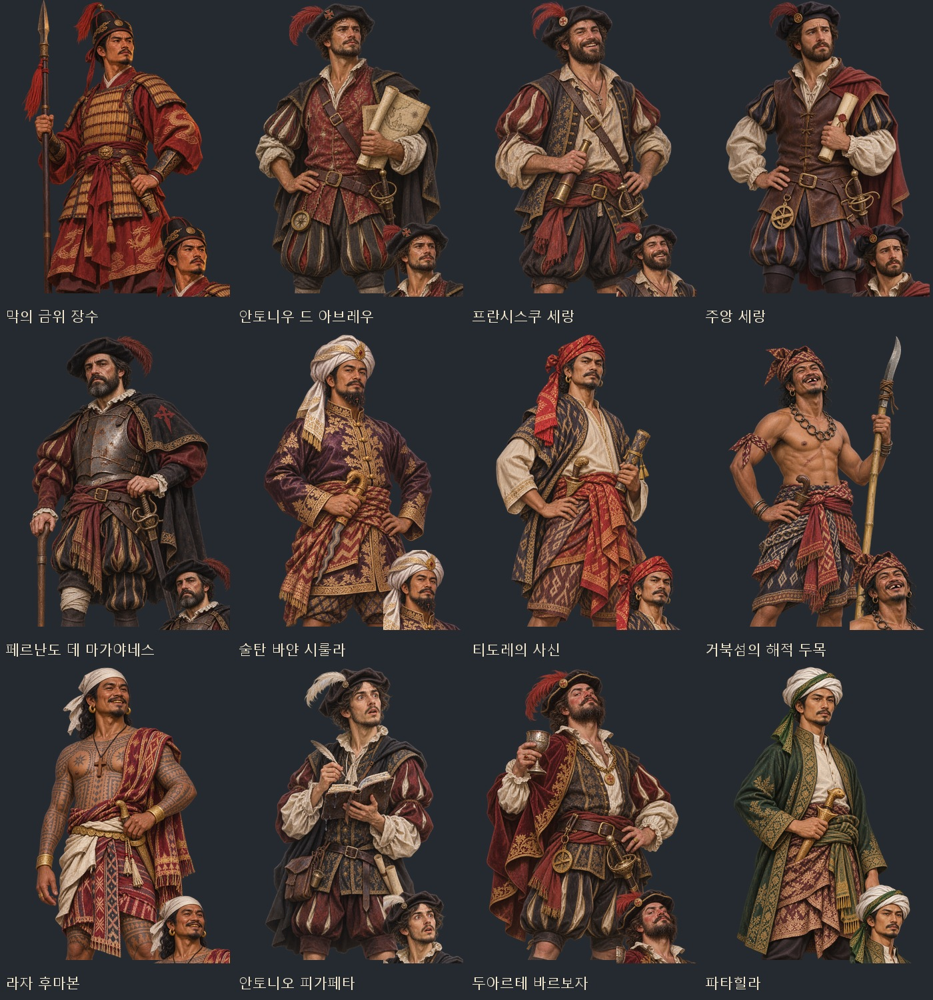
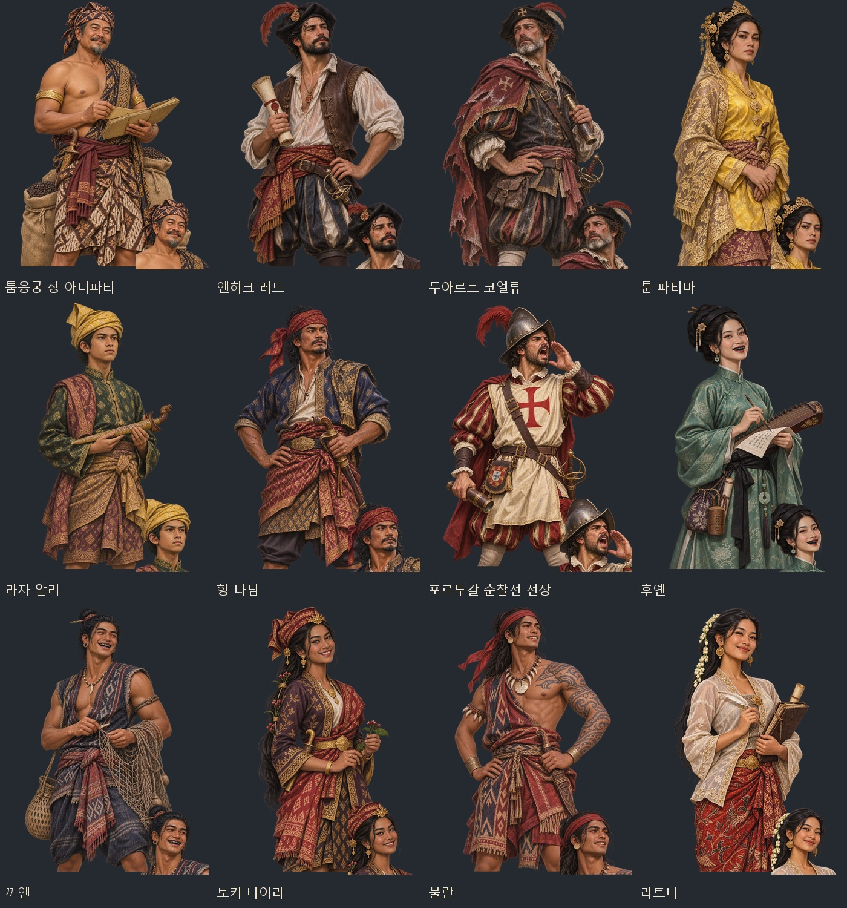
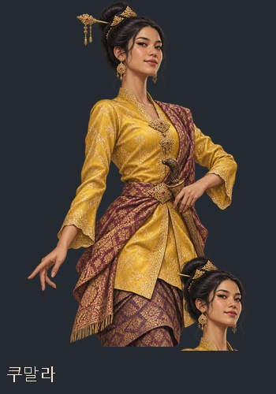
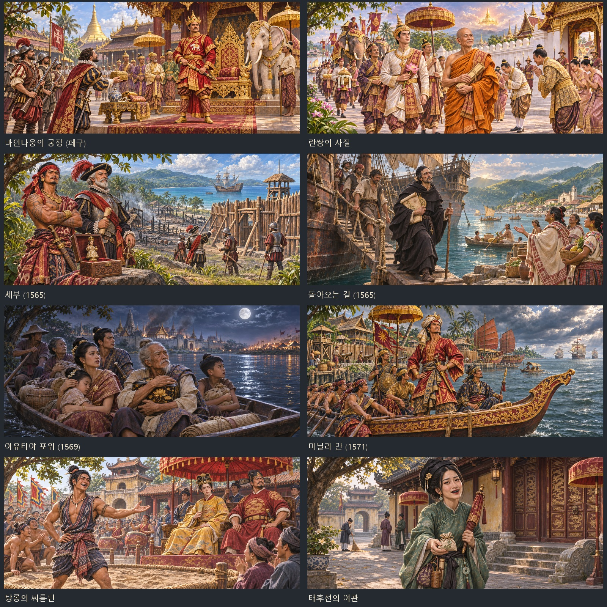
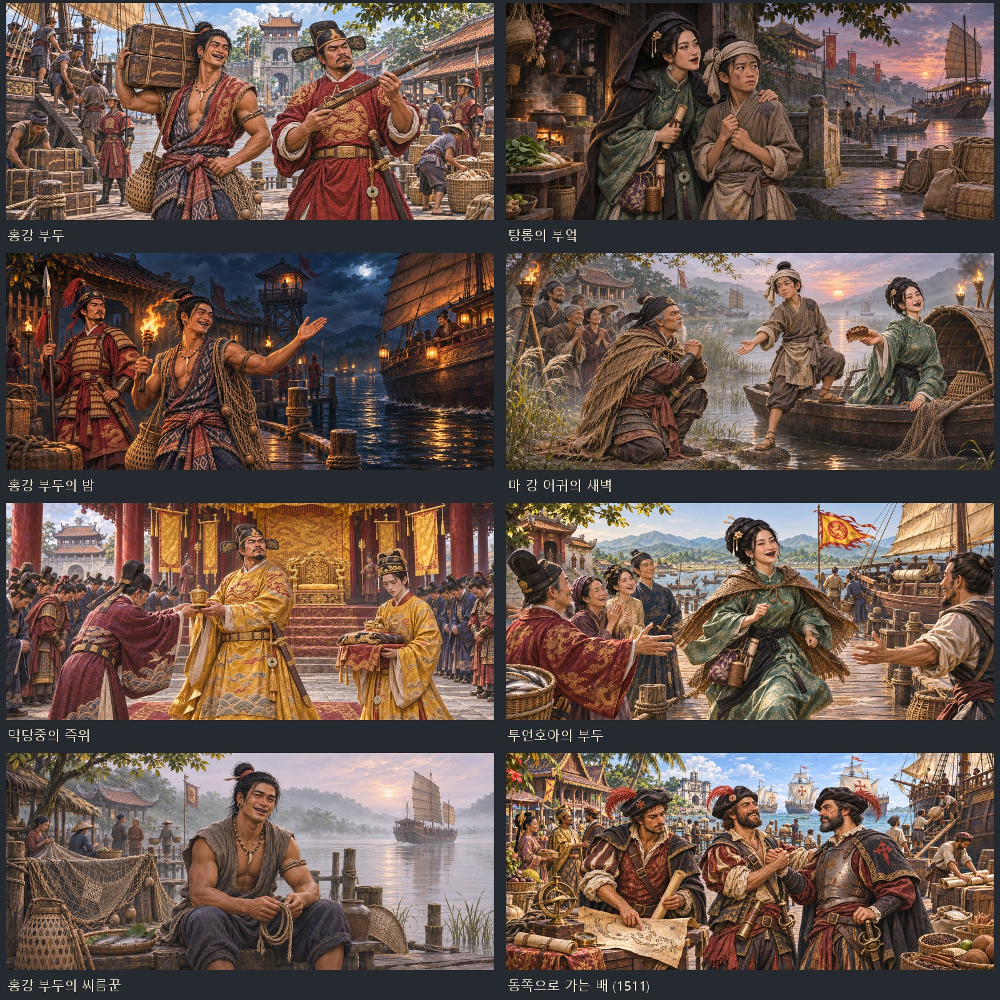
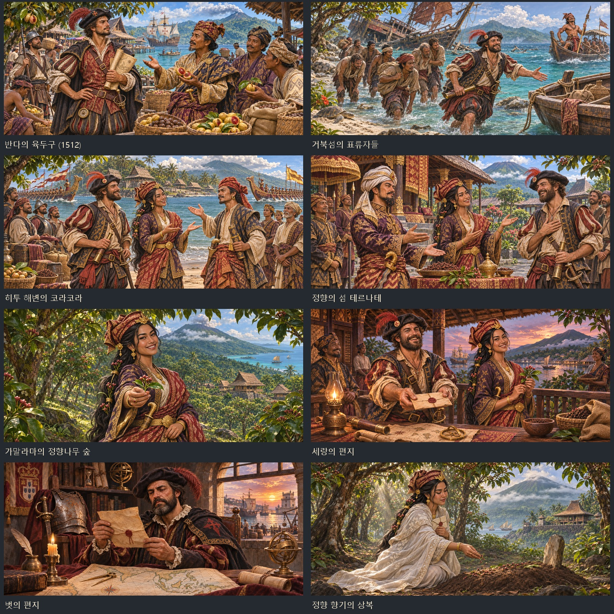
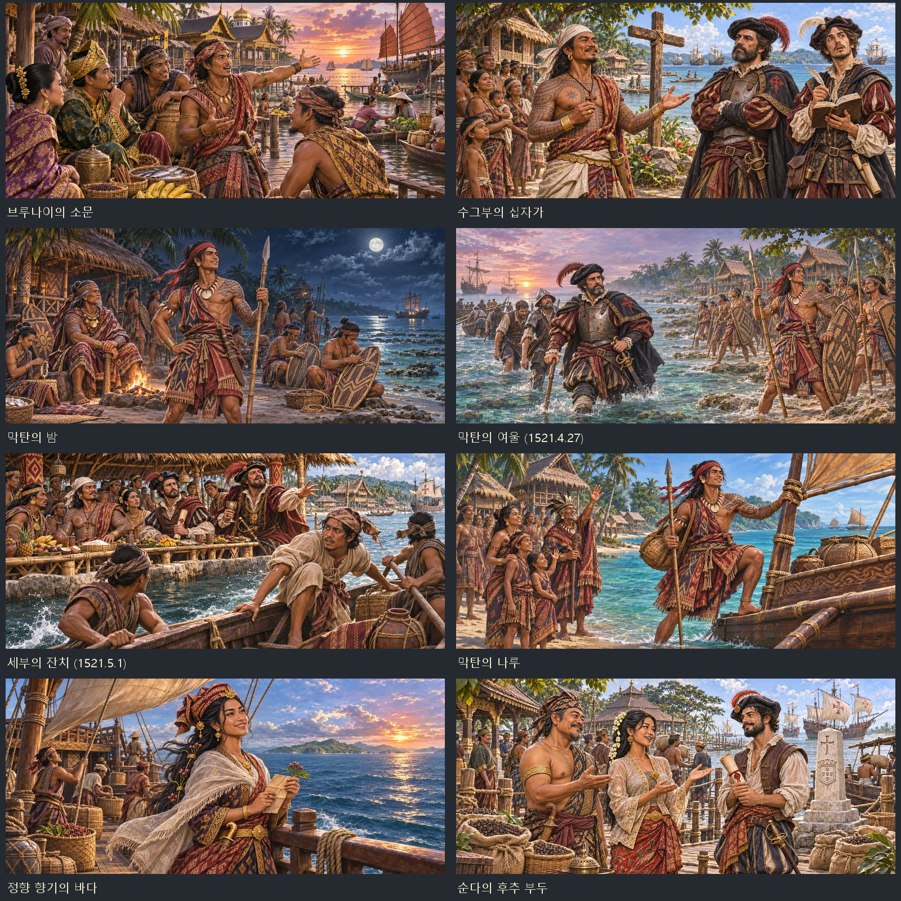
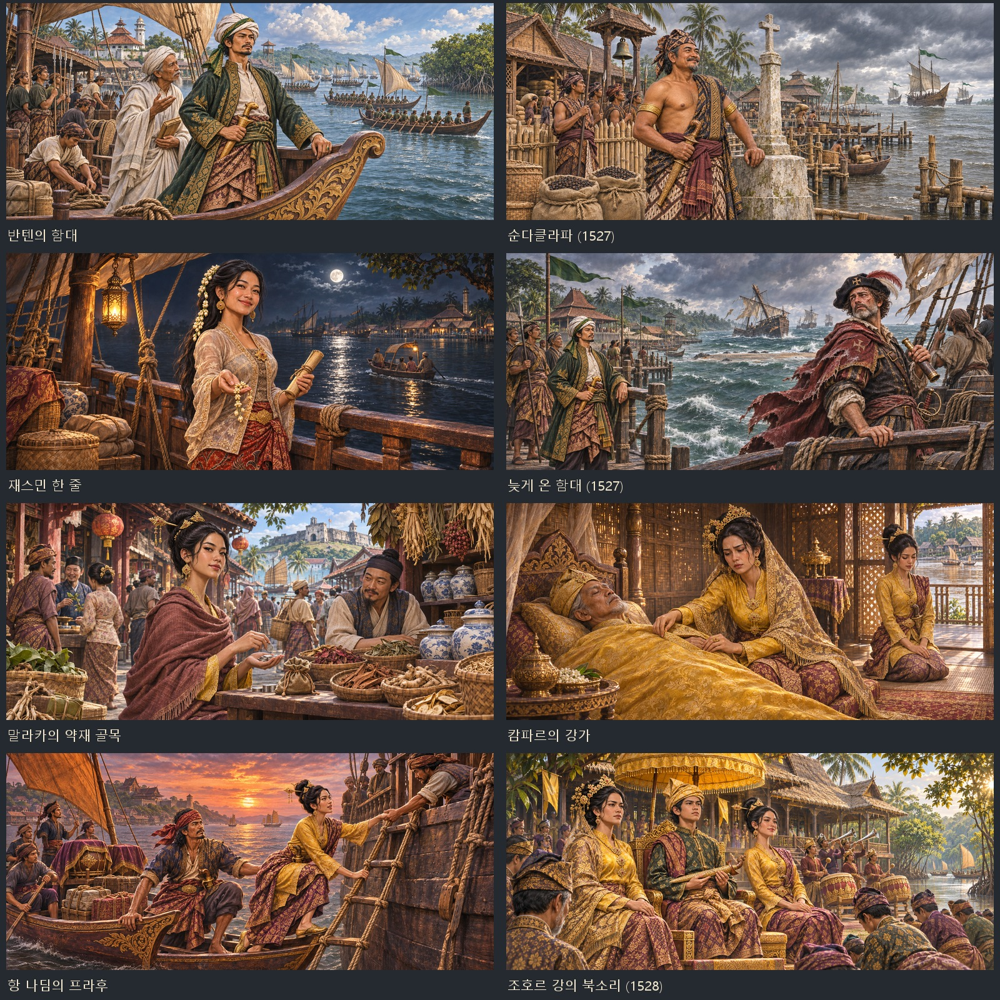

# 동남아 네 사건 묶음 인물화·장면 (2026-11-07)

추가된 `seasia16`, `macdang`, `spicemactan`, `sundajohor` 자료와 실제 `withPic` 호출을 기준으로 인물 37명과 장면 40종을 제작했다. 역사 인물 31명과 사건 동료 6명에게 각각 투명 얼굴상 448×448·무릎상 1024×1536 한 쌍을 배정했다. 장면은 게임 표준 1881×836 WebP로 저장했다.

내장 `image_gen`을 사용하며, 얼굴상은 각 무릎 원화에서 추출한다. 얼굴을 다른 몸에 붙이지 않는다. 기존 인물 ID와 사건 분기는 그대로 사용한다. 레 주이 닌은 열두 살, 라자 알리는 열다섯 살의 옷차림과 몸 비율로 그린다. 후옌·끼엔·나이라·불란·라트나·쿠말라는 성인 동료로 그린다.

## 파일

- [전체 제작 지시문·원본 연결](../../tools/seasia_event_art_20261107_prompts.json)
- [장면별 구도·등장인물 지정](../../tools/seasia_event_art_20261107_scenes.json)
- [원화·검사·실제 화면 폴더](../../artifacts/seasia-event-art-20261107/)
- [게임용 114장·지시문·미리보기 묶음](../../artifacts/seasia-event-art-20261107/seasia-event-art-20261107.zip)
- `images/portraits/history/{sa,md,sm,sj}_*.webp`: 역사 인물 31명, 얼굴·무릎 62장
- `images/portraits/mates/{md,sm,sj}_*.webp`: 동료 6명, 얼굴·무릎 12장
- `images/legend-events/{sa,md,sm,sj}_*.webp`: 장면 40장

## 인물 미리보기

## 이벤트샷 미리보기

## 제작·검증 도구

`python tools/package_seasia_event_art_20261107.py`는 원화를 저장소 안에 복사하고 규격·투명도를 확인한 뒤 이미지 목록과 미리보기·ZIP을 만든다. 원래 파일이 있으면 덮어쓰지 않는다.

`python tools/portrait_faces.py --merge --key …`로 이번 초상에 한해서 얼굴 좌표를 더한다. `node tests/seasia_event_art_20261107_smoke.cjs`는 실제 file:// 게임에서 인물 37명의 얼굴·몸 선택, 74개 대화 표시, 사건샷 40개 표시·종료와 콘솔 오류를 검사하고 실제 화면을 남긴다.

## 최종 확인 (2026-11-08)

- 인물 원화 37종: 모두 서로 다른 파일, 1024×1536, 투명 알파 확인.
- 게임용 114장: 얼굴 37·무릎 37·사건샷 40, 규격·해독·경로 확인. [파일 검사 기록](../../artifacts/seasia-event-art-20261107/asset-checks.json).
- 얼굴 좌표 74장 등록. 기존 인물 5명(응우옌 빈 키엠·라푸라푸·엔리케·순안 구능 자티·마흐무드 샤)도 기존 얼굴·무릎 원화가 모두 있음을 확인했다.
- `node tests/seasia_event_art_20261107_smoke.cjs` 통과: 실제 역사/전설 화자 연결, 얼굴·무릎 대화 74개, 장면 40개 표시·종료, 장면 중 무릎상 숨김, 새 동료 6명의 도감 연결. 콘솔 오류·실패한 이미지 요청 0. [검사 결과](../../artifacts/seasia-event-art-20261107/runtime/checks.json).
- 실제 화면 50장 저장. 검사에 띄운 Chromium과 테스트 과정을 종료했다.

