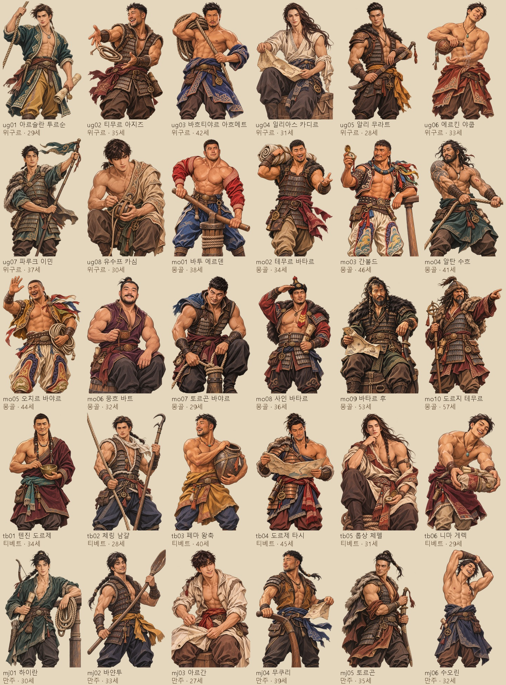
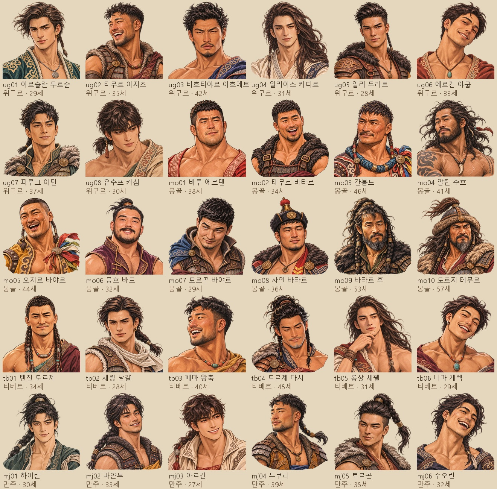

# 위구르·몽골·티베트·만주 남성 항해사 30쌍

2026-11-17, 내장 ImageGen으로 창작 성인 남성 30명의 얼굴상·무릎상 60장을 제작했다. 첨부한 사진의 얼굴 골격·시선·표정·머리 흐름을 참고하고, 얼굴부터 손·근육·천·가죽·금속까지 같은 게임 회화풍으로 표현했다. 짧은 머리·장발·땋은 머리·상투·수염을 나누고, 강한 시선과 잔잔한 미소·눈웃음·활짝 웃는 표정을 섞었다.

## 인물과 복식

- 위구르 8명(`ug01~08`), 몽골 10명(`mo01~10`), 티베트 6명(`tb01~06`), 만주 6명(`mj01~06`). 나이는 27~57세다.
- 전통복 10명, 기마병 복식 8명, 장군 복식 5명, 상의 탈의 7명이다. 열린 옷깃·한쪽 어깨를 내린 포·민소매 갑옷·조끼·허리에 묶은 겉옷을 나눴다.
- 몽골식 포의 여밈·자수 띠·씨름복의 열린 앞섶과 소매, 층층이 엮은 갑옷·모피 가장자리·기마용 허리띠를 변형했다. 티베트 인물은 한쪽 팔을 뺀 포와 양옆 땋은 머리, 만주 인물은 기마복의 주름과 긴 땋은 머리를 조합했다.
- 밧줄 던지기·어깨에 메기·매듭 묶기·권양기 돌리기·돛 꾸러미 운반·나침반 확인·지도 읽기·노 젓기·조타·돛 수선·물 건네기·손인사·기지개 등 서로 다른 동작을 사용했다.
- 바람에 흐트러진 잔머리와 옷자락, 땀과 파도의 작은 반사광, 소금기와 닳은 옷 가장자리로 항해 뒤의 분위기를 냈다.

출신은 사용자가 지정한 게임 속 분류다. 사진 속 인물의 실제 출신을 판정하지 않았으며, 이름·직업·복식은 창작 설정이다. 첨부 11·12번의 갑옷과 모피는 복식 참고로도 사용했다. 특정 시대의 고증 복식으로 제시하지 않는다.

## 파일과 등록

- 얼굴상은 `images/portraits/mates/steppe-windsalt/<ID>.webp`, 512×512 투명 WebP다.
- 무릎상은 같은 이름의 `<ID>_half.webp`, 1024×1536 투명 WebP다.
- 얼굴상은 완성된 해당 무릎상을 참고해 별도로 생성하여 머리·수염·장식·표정·시선·옷깃을 맞췄다. 내보내기에서는 크기 조정과 WebP 변환만 했다.
- `images/manifest.js`에 이미지 열쇠 60개, `js/data/portraitfaces.js`에 얼굴·눈·입의 자리를 등록했다.
- 30명을 `steppe_<ID>` 실제 부하 후보로 등록했다. 해당 지역 발견물을 처음 직접 찾은 날부터 지역별로 5년마다 미고용 후보 최대 3명이 순환하고, 40년마다 순서를 새로 섞는다. [정확한 등장 조건·활동 도시·검증](../steppe-crew-20261117.md)

[전체 생성 지시문·인물 설정·사진 대응·원본 경로·해시](../../tools/steppe_windsalt_20261117_prompts.json) · [등록 열쇠](../../tools/steppe_windsalt_20261117_keys.json) · [원본 보존·내보내기 도구](../../tools/package_steppe_windsalt_20261117.py)

원본 PNG와 전달 묶음은 저장소 상위 `output/steppe-windsalt-navigators-30-20261117/`에 있다. `sources/face/`·`sources/knee/`에 원본 60장, `prompts-final.json`에 최종 생성 기록을 보존했다. `steppe-windsalt-navigators-30-game-ready.zip`에는 게임용 그림 60장과 최종 생성 기록을 담았다.

## 검증

전체 미리보기로 얼굴상과 무릎상의 짝·표정·머리·복식·동작을 확인했다. 포장 도구에서 60장의 규격·투명 알파·고유 해시를 검사하고 ZIP 무결성도 확인했다.

`node tests/steppe_windsalt_art_20261117_smoke.cjs`는 실제 `file://` 게임과 도감에서 60개 이미지의 등록·읽기·크기·투명도·얼굴 자리 범위를 검사한다. 네 출신의 얼굴상·무릎상 표시를 저장하고 `pageerror`·`console.error`가 없는지 확인한다. 브라우저는 `finally`에서 종료한다.

[검사 결과](../../artifacts/steppe-windsalt-20261117/report.json) · [네 출신 표시 화면](../../artifacts/steppe-windsalt-20261117/four-origins-in-game.png)
