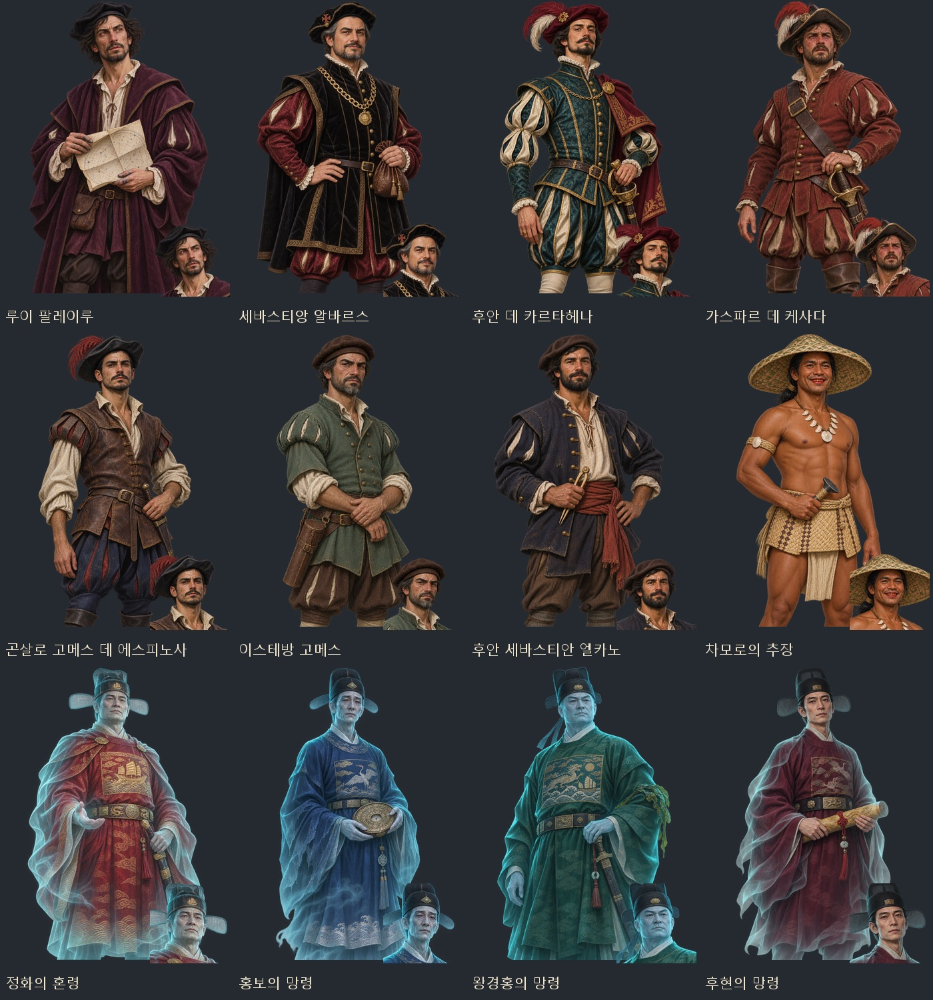
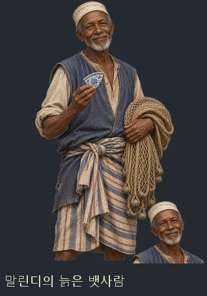
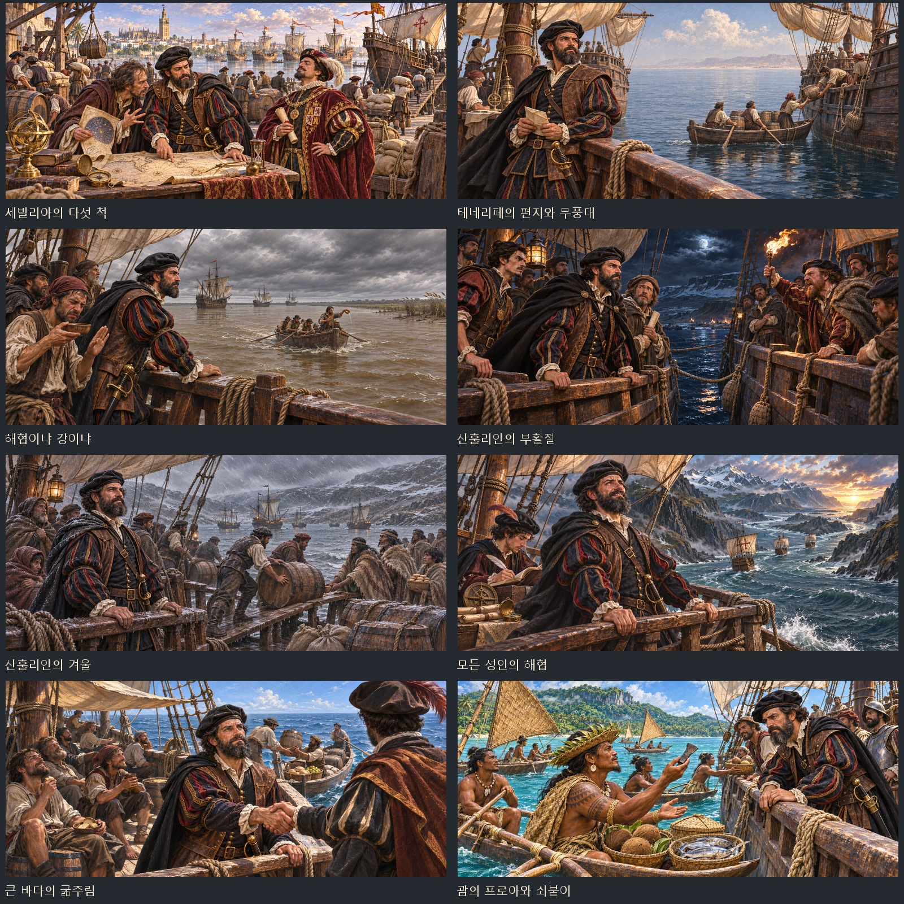
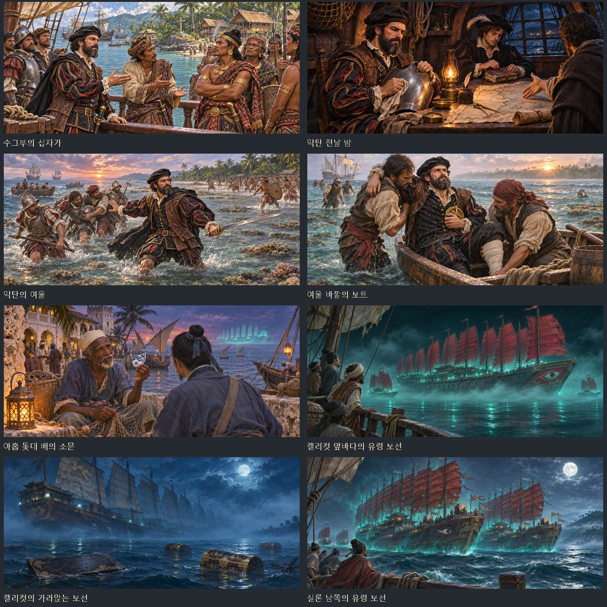
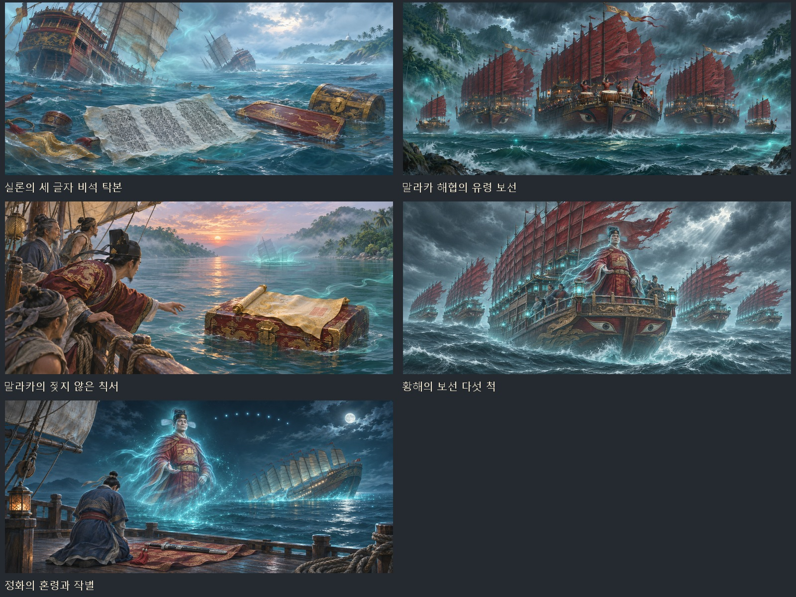

# 마젤란의 세계 일주 · 정화의 유령 보선 인물화와 사건샷

2026-11-08 추가된 두 사건 묶음에 새 인물 13명의 얼굴상·무릎상 26장과 사건샷 21장을 연결했다. 내장 `image_gen`으로 서로 다른 원화 34종을 제작했다.

| 구분 | 새 인물 | 얼굴·무릎상 | 사건샷 |
|---|---:|---:|---:|
| 마젤란의 세계 일주 | 8명 | 16장 | 12장 |
| 정화의 유령 보선 | 혼령 4명·뱃사람 1명 | 10장 | 9장 |
| 합계 | 13명 | 26장 | 21장 |

마젤란·피가페타는 기존 원화를 재사용한다. 역사 인물 마젤란은 기존 이름별 초상을, 합류한 동료 마젤란은 자료에 지정된 `portraits/history/magellan` 초상을 고르는 게임의 기존 우선순위를 유지한다. 피가페타는 같은 사람인 향료제도·막탄 사건의 `sm_pigafetta` 초상을 연결했다. 말린디의 늙은 뱃사람은 실제 소문 대화에서 새 얼굴·무릎상을 쓴다. 동료 마젤란의 자료는 도감에도 추가했다.

## 파일과 제작 지시문

- [게임용 47장·미리보기·제작 지시문 ZIP](../../artifacts/voyage-event-art-20261108/voyage-event-art-20261108.zip)
- [인물·장면별 프롬프트와 원화 경로](../../tools/voyage_event_art_20261108_prompts.json)
- [원화·생성 기록·실제 화면 폴더](../../artifacts/voyage-event-art-20261108/)
- [파일 검사 기록](../../artifacts/voyage-event-art-20261108/asset-checks.json)

인물 원화는 1024×1536 투명 PNG다. 같은 원화에서 448×448 얼굴상을 잘라 인상이 이어지도록 했고, 무릎상은 1024×1536 투명 WebP로 보관한다. 사건샷은 1881×836 WebP다. 정화의 혼령들은 붉은색·남색·녹색·검붉은 관복과 나경·칼·칙서 등의 소품으로 구분하며, 푸른 빛과 안개를 사용했다.

게임 파일은 `images/portraits/history/{mg,zh}_*.webp`와 `images/legend-events/{mg,zh}_*.webp`에 있다. 기존 그림을 덮어쓰지 않고, 새 경로를 이미지 목록에 등록했다. `python tools/images.py`로 목록을 다시 만들어도 실제 파일에서 등록이 유지된다.

## 인물 미리보기

## 사건샷 미리보기

## 검증

`python tools/package_voyage_event_art_20261108.py`는 원화를 작업 폴더에 복사하고 게임용 WebP·이미지 목록·미리보기·ZIP을 만든다. 원화 34종은 모두 다른 파일이며, 게임용 47장의 해독·규격·투명도 검사를 통과했다. 얼굴 위치는 `python tools/portrait_faces.py --merge --keys-file artifacts/voyage-event-art-20261108/portrait-keys.json`으로 이번 초상 26장에만 추가했다.

기존 `tests/magellan_smoke.js`와 `tests/zhenghe_smoke.js`는 설치된 `tools/procedural_art/node_modules/playwright-core`를 `playwright` 별칭으로 연결하고 Chrome 경로를 지정해 통과했다. 사건 분기·보상·마젤란 구조와 합류·유령 보선의 네 단계와 작별을 확인했다.

새 파일 검사는 `node tests/voyage_event_art_20261108_smoke.cjs`로 실행한다. 실제 소문 사건에서 뱃사람 화자를 받아 검사하며, 새 초상 13쌍·기존 초상 2쌍·사건샷 21장과 도감의 동료 마젤란 연결을 확인한다. 실제 화면과 결과는 위 폴더의 `runtime/`에 저장한다.

최종 검사 통과: 얼굴·무릎 대화 26회, 사건샷 21종의 해독·표시·종료, 사건샷 중 무릎상 숨김, 기존 인물 초상과 동료 도감 연결. 콘솔 오류·실패한 이미지 요청 0. [검사 결과](../../artifacts/voyage-event-art-20261108/runtime/checks.json). 실제 항구 화면에서 캡처 34장을 남겼고, 검사에 띄운 Chromium과 실행 과정을 모두 종료했다.

