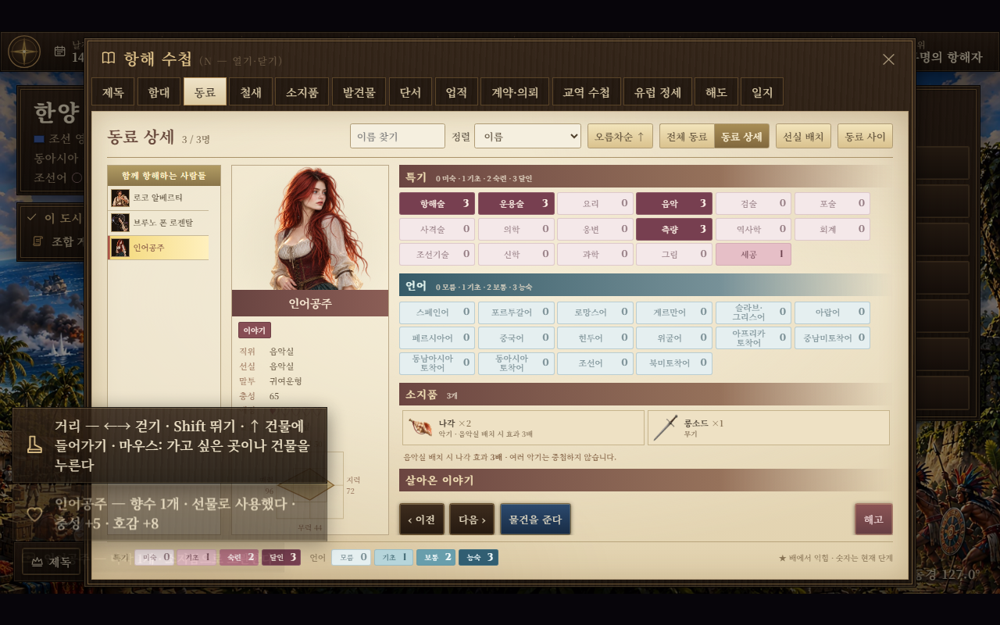
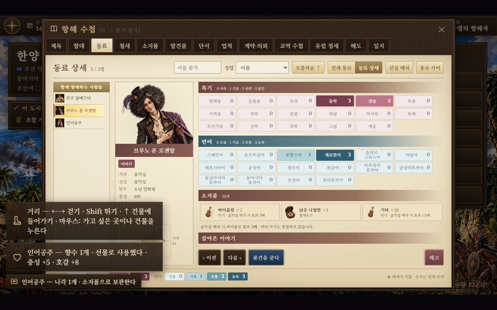
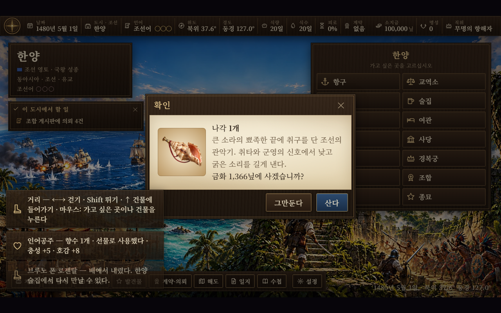

# 동료 소지품·음악실 악기 — 2026-11-01

수첩의 동료 상세에서 물건을 전달하고, 받은 동료의 소지품과 음악실 효과를 확인한다. 술집·여관에서 「부하와 이야기 → 선물한다」를 골라도 같은 전달 창을 쓴다.

## 전달과 보관

- 수첩 → 동료 → 한 사람 선택 → 「물건을 준다」에서 한 번에 한 개씩 준다. 무기·방어구·항해도구·악기 등은 남녀 모두 받을 수 있다.
- 호감용 장신구·남자 선물(`gift`·`mgift`, `gv > 0`)은 기존 대상 구분대로 사용한다. 전달 창에서 「선물로 소모」「동료가 보관」을 구분해 표시한다.
- 받은 물건은 `m.items`에 보관하고 동료 상세의 「소지품」에 그림·수량·분류를 표시한다. 일반 물건은 같은 ID끼리 묶고, 개별 이름·발견 기록 등은 별개로 유지한다.
- 구매 도시·치른 값·이름·남은 사용 횟수를 그대로 보존한다. 저장 복원과 단기 해고 뒤 재등용에도 보관 상태가 이어진다. 옛 저장의 소지품 필드가 없으면 빈 목록으로 읽는다.
- 미보고 증거품·청혼 반지·가족 사진, 제독이 착용 중인 마지막 장비 한 벌은 남긴다. 같은 장비를 두 개 이상 가진 경우 남는 한 개를 줄 수 있다.

무기·방어구를 줄 때의 충성 보너스와 호감용 선물의 기존 충성·호감 규칙을 유지한다. 일반 도구·악기는 보관하며, 호감은 소모한 호감용 선물에서만 오른다.

## 음악실 효과

| 음악실 담당자가 직접 소지한 악기 | 효과 |
|---|---:|
| 일반 악기 | 1.5배 |
| 브루노 폰 로젠탈의 바이올린 | 3배 |
| 인어공주의 나각 | 3배 |

담당자가 직접 보관한 악기만 음악실의 피로 감소 효과를 증폭한다. 제독의 소지품이나 다른 동료의 악기는 대신 적용하지 않는다. 악기 종류·수량은 중첩하지 않고 가장 높은 배율 하나를 쓴다. 음악실 이외의 방에는 영향을 주지 않는다.

조정값은 `G.BALANCE.cabins.musicInstrument`다. 기본 방의 힘과 충성 효율을 구한 뒤 기존 기본 힘 상한을 적용하고 악기 배율을 반영한다. 여러 음악실은 담당자별 기본 힘으로 가중한 배율을 사용해 상한을 유지하면서 전용 악기의 3배 효과가 줄지 않게 했다. 선실 카드·추천 목록에도 담당 악기와 배율을 표시한다.





## 나각 원화

기존 `nagak` ID·조선 판매처·가격은 유지한다. 내장 `image_gen`으로 새 원화를 만들고 `images/items/nagak.webp`로 저장했다(256×256 RGBA, 19,680바이트, 투명 여백 최소 16px). 소라의 층·입구와 금속 취구·붉은 휴대 끈을 표현했다.

[전체 생성 지시문과 원본 경로](../art/companion-instruments-prompts-20261101.json). 원본은 `artifacts/companion-instruments-20261101/raw/nagak.png`, 변환 결과는 같은 폴더의 `assets.json`이다.



```powershell
python tools/instrument_item_art.py --spec docs/art/companion-instruments-prompts-20261101.json --out artifacts/companion-instruments-20261101
python tools/images.py
node tests/companion_inventory_music_smoke.cjs
```

## 검증

새 시험은 실제 음악실 효과의 1.5배·3배, 여러 악기의 중첩 방지, 다른 방과 다른 소유자에게 영향이 없는지 검사한다. 묶음 전달·구매 기록·개별 상태·증거품·착용 장비 보호, 저장·재등용을 확인하고 실제 수첩 창에서 향수 소비와 나각 보관을 조작한다. 나각의 시장 구매 확인과 도감 전용 원화 연결도 검사한다.

기존 `fairytale_mermaid_gift_smoke.js`, `matebook_smoke.js`, `cabin_main_skill_smoke.js`, `studio_cabins_smoke.js`도 실행한다. 회귀 시험은 로컬 `playwright-core`를 기존 `playwright` 요청에 연결하고 설치된 Chrome 경로로 실행한다.

결과: 신규 시험과 위 회귀 시험 4종 모두 통과. `pageerror`·`console.error` 0건, `git diff --check` 통과. 실제 소지품·배율 화면을 확인했고 시험용 브라우저와 실행 과정은 종료했다.
