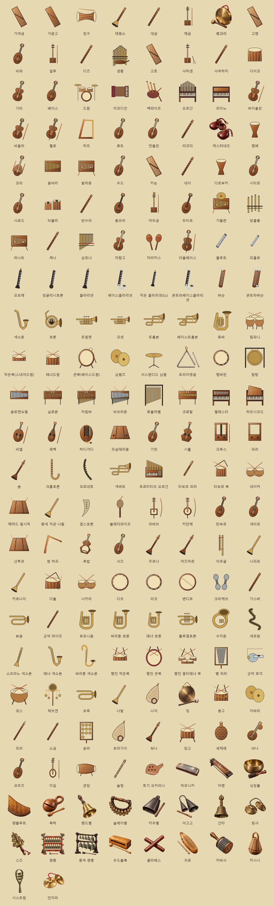
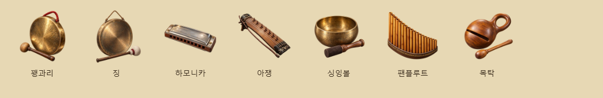
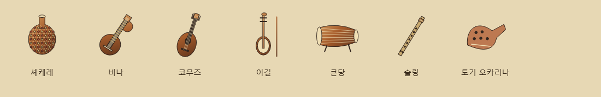
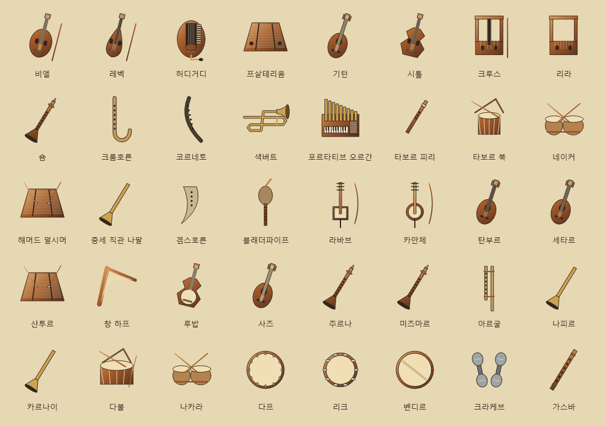
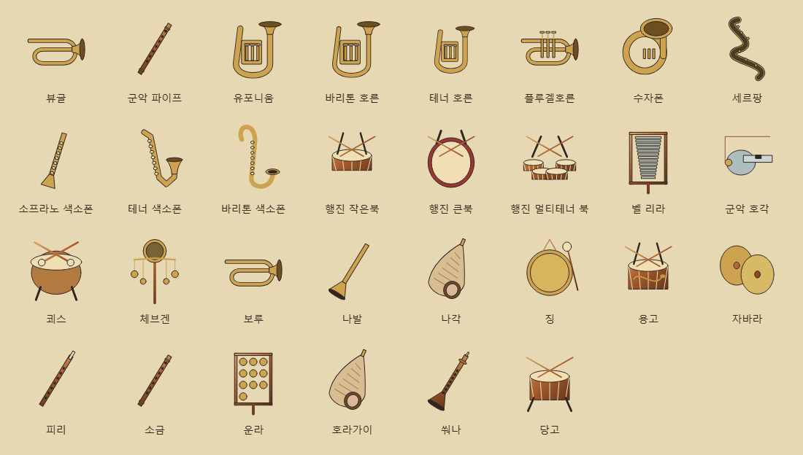
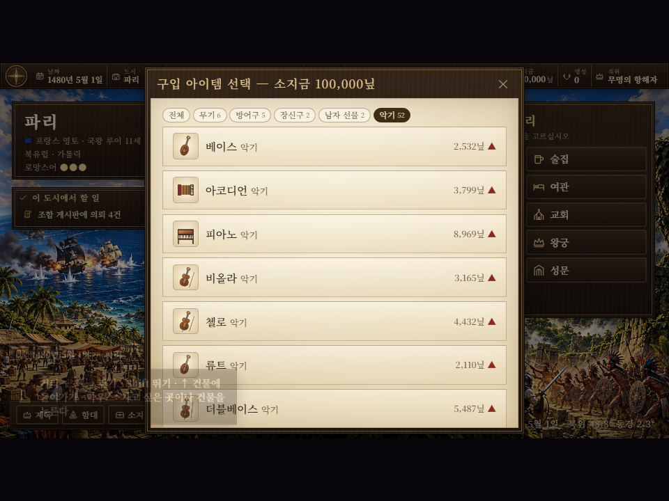

# 지역별 시장 악기 186종·모든 시장 최소 5종 — 2026-11-01

> 2026-11-03 변경: 현재 진열 규칙은 시장당 **최대 3종, 게임 시간 7일마다 무작위 교체**다. 아래 최소 5종·45일 규칙은 변경 전 기록이다. [현재 규칙과 검증](instrument-weekly-20261103.md).

시장에서 사고팔고 소지품·자택 보관함에 모을 수 있는 악기 186종을 추가했다. 지역 악기 53종에 오케스트라 기본 편성과 주요 보조 악기 35종, 중세 유럽·중세 말 고악기 20종, 이슬람권 전통 악기 20종, 군악·행진·신호용 악기 30종, 지역별 최소 구성 보강 7종, 하모니카·아쟁 2종, 싱잉볼·팬플루트 2종, 목탁 1종을 포함한다. 기존 `G.ITEMS`에 자료를 넣어 새 게임과 기존 저장 모두에 적용한다. 저장 형식이나 기존 아이템 ID는 바꾸지 않는다.

## 판매 지역과 품목

후속으로 종 계열 9종과 소형 타악기 7종을 추가했다. 캐스터네츠·트라이앵글은 기존 품목을 유지하며 전용 외형과 검색을 보강했다. [18종 외형·판매처·참고 자료·검증 기록](../art/bells-small-percussion-20261101.md).

| 지역 | 품목 |
| --- | --- |
| 조선 | 가야금, 거문고, 장구, 태평소, 대금, 해금, 꽹과리, 아쟁, 목탁 |
| 중국 | 고쟁, 비파, 얼후, 디즈, 생황 |
| 일본 | 고토, 샤미센, 샤쿠하치, 다이코 |
| 이베리아·북유럽·지중해 | 기타, 베이스, 드럼, 아코디언, 백파이프, 오르간, 피아노, 바이올린, 비올라, 첼로, 하프, 류트, 만돌린, 리코더, 캐스터네츠, 팬플루트(북유럽·지중해) |
| 아프리카 | 젬베, 코라, 음비라, 발라폰, 셰케레 |
| 중근동 | 우드, 카눈, 네이, 다르부카 |
| 인도 | 시타르, 사로드, 타블라, 반수리, 비나, 싱잉볼 |
| 중앙아시아 | 돔브라, 마두금, 두타르, 네이, 코무즈, 이길, 싱잉볼 |
| 동남아시아 | 가믈란, 앙클룽, 라나트, 큰당, 술링 |
| 아메리카 | 케나, 삼포냐, 차랑고, 마라카스, 토기 오카리나 |

유럽 안에서도 기타·캐스터네츠는 이베리아, 백파이프는 북유럽, 만돌린은 지중해 시장에 배치했다. 정확한 판매처는 각 악기 자료의 `reg`와 도감의 「판매 시장」에 표시한다. 조선과 중국은 지역 번호 6을 함께 쓰므로 `subRegion`을 `G.subRegion(도시)`와 비교해 구분한다. 네이는 중근동·중앙아시아 양쪽에서 판다.

## 지역별 대표 악기 최소 5종과 실제 진열 보장

군악 수입품만으로 수를 채우지 않고 각 지역의 대표 악기 다섯 종류를 별도로 검사한다. 조선·중국은 같은 지역 번호 6 안에서 나누므로 11개 지역 번호, 12개 문화권을 기준으로 삼는다.

| 문화권 | 대표 악기 5종 |
| --- | --- |
| 이베리아 | 기타, 캐스터네츠, 기턴, 시톨, 타보르 피리 |
| 북유럽 | 백파이프, 크루스, 리라, 리코더, 허디거디 |
| 지중해 | 류트, 만돌린, 레벡, 숌, 포르타티브 오르간 |
| 아프리카 | 젬베, 코라, 음비라, 발라폰, 셰케레 |
| 중근동 | 우드, 카눈, 네이, 다르부카, 산투르 |
| 인도 | 시타르, 사로드, 타블라, 반수리, 비나 |
| 조선 | 가야금, 거문고, 장구, 태평소, 대금 |
| 중국 | 고쟁, 비파, 얼후, 디즈, 생황 |
| 중앙아시아 | 돔브라, 마두금, 두타르, 코무즈, 이길 |
| 동남아시아 | 가믈란, 앙클룽, 라나트, 큰당, 술링 |
| 일본 | 고토, 샤미센, 샤쿠하치, 다이코, 호라가이 |
| 아메리카 | 케나, 삼포냐, 차랑고, 마라카스, 토기 오카리나 |

추가한 7종은 셰케레(아프리카), 비나(인도), 코무즈·이길(중앙아시아), 큰당·술링(동남아시아), 토기 오카리나(아메리카)다. 새 악기는 종교 제한 없이 그 지역에서 판매한다. 이슬람권 악기를 살 수 없는 아프리카·인도·중앙아시아 도시도 최소 구성을 갖춘다.

`G.BALANCE.marketInstrumentMin = 5`를 조정값으로 두었다. `MK.stock`은 기존 추첨을 마친 다음 악기가 다섯 종류 미만이면 **그 도시에서 판매 가능한 악기 중 아직 진열하지 않은 것**을 같은 난수 생성기로 뽑아 보충한다. 같은 도시·45일 입고 주기는 같은 진열을 유지한다. 지역·조선/중국·종교·판매 연도·희귀품 조건은 모두 보충 전에 적용하므로 다른 고장의 악기를 끌어오지 않는다. 일반 물건의 입고 추첨과 고향 항해도구·라임 상시 판매는 유지한다.

전체 도시를 다섯 입고 주기로 검사한 문화권별 실제 최저 진열 수는 이베리아 16, 북유럽 49, 지중해 48, 중근동 10, 아프리카 5, 중앙아시아 5, 인도 5, 동남아시아 5, 중국 5, 조선 8, 일본 5, 아메리카 7종이었다. 이는 검사 구간의 최저값이며 보장 하한은 모든 시장에 5종이다.

자료: [스미스소니언의 셰케레](https://www.americanhistory.si.edu/collections/object/nmah_1216678), [메트로폴리탄 미술관의 비나](https://www.metmuseum.org/art/collection/search/506151), [유네스코 아태무형유산센터 코무즈 안내](https://ichcourier.unesco-ichcap.org/board.es?act=view&bid=A102&list_no=290&mid=a10501000000), [스미스소니언의 가믈란 편성 안내](https://asia.si.edu/explore-art-culture/audio/javanese-gamelan-music/), [메트로폴리탄 미술관의 토기 오카리나](https://www.metmuseum.org/art/collection/search/504008).

## 오케스트라 악기 35종 보강

기본 현악·목관·금관·타악 편성에 주요 보조 악기와 건반악기를 포함했다. 기존 바이올린·비올라·첼로·하프·피아노·오르간과 합쳐 41종의 오케스트라 악기를 검사한다. 악기 구성은 [필하모니아의 악기 안내](https://philharmonia.co.uk/resources/instruments/)와 [타악기 안내](https://philharmonia.co.uk/resources/instruments/percussion/)를 참고했다. 색소폰·코넷·콘트라베이스클라리넷·크로탈·하프시코드 등은 곡에 따라 쓰는 보조·확장 악기로 설명한다.

| 갈래 | 이번에 추가한 품목 |
| --- | --- |
| 현악 | 더블베이스(콘트라베이스) |
| 목관 | 플루트, 피콜로, 오보에, 잉글리시호른(코르 앙글레), 클라리넷, 베이스클라리넷, 작은 클라리넷(E♭), 콘트라베이스클라리넷, 바순, 콘트라바순, 색소폰 |
| 금관 | 호른, 트럼펫, 코넷, 트롬본, 베이스트롬본, 튜바 |
| 타악 | 팀파니, 작은북(스네어드럼), 테너드럼, 큰북(베이스드럼), 심벌즈, 서스펜디드 심벌, 트라이앵글, 탬버린, 탐탐, 글로켄슈필, 실로폰, 마림바, 비브라폰, 튜블러벨, 크로탈 |
| 건반 | 첼레스타, 하프시코드 |

35종 모두 북유럽·지중해 시장에서 팔고, 작은북·큰북·심벌즈·트라이앵글·탬버린은 이베리아에서도 판다. 더블베이스는 기존 네 줄 베이스, 작은북·큰북은 기존 드럼 세트와 ID·그림·설명을 따로 둔다. 리코더와 플루트, 태평소와 호른도 각각 별도 악기다.

## 중세 유럽·이슬람권 40종 보강

중세 유럽과 중세 말·르네상스의 고악기, 아랍·페르시아·아나톨리아·마그레브·중앙아시아의 음악 전통을 추가한다. 이슬람권은 여러 지역의 음악 문화를 가리키며 모든 악기의 현재 형태를 중세까지 소급하지 않는다. 크룸호른·코르네토·색버트·해머드 덜시머·겜스호른은 전통 표기에 「중세 말·르네상스 유럽」을 쓴다.

| 음악 전통 | 추가 품목 |
| --- | --- |
| 중세 유럽 현악 | 비엘, 레벡, 허디거디, 프살테리움, 기턴, 시톨, 크루스, 리라 |
| 중세 유럽 관악·건반·타악 | 숌, 크룸호른, 코르네토, 색버트, 포르타티브 오르간, 타보르 피리, 타보르 북, 네이커, 해머드 덜시머, 중세 직관 나팔, 겜스호른, 블래더파이프 |
| 이슬람권 현악 | 라바브, 카만체, 탄부르, 세타르, 산투르, 창 하프, 루밥, 사즈 |
| 이슬람권 관악 | 주르나, 미즈마르, 아르굴, 나피르, 카르나이, 가스바 |
| 이슬람권 타악 | 다불, 나카라, 다프, 리크, 벤디르, 크라케브 |

유럽 고악기는 이베리아·북유럽·지중해 시장에 배치한다. 크루스와 블래더파이프는 북유럽, 르네상스 계열은 주로 북유럽·지중해에 둔다. 이슬람권 신규 악기는 품목별 `reg`와 함께 `marketRel: 'I'`를 검사해 해당 지역의 이슬람 문화권 도시에서만 판다. 이 조건은 기존 악기 판매처에는 적용하지 않는다. 이베리아의 그라나다, 지중해의 튀니스·알제·이스탄불, 아프리카의 이슬람 문화권 도시, 중근동·중앙아시아와 일부 인도 시장이 품목별 판매처다.

서로 가까운 악기는 설명과 그림으로 구별한다. 라바브는 활로 켜는 악기, 루밥은 가죽 울림판의 줄을 뜯는 악기다. 코르네토와 밸브 금관악기 코넷, 작은 중세 포르타티브 오르간과 기존 오르간도 각각 별도 ID를 쓴다. 도감은 `tradition`을 「음악 전통」으로 표시하고, 판매처에는 이슬람 문화권 조건을 덧붙인다.

자료: [케이스웨스턴리저브대 고악기 자료실](https://caslabs.case.edu/medren/), [아이오와주립대 Musica Antiqua 악기 안내](https://antiqua.music.iastate.edu/instruments), [메트로폴리탄 미술관의 카만체](https://www.metmuseum.org/art/collection/search/503503), [메트로폴리탄 미술관의 아르굴](https://www.metmuseum.org/art/collection/search/505290), [스미스소니언의 세타르 안내](https://asia-archive.si.edu/podcast/master-of-persian-music-hossein-alizadeh-tar-and-setar/), [스미스소니언의 나피르](https://americanhistory.si.edu/collections/object/nmah_1160853). 판매 지역·가격은 게임 배치를 위한 값이다.

## 군악·행진·신호용 악기 30종 보강

| 갈래 | 추가 품목 | 판매처 |
| --- | --- | --- |
| 서양 신호·관악 | 뷰글, 군악 파이프, 유포니움, 바리톤 호른, 테너 호른, 플루겔호른, 수자폰, 세르팡, 소프라노 색소폰, 테너 색소폰, 바리톤 색소폰 | 주로 북유럽·지중해, 일부 이베리아·아메리카 |
| 서양 행진·타악 | 행진 작은북, 행진 큰북, 행진 멀티테너 북, 벨 리라, 군악 호각 | 북유럽·지중해·아메리카, 일부 이베리아 |
| 오스만 메흐테르 | 쾨스, 체브겐, 보루 | 지중해·중근동의 이슬람 문화권 도시 |
| 조선 취타·행악 | 나발, 나각, 징, 용고, 자바라, 피리, 소금, 운라 | 조선 |
| 일본 신호 | 호라가이 | 일본 |
| 중국 고취·행렬 | 쒀나, 당고 | 중국 |

기존 군악기 29종은 같은 ID와 판매처를 유지하며 `military` 용도만 표시한다. 플루트·피콜로·오보에·클라리넷 계열·바순·색소폰, 호른·트럼펫·코넷·트롬본·튜바, 작은북·큰북·테너드럼·심벌즈·글로켄슈필, 백파이프·태평소·장구·주르나·다불·나카라·나피르·카르나이·네이커·중세 직관 나팔이 해당한다. 신규 30종과 합쳐 도감의 「군악」 검색은 59종을 보여 준다.

시장 구입·매각 목록에는 「악기 · 군악」을 표시한다. 도감은 카드와 검색에 군악 용도를 포함하고 상세에 「군악 용도」를 표시한다. 도감 검색에는 음악 전통도 포함한다. 신규 행진용 북은 휴대 받침·끈이 있는 별도 상품이며 오케스트라 북을 덮어쓰지 않는다. 뷰글은 밸브 없는 신호 나팔로 그리고, 나발과 소라 나각도 별도 형상으로 구분한다.

시대가 다른 군악 형식을 함께 수집하는 기존 게임 방침을 따른다. 근현대 군악대의 수자폰·유포니움·행진 멀티테너 북을 중세 악기로 설명하지 않는다. 악기를 가졌다고 전투력·규율 보너스나 새 군악 행동이 생기지는 않는다.

자료: [미 육군 군악대 악기 안내](https://www.goarmy.com/careers-and-jobs/specialty-careers/band), [스미스소니언의 군악 파이프](https://americanhistory.si.edu/collections/object/nmah_440935), [스미스소니언의 벨 리라](https://americanhistory.si.edu/collections/object/nmah_608103), [옥스퍼드 Bate Collection의 군악 세르팡](https://www.bate.ox.ac.uk/military-serpent), [튀르키예 문화관광부 메흐테르 안내](https://www.ktb.gov.tr/EN-120262/janissary-mehter-music.html), [국립국악원 취타 자료](https://archive.gugak.go.kr/portal/online/searchOnlineDetail?disp_seq=37), [메트로폴리탄 미술관의 쒀나](https://www.metmuseum.org/art/collection/search/500597).

## 하모니카·아쟁·꽹과리·징

| 악기 | 기준가 | 판매처 | 구성 |
| --- | --- | --- | --- |
| 하모니카 | 900닢 | 이베리아·북유럽·지중해·아메리카 | 작은 몸통과 금속 덮개, 입김 구멍을 가진 신규 관악기 |
| 아쟁 | 2,600닢 | 조선 | 일곱 줄과 활대를 그린 신규 저음 찰현악기 |
| 꽹과리 | 650닢 | 조선 | 기존 ID 유지. 작은 손 타악기의 울림 조절과 풍물 용도를 설명 |
| 징 | 1,100닢 | 조선 | 기존 ID와 큰 원반·끈·채 그림 유지 |

사용자 입력 「어쟁」은 아쟁을 뜻하는 것으로 반영했다. 화면 이름은 「아쟁」으로 쓰고 `aliases: ['어쟁']`를 도감 검색에 포함한다. 같은 이름의 중복 아이템은 만들지 않는다. 하모니카는 기존 피아노·수자폰과 마찬가지로 시작 연도부터 수집할 수 있다. 아쟁·꽹과리·징은 중국 도시에서 판매하지 않는다.

자료: [국립국악원 아쟁 안내](https://www.gugak.go.kr/ency/topic/view/71), [브뤼셀 악기박물관 하모니카 안내](https://www.mim.be/index.php/en/collection-piece/harmonica).

## 가격과 화면

- 기준가는 350~8,500닢이며 각 악기의 `price`에 둔다. 공예품·사치품 시세와 기존 시장 흥정이 구매·매각 가격에 적용된다.
- 기존 시장 규칙대로 45일 주기로 품목을 고르고 일반 입고 추첨은 70%다. 악기는 추첨 뒤 최소 5종까지 보충하므로 다섯 종류만 판매 가능한 도시에서는 다섯 종류 모두 늘 진열한다.
- 요청에 포함된 피아노·아코디언과 이번 오케스트라 악기도 시작 연도부터 수집할 수 있다. 제작 연도를 제한하지 않는다.
- 시장 구입 창에 종류별 단추를 연결해 「악기」만 볼 수 있다. 매각·소지품·보관함·도감의 분류에도 「악기」가 나온다.
- 기존 묶음 수량(종류별 최대 99개), 산 도시와 치른 값, 고정, 보관·매각 규칙을 따른다.
- `js/art/pictures.js`에서 악기의 줄·관·북·건반 등을 코드로 그린다. 시장의 투명 배경 작은 그림과 소지품·도감 그림에 함께 쓰며 `images/items/ID`에 전용 그림을 넣으면 기존 교체 체인이 우선한다.
- 시장 메뉴의 평균 시세는 고정 분모 4 대신 실제 품목 분류 수로 나눈다.

악기는 수집·매매용 아이템이며 별도 연주 행동이나 능력치 보너스는 추가하지 않았다.

## 검증

하모니카·아쟁·꽹과리·징·싱잉볼·팬플루트·목탁 7종은 교역품 수준의 투명 전용 원화로 보강했다. 시장·소지품·도감의 품목별 그림 경로에 연결하며, [전후 비교·파일·제작 기록](../art/instrument-item-art-20261101.md)에 상세 내용을 남겼다.

`node tests/instrument_market_smoke.js` 통과:

- 186종의 ID·이름·가격·기존 유물과의 충돌, 시작 시 판매 가능 여부 검사.
- 오케스트라 41종의 현악·목관·금관·타악·건반별 필수 목록과 북유럽·지중해 판매처 검사. 기존 베이스·드럼과 별도 ID 확인.
- 중세 유럽 20종·이슬람권 20종의 필수 목록과 전통 표기, 라바브/루밥·코르네토/코넷의 구분 확인.
- 군악 신규 30종·기존 29종의 용도 표시, 신호 나팔·행진 북·나발/나각 구분 확인.
- 12개 문화권마다 대표 악기 5종의 판매처와 신규 7종의 종교 제한 없는 지역 판매 확인.
- 전체 도시를 다섯 입고 주기 동안 검사해 실제 진열 최소 5종, 중복 없는 보충, 같은 주기 진열의 재현성, 186종 입고, 조선·중국·이슬람 문화권 판매 조건 확인.
- 모든 악기의 그림과 투명 배경 확인.
- 실제 파리 시장 구입 창의 「악기」 필터 → 트럼펫 2개 구매 → 저장 복원 → 1개 매각 → 소지품 필터 확인. 구매 총액·매각 금액·잔여 수량 일치.
- 허디거디(파리)·산투르(사마르칸트)도 실제 화면에서 각각 2개 구매 → 저장 복원 → 1개 매각하여 수량과 금액 확인.
- 뷰글(파리)·용고(한양)·쾨스(이스탄불)도 같은 실제 구매·저장·매각 과정을 거쳐 수량·금액을 확인.
- 큰당(말라카)·셰케레(이페)의 실제 구매 창에서 악기 5종 진열을 확인하고 구매·저장·매각 금액과 수량 검사.
- 하모니카(파리)·아쟁·꽹과리·징(한양)의 실제 구매·저장·매각을 각각 확인. 기존 꽹과리·징의 ID 중복 없음 확인.
- 싱잉볼(라사)·팬플루트(파리)의 실제 구매·저장·매각과 소지품·도감 원화 픽셀 일치 확인. 팬플루트와 안데스 삼포냐의 ID·외형을 구분하고 「팬플룻」 검색 결과도 검사.
- 목탁(한양) 2개 구매 → 저장 복원 → 1개 매각으로 수량·금액과 조선 판매 조건 확인. 소지품·도감의 전용 원화 픽셀 일치 검사.
- 종 계열·소형 타악기 신규 16종과 기존 캐스터네츠·트라이앵글도 같은 실제 거래·저장·소지품·도감 검사를 실행한다. 「종 계열」 10종·「소형 타악기」 9종과 「캐스터넷」「삼각철」 검색을 확인한다.
- 도감 「악기」 186개와 가야금의 조선 판매처·입고 주기, 트럼펫의 북유럽·지중해 판매처, 허디거디·산투르의 전통·판매 조건 표시 확인.
- 「어쟁」 검색 결과가 아쟁 한 건이며 상세에 일곱 줄·조선 판매처가 나오는지 확인.
- 도감에서 「군악」 검색 59종과 용고 상세의 군악 용도·조선 판매처 확인.
- `pageerror`·`console.error` 0. 브라우저는 `finally`에서 종료한다.

기존 `tests/market_bulk_announce_smoke.js`, `tests/sort_filter_pin_smoke.js`도 통과했다. 로컬에 설치된 `playwright-core`를 기존 시험의 `playwright` 요청에 연결하고 Chrome 경로를 지정해 실행했다. `git diff --check` 통과.

시험 결과와 화면은 `artifacts/instruments-20261101/`에 생성한다.

